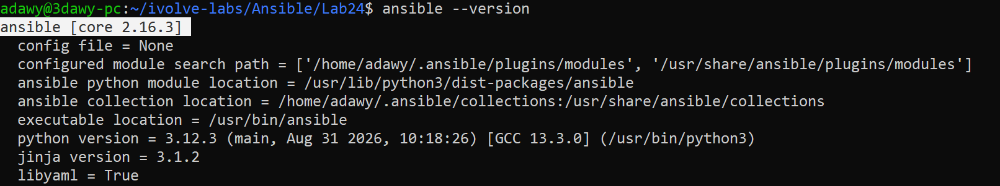
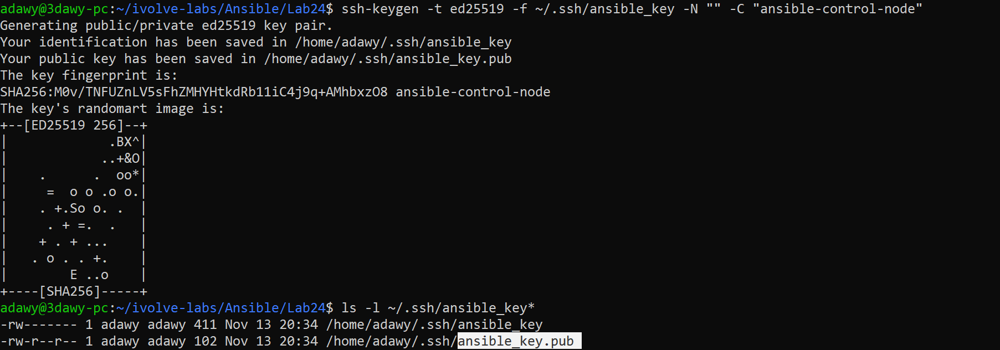
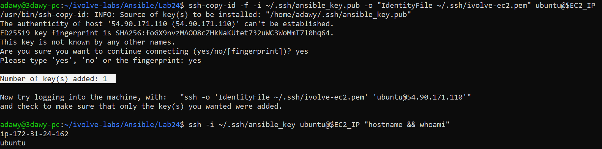
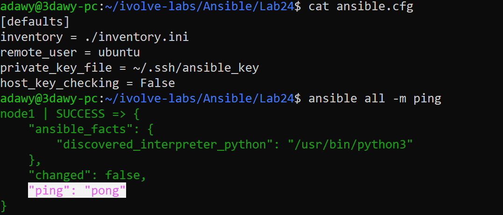
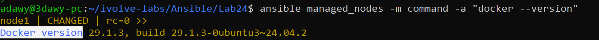

# Lab 24: Initial Ansible Configuration and Ad-Hoc Execution

## Objective
Install and configure **Ansible** on a local control node (WSL2), generate a dedicated SSH key pair for passwordless authentication, transfer the public key to a remote AWS EC2 managed node using `ssh-copy-id`, define a project inventory and `ansible.cfg`, and execute Ansible Ad-Hoc commands to install, enable, and verify Docker on the managed node.

## Requirements

| Item | Requirement |
|---|---|
| Control Node | Install and configure Ansible (`ansible.cfg`) |
| SSH Authentication | Generate a new SSH key pair (`ssh-keygen`) on the control node |
| Key Distribution | Transfer the public key to the managed node via `ssh-copy-id` |
| Inventory | Create an inventory file (`inventory.ini`) defining the managed node |
| Ad-Hoc Execution | Perform Ad-Hoc commands to install and verify Docker on the managed node |

## Environment
- **Control Node:** Windows + WSL2 (Ubuntu 24.04), Ansible Core `2.16.3`, Python `3.12.3`
- **Managed Node:** AWS EC2 Instance (`t3.micro`, Ubuntu Server 24.04 LTS, 20 GiB `gp3`, tag `server:ivolve`)
- **Authentication:** Ed25519 SSH Key Pair (`~/.ssh/ansible_key`)

## Folder Structure

```text
Ansible/
└── Lab24/
    ├── README.md
    ├── ansible.cfg
    ├── inventory.ini
    └── screenshots/
        ├── 01-python-and-ansible-installed.png
        ├── 02-ssh-key-generated.png
        ├── 03-ssh-copy-id.png
        ├── 04-cfg-and-ping.png
        └── 05-adhoc-install-docker.png
```

## Components

| Component | File / Command | Role |
|---|---|---|
| `ansible.cfg` | Project configuration file | Sets the default inventory path, remote user (`ubuntu`), SSH private key, and disables interactive host key checking |
| `inventory.ini` | Host inventory file | Defines the `[managed_nodes]` group and maps `node1` to the AWS EC2 public IP |
| `ssh-keygen` | `~/.ssh/ansible_key` | Generates the Ed25519 key pair on the control node for passwordless automation |
| `ssh-copy-id` | `~/.ssh/authorized_keys` | Appends the control node's public key to the EC2 managed node's authorized keys |
| Ad-Hoc Commands | `ansible ... -m <module> -a "<args>"` | Runs single-task modules (`ping`, `apt`, `service`, `command`) remotely over SSH |

## Workflow

```text
  +-------------------------------------------------------------------+
  |                  Control Node (WSL2 - Ubuntu)                     |
  |                                                                   |
  |  1. Reads local ansible.cfg + inventory.ini                       |
  |  2. Authenticates via SSH using ~/.ssh/ansible_key                |
  |  3. Pushes Python modules (ping / apt / service / command)        |
  +-------------------------------------------------------------------+
                                  |
                                  | SSH (Port 22, Key-Based Auth)
                                  v
  +-------------------------------------------------------------------+
  |             Managed Node (AWS EC2 - Ubuntu 24.04)                 |
  |                                                                   |
  |  - Validates public key in /home/ubuntu/.ssh/authorized_keys      |
  |  - Escalates privileges via sudo (--become / -b)                  |
  |  - Installs and starts Docker (docker.io), returns JSON result    |
  +-------------------------------------------------------------------+
```

## Ad-Hoc Modules Used

| Module | Purpose in Lab | Idempotent? |
|---|---|---|
| `ping` | Verifies SSH authentication and confirms a working Python interpreter on the managed node | Yes (`ok`) |
| `apt` | Updates the APT cache and installs `docker.io` only if not already installed | Yes (`changed` -> `ok`) |
| `service` | Ensures the `docker` systemd daemon is running and enabled on boot | Yes (`changed` -> `ok`) |
| `command` | Executes `docker --version` to verify the binary output (`Docker version 29.1.3`) | No (always runs command) |

## Design Decisions
- **Remote AWS EC2 Managed Node (`t3.micro`):** Separating the managed node onto an isolated cloud VM prevents package and daemon conflicts with Docker Desktop and Minikube running on the local WSL2 control node.
- **Ed25519 SSH Key (`-t ed25519`):** Provides faster cryptographic operations and compact keys compared to legacy RSA keys, configured with an empty passphrase (`-N ""`) for unattended Ansible runs.
- **Bootstrapping `ssh-copy-id` on EC2:** Because cloud images disable password authentication by default, `-o "IdentityFile ~/.ssh/ivolve-ec2.pem"` is passed to `ssh-copy-id` to authenticate with the initial AWS key pair and inject `ansible_key.pub` cleanly.
- **Project-Scoped `ansible.cfg`:** Placing `ansible.cfg` in `Ansible/Lab24/` keeps configuration version-controlled per lab without modifying system-wide settings in `/etc/ansible/ansible.cfg`.

## Steps

### Step 1: Install and Verify Python and Ansible on the Control Node
Update the APT repository index, install Ansible on the WSL2 control node, and verify the installed versions:

```bash
sudo apt update && sudo apt install -y ansible
python3 --version
ansible --version
```



### Step 2: Generate a New SSH Key Pair on the Control Node
Generate a dedicated passwordless Ed25519 SSH key pair (`~/.ssh/ansible_key`) for Ansible communication:

```bash
ssh-keygen -t ed25519 -f ~/.ssh/ansible_key -N "" -C "ansible-control-node"
ls -l ~/.ssh/ansible_key*
```

- `ansible_key` (`0600`): Private key kept securely on the control node.
- `ansible_key.pub` (`0644`): Public key distributed to managed nodes.



### Step 3: Transfer the Public Key to the Managed Node (`ssh-copy-id`)
Copy the public key (`~/.ssh/ansible_key.pub`) to the AWS EC2 instance using `ssh-copy-id`, then verify direct passwordless login using the new key:

```bash
EC2_IP="<EC2_PUBLIC_IP>"
ssh-copy-id -f -i ~/.ssh/ansible_key.pub -o "IdentityFile ~/.ssh/ivolve-ec2.pem" ubuntu@\$EC2_IP
ssh -i ~/.ssh/ansible_key ubuntu@\$EC2_IP "hostname && whoami"
```



### Step 4: Create the Inventory, Configure `ansible.cfg`, and Test Connectivity
Create `inventory.ini` targeting the EC2 managed node and `ansible.cfg` setting the connection defaults:

`inventory.ini`:

```ini
[managed_nodes]
node1 ansible_host=<EC2_PUBLIC_IP> ansible_user=ubuntu
```

`ansible.cfg`:

```ini
[defaults]
inventory = ./inventory.ini
remote_user = ubuntu
private_key_file = ~/.ssh/ansible_key
host_key_checking = False
```

Test connectivity across the inventory using the `ping` module:

```bash
cat ansible.cfg
ansible all -m ping
```



### Step 5: Perform Ad-Hoc Commands to Install and Verify Docker
Use the `apt` module with privilege escalation (`-b`) to update the package cache and install `docker.io`, ensure the `docker` service is started and enabled via the `service` module, and confirm the installed version (`Docker version 29.1.3`):

```bash
ansible managed_nodes -m apt -a "name=docker.io state=present update_cache=yes" -b
ansible managed_nodes -m service -a "name=docker state=started enabled=yes" -b
ansible managed_nodes -m command -a "docker --version"
```



## Notes
- **Dynamic EC2 Public IP:** Stopping and starting an EC2 instance (without an Elastic IP) assigns a new Public IPv4 address. If the instance is restarted for subsequent labs, update `ansible_host` in `inventory.ini`.
- **Idempotency Verification:** Re-running `ansible managed_nodes -m apt -a "name=docker.io state=present" -b` a second time returns `SUCCESS` in green with `"changed": false`, proving that Ansible checks the current state before making changes.
- **Security Best Practices:** Private SSH keys (`~/.ssh/ansible_key` and `~/.ssh/ivolve-ec2.pem`) remain in `~/.ssh/` with `0600`/`0400` permissions and are never committed to Git.

## Push to GitHub

```bash
cd ~/ivolve-labs
find Ansible/Lab24 -name "*Zone.Identifier" -type f -delete
git status
git add Ansible/Lab24
git commit -m "Add Lab24: Initial Ansible configuration and ad-hoc Docker installation"
git -c http.version=HTTP/1.1 push origin main
```