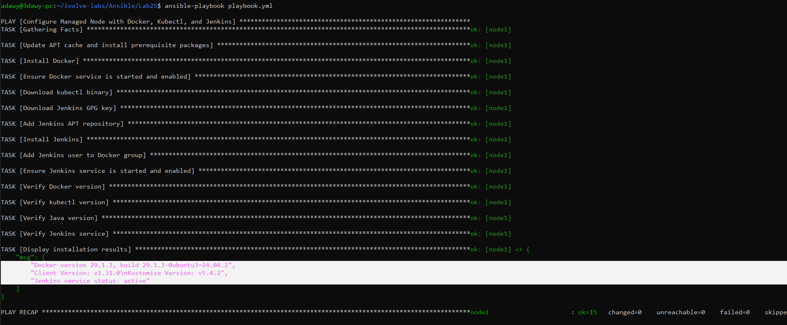

# Lab 25: Automated Server Configuration Using Ansible Playbooks

## Objective
Write and execute an **Ansible Playbook** (`playbook.yml`) using Fully Qualified Collection Names (`ansible.builtin.*`) to automate the installation, configuration, and verification of **Docker**, **kubectl**, and **Jenkins** on a remote AWS EC2 managed node.

## Requirements

| Item | Requirement |
|---|---|
| Playbook | Write a declarative Ansible Playbook (`playbook.yml`) |
| Task 1 | Automate **Docker** installation and service activation |
| Task 2 | Automate **kubectl** installation and binary permissions |
| Task 3 | Automate **Jenkins** (with Java 21 runtime, GPG key, and APT repository) installation and service activation |
| Verification | Verify the installed versions and service statuses on the managed node |

## Environment
- **Control Node:** Windows + WSL2 (Ubuntu 24.04), Ansible Core `2.16.3`, Python `3.12.3`
- **Managed Node:** AWS EC2 Instance (`t3.micro`, Ubuntu Server 24.04 LTS, 20 GiB `gp3`, tag `server:ivolve`)
- **Authentication:** Ed25519 SSH Key Pair (`~/.ssh/ansible_key`)

## Folder Structure

```text
Ansible/
└── Lab25/
    ├── README.md
    ├── ansible.cfg
    ├── inventory.ini
    ├── playbook.yml
    └── screenshots/
        └── 01-playbook-execution-and-verification.png
```

## Components

| Component | File / Module | Role |
|---|---|---|
| `ansible.cfg` | Project configuration | Configures inventory path, remote user (`ubuntu`), and SSH private key |
| `inventory.ini` | Host inventory | Defines `node1` inside the `[managed_nodes]` group |
| `playbook.yml` | Ansible Playbook | Automates installation, service management, and verification of Docker, kubectl, and Jenkins |
| `ansible.builtin.apt` & `apt_repository` | Packaging modules | Manages APT repositories, updates package cache, and installs packages idempotently |
| `ansible.builtin.get_url` | File download module | Downloads the `kubectl` binary and the Jenkins GPG keyring (`jenkins.io-2026.key`) over HTTPS |
| `ansible.builtin.service` & `user` | System modules | Starts/enables `docker` and `jenkins` services and adds `jenkins` to the `docker` group |
| `ansible.builtin.command` & `debug` | Verification modules | Captures installed versions with `register` (`changed_when: false`) and prints a summary |

## Workflow

```text
  +-------------------------------------------------------------------+
  |               Control Node (WSL2: ansible-playbook)               |
  |                                                                   |
  |  Reads ansible.cfg + inventory.ini + playbook.yml                 |
  +-------------------------------------------------------------------+
                                  |
                                  | SSH (Port 22, ~/.ssh/ansible_key)
                                  v
  +-------------------------------------------------------------------+
  |             Managed Node (AWS EC2 - Ubuntu 24.04)                 |
  |                                                                   |
  |  1. Prerequisites : Installs curl, gnupg, fontconfig, OpenJDK 21  |
  |  2. Docker        : Ensures docker.io is installed & active       |
  |  3. Kubectl       : Downloads v1.31.0 binary -> /usr/local/bin    |
  |  4. Jenkins Repo  : Downloads 2026 GPG key & adds APT repository  |
  |  5. Jenkins       : Installs jenkins, adds jenkins to docker      |
  |                     group, and starts/enables jenkins.service     |
  |  6. Verification  : Registers versions & prints summary via debug |
  +-------------------------------------------------------------------+
```

## Ansible Modules Used

| Module | Task in Playbook | Key Parameters |
|---|---|---|
| `ansible.builtin.apt` | Install prerequisites, Docker, and Jenkins | `name`, `state: present`, `update_cache: true`, `cache_valid_time: 3600` |
| `ansible.builtin.service` | Start and enable `docker` and `jenkins` | `name`, `state: started`, `enabled: true` |
| `ansible.builtin.get_url` | Download `kubectl` binary and Jenkins GPG key | `url`, `dest`, `mode`, `force: true` |
| `ansible.builtin.apt_repository` | Register official Jenkins Debian repository | `repo`, `state: present`, `filename: jenkins`, `update_cache: true` |
| `ansible.builtin.user` | Grant Jenkins access to the Docker socket | `name: jenkins`, `groups: docker`, `append: true` |
| `ansible.builtin.command` | Check tool versions and service status | `register`, `changed_when: false`, `failed_when: false` |
| `ansible.builtin.debug` | Print verification output on screen | `msg` |

## Design Decisions
- **Fully Qualified Collection Names (`ansible.builtin.*`):** Explicitly specifies the `ansible.builtin` collection for every module following modern Red Hat Ansible (RH294) best practices to avoid module name collisions.
- **APT Cache Optimization (`cache_valid_time: 3600`):** Prevents redundant APT cache updates on repeat runs if the cache was updated within the last hour.
- **Direct Binary Download for `kubectl` (`get_url`):** Downloading the official release binary directly to `/usr/local/bin/kubectl` with `mode: "0755"` avoids external repository overhead and keeps the task fast and idempotent.
- **Updated Jenkins GPG Keyring (`jenkins.io-2026.key` with `force: true`):** Uses the official 2026 Jenkins signing key stored in `/usr/share/keyrings/jenkins-keyring.asc` (`force: true` ensures any outdated keyring file is replaced) and references it via `[signed-by=...]` in `apt_repository`.
- **Safe Group Assignment (`append: true`):** Adding the `jenkins` user to the `docker` group with `append: true` preserves existing supplementary groups.
- **Built-in Idempotent Verification (`changed_when: false`):** Read-only verification tasks (`docker --version`, `kubectl version --client`, `java -version`, `systemctl is-active jenkins`) use `changed_when: false` so the playbook reports `changed=0` when no system state is modified.

## Relation to Previous Labs

| Previous Lab | Relation |
|---|---|
| Lab 24 (Ad-Hoc Commands) | Lab 24 configured SSH keys, `ansible.cfg`, and `inventory.ini`, and installed Docker via Ad-Hoc commands. Lab 25 reuses the same control/managed node setup and replaces one-off commands with a structured, repeatable Playbook. |

## Steps

### Step 1: Prepare `ansible.cfg` and `inventory.ini`
`ansible.cfg`:

```ini
[defaults]
inventory = ./inventory.ini
remote_user = ubuntu
private_key_file = ~/.ssh/ansible_key
host_key_checking = False
```

`inventory.ini`:

```ini
[managed_nodes]
node1 ansible_host=<EC2_PUBLIC_IP> ansible_user=ubuntu
```

### Step 2: Create the Ansible Playbook (`playbook.yml`)
`playbook.yml`:

```yaml
---
- name: Configure Managed Node with Docker, Kubectl, and Jenkins
  hosts: managed_nodes
  become: true

  vars:
    kubectl_version: "v1.31.0"

  tasks:
    # ==================== 1. Install Prerequisites ====================
    - name: Update APT cache and install prerequisite packages
      ansible.builtin.apt:
        name:
          - ca-certificates
          - curl
          - gnupg
          - fontconfig
          - openjdk-21-jre
        state: present
        update_cache: true
        cache_valid_time: 3600

    # ==================== 2. Install Docker ====================
    - name: Install Docker
      ansible.builtin.apt:
        name: docker.io
        state: present
        update_cache: true

    - name: Ensure Docker service is started and enabled
      ansible.builtin.service:
        name: docker
        state: started
        enabled: true

    # ==================== 3. Install Kubectl ====================
    - name: Download kubectl binary
      ansible.builtin.get_url:
        url: "[https://dl.k8s.io/release/](https://dl.k8s.io/release/){{ kubectl_version }}/bin/linux/amd64/kubectl"
        dest: /usr/local/bin/kubectl
        mode: "0755"
        owner: root
        group: root

    # ==================== 4. Configure Jenkins Repository ====================
    - name: Download Jenkins GPG key
      ansible.builtin.get_url:
        url: [https://pkg.jenkins.io/debian-stable/jenkins.io-2026.key](https://pkg.jenkins.io/debian-stable/jenkins.io-2026.key)
        dest: /usr/share/keyrings/jenkins-keyring.asc
        mode: "0644"
        force: true

    - name: Add Jenkins APT repository
      ansible.builtin.apt_repository:
        repo: "deb [signed-by=/usr/share/keyrings/jenkins-keyring.asc] [https://pkg.jenkins.io/debian-stable](https://pkg.jenkins.io/debian-stable) binary/"
        state: present
        filename: jenkins
        update_cache: true

    # ==================== 5. Install Jenkins ====================
    - name: Install Jenkins
      ansible.builtin.apt:
        name: jenkins
        state: present
        update_cache: true

    # ==================== 6. Configure Docker Access ====================
    - name: Add Jenkins user to Docker group
      ansible.builtin.user:
        name: jenkins
        groups: docker
        append: true

    # ==================== 7. Start Jenkins ====================
    - name: Ensure Jenkins service is started and enabled
      ansible.builtin.service:
        name: jenkins
        state: started
        enabled: true

    # ==================== 8. Verify Installation ====================
    - name: Verify Docker version
      ansible.builtin.command: docker --version
      register: docker_version_output
      changed_when: false

    - name: Verify kubectl version
      ansible.builtin.command: kubectl version --client
      register: kubectl_version_output
      changed_when: false

    - name: Verify Java version
      ansible.builtin.command: java -version
      register: java_version_output
      changed_when: false
      failed_when: false

    - name: Verify Jenkins service
      ansible.builtin.command: systemctl is-active jenkins
      register: jenkins_status
      changed_when: false

    - name: Display installation results
      ansible.builtin.debug:
        msg:
          - "{{ docker_version_output.stdout }}"
          - "{{ kubectl_version_output.stdout }}"
          - "Jenkins service status: {{ jenkins_status.stdout }}"
```

### Step 3: Execute the Playbook and Verify Results
Run the playbook against `node1`:

```bash
ansible-playbook playbook.yml
```

- All 15 tasks complete with `ok=15`, `changed=0`, and `failed=0`, demonstrating full idempotency.
- The `Display installation results` task outputs:
  - `Docker version 29.1.3, build 29.1.3-0ubuntu3~24.04.2`
  - `Client Version: v1.31.0` (`Kustomize Version: v5.4.2`)
  - `Jenkins service status: active`



## Notes
- **Why `jenkins.io-2026.key` is required:** The Jenkins Debian repository rotated its signing key (`7198F4B714ABFC68`) in 2026; using the legacy `jenkins.io-2023.key` causes APT signature verification (`NO_PUBKEY`) to fail.
- **Why `changed_when: false` is used on verification tasks:** The `ansible.builtin.command` module always reports `changed` by default. Setting `changed_when: false` tells Ansible that these commands only read system state, preserving an accurate `changed=0` recap.

## Push to GitHub

```bash
cd ~/ivolve-labs
find Ansible/Lab25 -name "*Zone.Identifier" -type f -delete
git status
git add Ansible/Lab25
git commit -m "Add Lab25: Automated server configuration with Ansible Playbook (Docker, Kubectl, Jenkins)"
git -c http.version=HTTP/1.1 push origin main
```