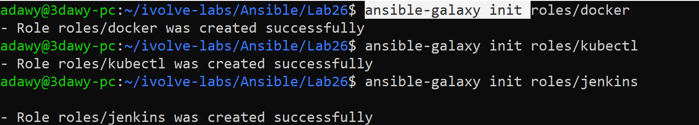
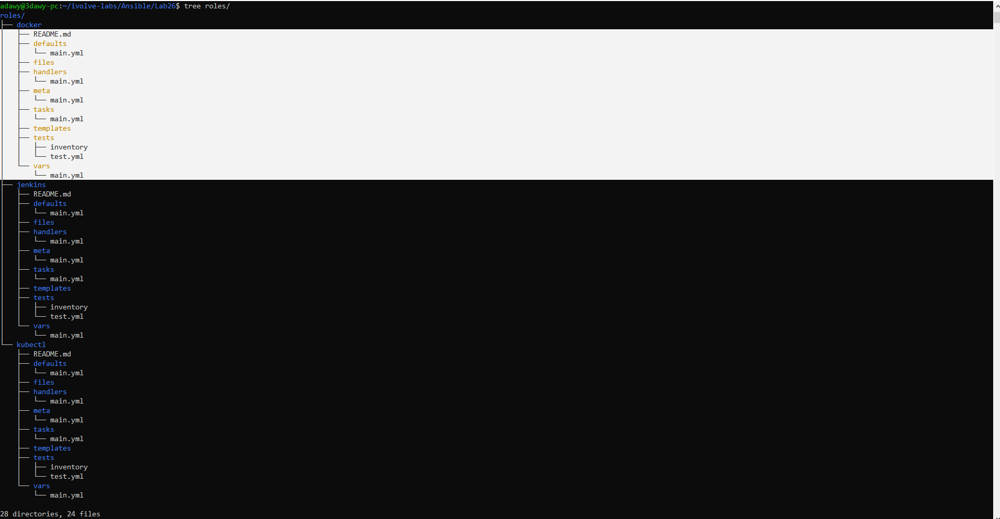
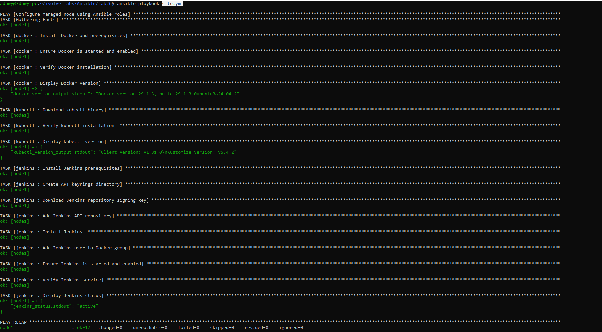

# Lab 26: Structured Configuration Management with Ansible Roles

## Objective
Refactor server configuration automation into modular, reusable **Ansible Roles** (`docker`, `kubectl`, and `jenkins`) complete with role tasks, defaults, and handlers, and execute them via a master playbook (`site.yml`) targeting the AWS EC2 managed node.

## Requirements

| Item | Requirement | Value / Path |
|---|---|---|
| Docker Role | Automate Docker installation, service startup, and version check | `roles/docker` |
| Kubectl Role | Automate `kubectl` binary download, permissions, and version check | `roles/kubectl` |
| Jenkins Role | Automate Java 21, APT keyring/repo, Jenkins install, and service handler | `roles/jenkins` |
| Master Playbook | Execute all three roles cleanly against the managed node | `site.yml` |

## Environment
- **Control Node:** Windows + WSL2 (Ubuntu 24.04), Ansible Core `2.16.3`, Python `3.12.3`
- **Managed Node:** AWS EC2 Instance (`t3.micro`, Ubuntu Server 24.04 LTS, 20 GiB `gp3`, tag `server:ivolve`)
- **Authentication:** Ed25519 SSH Key Pair (`~/.ssh/ansible_key`)

## Folder Structure

```text
Ansible/
└── Lab26/
    ├── README.md
    ├── ansible.cfg
    ├── inventory.ini
    ├── site.yml
    ├── roles/
    │   ├── docker/
    │   │   ├── README.md
    │   │   ├── defaults/main.yml
    │   │   ├── files/
    │   │   ├── handlers/main.yml
    │   │   ├── meta/main.yml
    │   │   ├── tasks/main.yml
    │   │   ├── templates/
    │   │   ├── tests/
    │   │   │   ├── inventory
    │   │   │   └── test.yml
    │   │   └── vars/main.yml
    │   ├── jenkins/
    │   │   ├── README.md
    │   │   ├── defaults/main.yml
    │   │   ├── files/
    │   │   ├── handlers/main.yml
    │   │   ├── meta/main.yml
    │   │   ├── tasks/main.yml
    │   │   ├── templates/
    │   │   ├── tests/
    │   │   │   ├── inventory
    │   │   │   └── test.yml
    │   │   └── vars/main.yml
    │   └── kubectl/
    │       ├── README.md
    │       ├── defaults/main.yml
    │       ├── files/
    │       ├── handlers/main.yml
    │       ├── meta/main.yml
    │       ├── tasks/main.yml
    │       ├── templates/
    │       ├── tests/
    │       │   ├── inventory
    │       │   └── test.yml
    │       └── vars/main.yml
    └── screenshots/
        ├── 01-create-roles.png
        ├── 02-roles-structure.png
        └── 03-playbook-roles-execution.png
```

## Components

| Component | Path | Purpose |
|---|---|---|
| `ansible.cfg` | `./ansible.cfg` | Configures default inventory, remote user (`ubuntu`), SSH key, and `roles_path` |
| `inventory.ini` | `./inventory.ini` | Defines `node1` inside the `[managed_nodes]` group |
| `site.yml` | `./site.yml` | Master playbook that invokes the `docker`, `kubectl`, and `jenkins` roles |
| `docker` Role | `roles/docker/` | Installs Docker and prerequisites, enables `docker.service`, and outputs the installed version |
| `kubectl` Role | `roles/kubectl/` | Downloads the `kubectl` (`v1.31.0`) binary to `/usr/local/bin/kubectl` and verifies the client version |
| `jenkins` Role | `roles/jenkins/` | Installs OpenJDK 21, configures `/etc/apt/keyrings/jenkins-keyring.asc` and the Jenkins APT repo, adds `jenkins` to the `docker` group, and uses `handlers/main.yml` to manage service restarts |

## Workflow

```text
  +-------------------------------------------------------------------+
  |                      Master Playbook (site.yml)                   |
  |                        hosts: managed_nodes                       |
  +-------------------------------------------------------------------+
            |                         |                         |
            v                         v                         v
  +-------------------+     +-------------------+     +-------------------+
  |   roles/docker    |     |   roles/kubectl   |     |   roles/jenkins   |
  |-------------------|     |-------------------|     |-------------------|
  | - tasks/main.yml  |     | - defaults/       |     | - defaults/       |
  |   * prerequisites |     |   * v1.31.0       |     | - tasks/main.yml  |
  |   * docker.io     |     | - tasks/main.yml  |     |   * Java 21       |
  |   * start service |     |   * get_url       |     |   * APT keyring   |
  |   * verify docker |     |   * verify client |     |   * install & run |
  |                   |     |                   |     | - handlers/       |
  |                   |     |                   |     |   * restart svc   |
  +-------------------+     +-------------------+     +-------------------+
            \                         |                         /
             \                        |                        /
              v                       v                       v
  +-------------------------------------------------------------------+
  |             Managed Node (AWS EC2 - Ubuntu 24.04)                 |
  +-------------------------------------------------------------------+
```

## Monolithic Playbook vs. Ansible Roles

| Feature | Monolithic Playbook (Lab 25) | Ansible Roles (Lab 26) |
|---|---|---|
| Structure | All tasks and variables in a single YAML file | Modular directory hierarchy (`tasks/`, `defaults/`, `handlers/`, `meta/`) |
| Reusability | Requires copying and pasting tasks across projects | Self-contained role folders can be reused across any playbook |
| Maintainability | Harder to maintain as task count grows | Clean separation of concerns; `site.yml` stays under 12 lines |
| Service Restarts | Handled inline with sequential tasks | Event-driven via `notify` and `handlers/main.yml` |

## Design Decisions
- **Standard Role Hierarchy (`ansible-galaxy init`):** Uses the official Ansible Galaxy directory layout so Ansible automatically loads `tasks/main.yml`, `defaults/main.yml`, and `handlers/main.yml` without manual file imports.
- **Admin-Managed APT Keyring (`/etc/apt/keyrings/jenkins-keyring.asc`):** Stores the third-party Jenkins signing key in `/etc/apt/keyrings/` (following Debian/Ubuntu standards for locally administered keys rather than `/usr/share/keyrings/`, which is reserved for OS-packaged keys).
- **Event-Driven Handler in `roles/jenkins/handlers/main.yml`:** Restarts the `jenkins` service only when configuration or group membership changes (`notify`), preserving idempotency on repeat runs.
- **Role-Level Verification:** Each role validates its own binary/service using `register` and `changed_when: false`, outputting the result via `ansible.builtin.debug`.

## Relation to Previous Labs
- **Lab 24 (Ad-Hoc):** Configured SSH key authentication (`~/.ssh/ansible_key`) and the EC2 inventory.
- **Lab 25 (Playbook):** Automated Docker, kubectl, and Jenkins in a single flat playbook (`playbook.yml`). Lab 26 refactors those tasks into three independent, reusable roles invoked by `site.yml`.

## Steps

### Step 1: Configure `ansible.cfg` and `inventory.ini`
`ansible.cfg`:

```ini
[defaults]
inventory = ./inventory.ini
remote_user = ubuntu
private_key_file = ~/.ssh/ansible_key
host_key_checking = False
roles_path = ./roles
```

`inventory.ini`:

```ini
[managed_nodes]
node1 ansible_host=<EC2_PUBLIC_IP> ansible_user=ubuntu
```

### Step 2: Initialize and Inspect the Roles Directory Structure
Create the three roles (`docker`, `kubectl`, `jenkins`) inside `roles/` using `ansible-galaxy init`:

```bash
ansible-galaxy init roles/docker
ansible-galaxy init roles/kubectl
ansible-galaxy init roles/jenkins
```



Inspect the generated directory hierarchy using `tree`:

```bash
tree roles/
```



### Step 3: Configure the `docker` Role
`roles/docker/tasks/main.yml`:

```yaml
---
- name: Install Docker and prerequisites
  ansible.builtin.apt:
    name:
      - ca-certificates
      - curl
      - gnupg
      - docker.io
    state: present
    update_cache: true
    cache_valid_time: 3600

- name: Ensure Docker is started and enabled
  ansible.builtin.service:
    name: docker
    state: started
    enabled: true

- name: Verify Docker installation
  ansible.builtin.command: docker --version
  register: docker_version_output
  changed_when: false

- name: Display Docker version
  ansible.builtin.debug:
    var: docker_version_output.stdout
```

### Step 4: Configure the `kubectl` Role
`roles/kubectl/defaults/main.yml`:

```yaml
---
kubectl_version: "v1.31.0"
kubectl_bin_path: "/usr/local/bin/kubectl"
```

`roles/kubectl/tasks/main.yml`:

```yaml
---
- name: Download kubectl binary
  ansible.builtin.get_url:
    url: "[https://dl.k8s.io/release/](https://dl.k8s.io/release/){{ kubectl_version }}/bin/linux/amd64/kubectl"
    dest: "{{ kubectl_bin_path }}"
    mode: "0755"
    owner: root
    group: root

- name: Verify kubectl installation
  ansible.builtin.command: kubectl version --client
  register: kubectl_version_output
  changed_when: false

- name: Display kubectl version
  ansible.builtin.debug:
    var: kubectl_version_output.stdout
```

### Step 5: Configure the `jenkins` Role and Handler
`roles/jenkins/defaults/main.yml`:

```yaml
---
java_package: "openjdk-21-jre"
jenkins_key_url: "[https://pkg.jenkins.io/debian-stable/jenkins.io-2026.key](https://pkg.jenkins.io/debian-stable/jenkins.io-2026.key)"
jenkins_keyring_path: "/etc/apt/keyrings/jenkins-keyring.asc"
jenkins_repo: "deb [signed-by=/etc/apt/keyrings/jenkins-keyring.asc] [https://pkg.jenkins.io/debian-stable](https://pkg.jenkins.io/debian-stable) binary/"
```

`roles/jenkins/tasks/main.yml`:

```yaml
---
- name: Install Jenkins prerequisites
  ansible.builtin.apt:
    name:
      - fontconfig
      - "{{ java_package }}"
    state: present
    update_cache: true
    cache_valid_time: 3600

- name: Create APT keyrings directory
  ansible.builtin.file:
    path: /etc/apt/keyrings
    state: directory
    mode: "0755"

- name: Download Jenkins repository signing key
  ansible.builtin.get_url:
    url: "{{ jenkins_key_url }}"
    dest: "{{ jenkins_keyring_path }}"
    mode: "0644"
    force: true

- name: Add Jenkins APT repository
  ansible.builtin.apt_repository:
    repo: "{{ jenkins_repo }}"
    state: present
    filename: jenkins
    update_cache: true

- name: Install Jenkins
  ansible.builtin.apt:
    name: jenkins
    state: present
    update_cache: true
  notify: Restart Jenkins

- name: Add Jenkins user to Docker group
  ansible.builtin.user:
    name: jenkins
    groups: docker
    append: true
  notify: Restart Jenkins

- name: Ensure Jenkins is started and enabled
  ansible.builtin.service:
    name: jenkins
    state: started
    enabled: true

- name: Verify Jenkins service
  ansible.builtin.command: systemctl is-active jenkins
  register: jenkins_status
  changed_when: false

- name: Display Jenkins status
  ansible.builtin.debug:
    msg: "Jenkins service status: {{ jenkins_status.stdout }}"
```

`roles/jenkins/handlers/main.yml`:

```yaml
---
- name: Restart Jenkins
  ansible.builtin.service:
    name: jenkins
    state: restarted
```

### Step 6: Create and Run the Master Playbook (`site.yml`)
`site.yml`:

```yaml
---
- name: Configure managed node using Ansible roles
  hosts: managed_nodes
  become: true

  roles:
    - docker
    - kubectl
    - jenkins
```

Execute the playbook:

```bash
ansible-playbook site.yml
```



## Notes
- **Resolving `Signed-By` Path Conflicts Across Labs:** Because Lab 25 configured the Jenkins repository using `/usr/share/keyrings/jenkins-keyring.asc` and Lab 26 uses the standard `/etc/apt/keyrings/jenkins-keyring.asc` path, any old `/etc/apt/sources.list.d/*jenkins*` file from Lab 25 must be removed prior to running `site.yml` so APT does not see two conflicting `Signed-By` paths for the same URL.
- **Role Metadata (`meta/main.yml`):** Automatically generated by `ansible-galaxy init` to store role authorship, supported platforms, and role dependencies (`dependencies: []`).

## Push to GitHub

```bash
cd ~/ivolve-labs
find Ansible/Lab26 -name "*Zone.Identifier" -type f -delete
git status
git add Ansible/Lab26
git commit -m "Add Lab26: Structured configuration management with Ansible Roles (docker, kubectl, jenkins)"
git -c http.version=HTTP/1.1 push origin main
```