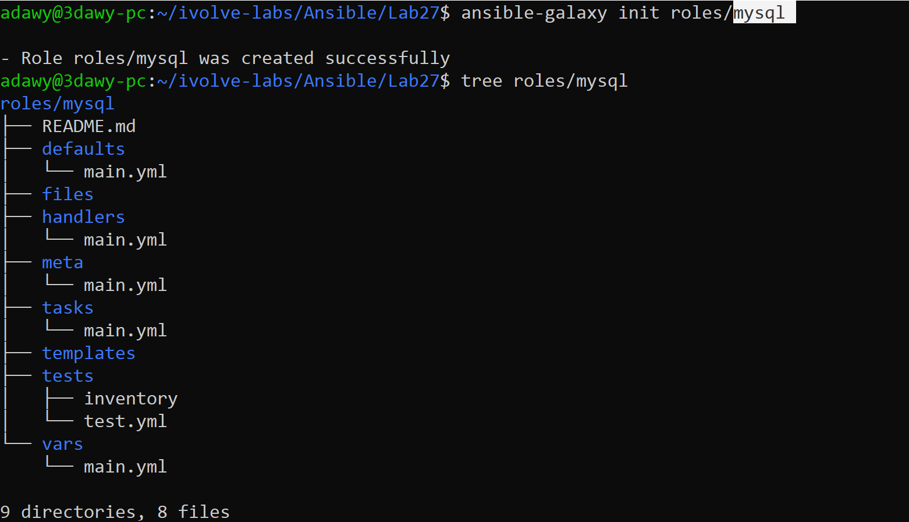
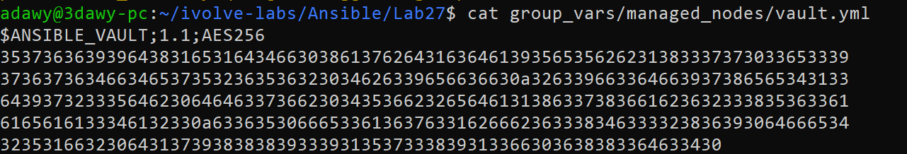
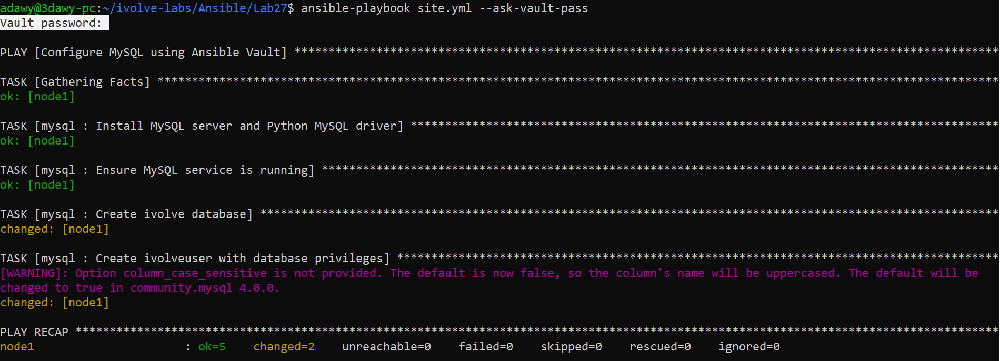
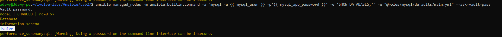

# Lab 27: Securing Sensitive Data with Ansible Vault

## Objective
Create an **Ansible Role** (`mysql`) to automate the installation of **MySQL Server**, create the `ivolve` database, and provision the `ivolveuser` user with full privileges on `ivolve`, while securing sensitive credentials (`mysql_app_password`) inside `group_vars/managed_nodes/vault.yml` using **Ansible Vault**.

## Requirements

| Item | Requirement | Value / Path |
|---|---|---|
| MySQL Role | Automate MySQL Server installation and service management | `roles/mysql` |
| Database | Create the application database | `ivolve` |
| Database User | Create user with `ALL` privileges on `ivolve.*` | `ivolveuser` |
| Secret Management | Encrypt the database user password using Ansible Vault | `group_vars/managed_nodes/vault.yml` |
| Validation | Connect to MySQL on the managed node as `ivolveuser` and list databases | `SHOW DATABASES;` |

## Environment
- **Control Node:** Windows + WSL2 (Ubuntu 24.04), Ansible Core `2.16.3`, Python `3.12.3`
- **Managed Node:** AWS EC2 Instance (`t3.micro`, Ubuntu Server 24.04 LTS, 20 GiB `gp3`, tag `server:ivolve`)
- **Database Engine:** MySQL Server `8.0` (`mysql-server` + `python3-pymysql`)
- **Encryption:** Ansible Vault (`$ANSIBLE_VAULT;1.1;AES256`)

## Folder Structure

```text
Ansible/
└── Lab27/
    ├── README.md
    ├── ansible.cfg
    ├── inventory.ini
    ├── site.yml
    ├── group_vars/
    │   └── managed_nodes/
    │       └── vault.yml          # Encrypted with Ansible Vault (AES256)
    ├── roles/
    │   └── mysql/
    │       ├── README.md
    │       ├── defaults/
    │       │   └── main.yml
    │       ├── files/
    │       ├── handlers/
    │       │   └── main.yml
    │       ├── meta/
    │       │   └── main.yml
    │       ├── tasks/
    │       │   └── main.yml
    │       ├── templates/
    │       ├── tests/
    │       │   ├── inventory
    │       │   └── test.yml
    │       └── vars/
    │           └── main.yml
    └── screenshots/
        ├── 01-create-mysql-role.png
        ├── 02-vault-encrypted-file.png
        ├── 03-playbook-vault-execution.png
        └── 04-validate-mysql-db.png
```

## Components

| Component | Path | Purpose |
|---|---|---|
| `ansible.cfg` | `./ansible.cfg` | Configures default inventory, remote user (`ubuntu`), SSH key, and `roles_path` |
| `inventory.ini` | `./inventory.ini` | Defines `node1` inside the `[managed_nodes]` group |
| `site.yml` | `./site.yml` | Master playbook that invokes the `mysql` role |
| `vault.yml` | `group_vars/managed_nodes/vault.yml` | Ansible Vault-encrypted file storing `mysql_app_password` using AES-256 encryption |
| `defaults/main.yml` | `roles/mysql/defaults/main.yml` | Stores non-sensitive role defaults (`mysql_database: ivolve`, `mysql_user: ivolveuser`) |
| `tasks/main.yml` | `roles/mysql/tasks/main.yml` | Installs `mysql-server` and `python3-pymysql`, starts `mysql`, and configures the DB and user |

## Workflow

```text
  +-------------------------------------------------------------------+
  |                     Control Node (WSL2)                           |
  |                                                                   |
  |  1. Runs: ansible-playbook site.yml --ask-vault-pass              |
  |  2. Prompts for Vault password and decrypts                       |
  |     group_vars/managed_nodes/vault.yml in memory (AES-256)        |
  +-------------------------------------------------------------------+
                                  |
                                  | SSH (Port 22, ~/.ssh/ansible_key)
                                  v
  +-------------------------------------------------------------------+
  |             Managed Node (AWS EC2 - Ubuntu 24.04)                 |
  |                                                                   |
  |  - Installs mysql-server & python3-pymysql                        |
  |  - Starts and enables mysql.service                               |
  |  - Authenticates via Unix socket (/var/run/mysqld/mysqld.sock)    |
  |  - Creates database: ivolve                                       |
  |  - Creates user: ivolveuser@localhost (PRIVILEGES: ivolve.*:ALL)  |
  |  - Validated via: mysql -u ivolveuser -p... -e "SHOW DATABASES;"  |
  +-------------------------------------------------------------------+
```

## Common Ansible Vault Commands

| Command | Description |
|---|---|
| `ansible-vault create <file>` | Creates a new AES-256 encrypted YAML file directly in the editor |
| `ansible-vault encrypt <file>` | Encrypts an existing plaintext YAML file using AES-256 |
| `ansible-vault view <file>` | Displays the decrypted content on screen without modifying the file on disk |
| `ansible-vault edit <file>` | Opens the encrypted file in the editor and re-encrypts automatically on save |
| `ansible-vault decrypt <file>` | Permanently decrypts the file back to plaintext |
| `ansible-playbook site.yml --ask-vault-pass` | Prompts interactively for the Vault password to decrypt variables in memory at runtime |

## Design Decisions
- **Group-Scoped Vault Secrets (`group_vars/managed_nodes/vault.yml`):** Placing encrypted secrets inside `group_vars/managed_nodes/vault.yml` decouples environment-specific passwords from reusable role code in `roles/mysql/`, allowing Ansible to load the encrypted variables automatically for any play or ad-hoc command targeting `managed_nodes`.
- **Separating Non-Sensitive Defaults (`defaults/main.yml`):** Non-sensitive parameters (`mysql_database: ivolve` and `mysql_user: ivolveuser`) are kept in plaintext inside `roles/mysql/defaults/main.yml` for readability during code review.
- **Root Socket Authentication (`login_unix_socket`):** On Ubuntu 24.04, MySQL's `root@localhost` account uses the `auth_socket` plugin (`/var/run/mysqld/mysqld.sock`). Passing `login_unix_socket` with `become: true` enables `community.mysql` modules to provision databases and users idempotently.

## Relation to Previous Labs
- **Lab 24 & Lab 25:** Established SSH key authentication (`~/.ssh/ansible_key`), `ansible.cfg`, and `inventory.ini` targeting the AWS EC2 managed node.
- **Lab 26 (Ansible Roles):** Introduced standard role directory structures (`roles/`). Lab 27 adds database automation with `community.mysql` and secret encryption via **Ansible Vault**.

## Steps

### Step 1: Initialize the `mysql` Role
Create the `mysql` role scaffolding inside `roles/` using `ansible-galaxy init` and inspect its directory tree:

```bash
ansible-galaxy init roles/mysql
tree roles/mysql
```



### Step 2: Create the Encrypted Vault File (`group_vars/managed_nodes/vault.yml`)
Create the encrypted Vault file storing `mysql_app_password` using `ansible-vault create` and verify its AES-256 header:

```bash
mkdir -p group_vars/managed_nodes
ansible-vault create group_vars/managed_nodes/vault.yml
cat group_vars/managed_nodes/vault.yml
```



### Step 3: Configure the `mysql` Role and `site.yml`
`roles/mysql/defaults/main.yml`:

```yaml
# defaults file for roles/mysql
---
mysql_database: ivolve
mysql_user: ivolveuser
```

`roles/mysql/tasks/main.yml`:

```yaml
# tasks file for roles/mysql
---
- name: Install MySQL server and Python MySQL driver
  ansible.builtin.apt:
    name:
      - mysql-server
      - python3-pymysql
    state: present
    update_cache: true

- name: Ensure MySQL service is running
  ansible.builtin.service:
    name: mysql
    state: started
    enabled: true

- name: Create ivolve database
  community.mysql.mysql_db:
    name: "{{ mysql_database }}"
    state: present
    login_unix_socket: /var/run/mysqld/mysqld.sock

- name: Create ivolveuser with database privileges
  community.mysql.mysql_user:
    name: "{{ mysql_user }}"
    host: localhost
    password: "{{ mysql_app_password }}"
    priv: "{{ mysql_database }}.*:ALL"
    state: present
    login_unix_socket: /var/run/mysqld/mysqld.sock
```

`site.yml`:

```yaml
---
- name: Configure MySQL using Ansible Vault
  hosts: managed_nodes
  become: true

  roles:
    - mysql
```

### Step 4: Execute the Playbook with `--ask-vault-pass`
Run the playbook and supply the Ansible Vault password when prompted:

```bash
ansible-playbook site.yml --ask-vault-pass
```



### Step 5: Validate the Database on the Managed Node
Connect to MySQL on `node1` as `ivolveuser` using the Vault-encrypted `{{ mysql_app_password }}` variable and list accessible databases:

```bash
ansible managed_nodes -m ansible.builtin.command -a "mysql -u ivolveuser -p'{{ mysql_app_password }}' -e 'SHOW DATABASES;'" --ask-vault-pass
```



## Notes
- **Why `mysql_user` is not loaded in standalone Ad-Hoc commands:** Ad-hoc commands (`ansible ...`) automatically load `group_vars/` and `host_vars/`, which makes `{{ mysql_app_password }}` available, but they do not load role `defaults/main.yml` unless `-e "@roles/mysql/defaults/main.yml"` is explicitly passed.
- **Safe Version Control:** Because `group_vars/managed_nodes/vault.yml` is encrypted with AES-256 (`$ANSIBLE_VAULT;1.1;AES256`), committing the directory to GitHub never exposes the plaintext database password.

## Push to GitHub

```bash
cd ~/ivolve-labs
find Ansible/Lab27 -name "*Zone.Identifier" -type f -delete
git status
git add Ansible/Lab27
git commit -m "Add Lab27: Securing sensitive MySQL credentials with Ansible Vault"
git -c http.version=HTTP/1.1 push origin main
```