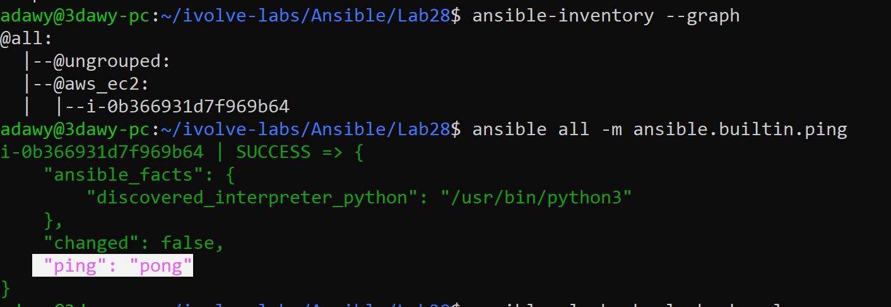
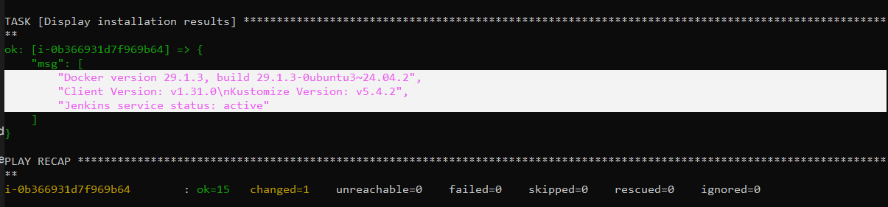

# Lab 28: Automated Host Discovery with Ansible Dynamic Inventory

## Objective
Configure **Ansible Dynamic Inventory** using the `amazon.aws.aws_ec2` inventory plugin (`inventory.aws_ec2.yml`) to automatically discover and manage running AWS EC2 instances tagged with `server:ivolve`, list target hosts using `ansible-inventory`, execute a configuration playbook on the discovered instance, and verify the configuration.

## Requirements

| Item | Requirement | Value / Path |
|---|---|---|
| AWS EC2 Tag | Running AWS EC2 instance tagged for discovery | `server:ivolve` |
| Ansible Config | Enable `amazon.aws.aws_ec2` plugin and set default inventory | `ansible.cfg` |
| Dynamic Inventory | Filter running EC2 instances with tag `server:ivolve` | `inventory.aws_ec2.yml` |
| Host Discovery | List target hosts using the Ansible inventory CLI | `ansible-inventory --graph` / `--list` |
| Playbook & Verification | Run `playbook.yml` on the discovered EC2 and verify tool statuses | `playbook.yml` (`hosts: all`) |

## Environment
- **Control Node:** Windows + WSL2 (Ubuntu 24.04), Ansible Core `2.16.3`, Python `3.12.3`, `python3-boto3`, `amazon.aws` collection (`7.2.0`)
- **Managed Node:** AWS EC2 Instance (`i-0b366931d7f969b64`, `t3.micro`, Ubuntu Server 24.04 LTS, tag `server:ivolve`)
- **Authentication:** AWS IAM Credentials (`~/.aws/credentials`) for API discovery + Ed25519 SSH Key (`~/.ssh/ansible_key`) for node connection

## Folder Structure

```text
Ansible/
└── Lab28/
    ├── README.md
    ├── ansible.cfg
    ├── inventory.aws_ec2.yml
    ├── playbook.yml
    └── screenshots/
        ├── 01-dynamic-inventory-and-ping.png
        └── 02-playbook-execution-and-verification.png
```

## Components

| Component | Path | Purpose |
|---|---|---|
| `ansible.cfg` | `./ansible.cfg` | Configures `./inventory.aws_ec2.yml` as the default inventory and enables the `amazon.aws.aws_ec2` plugin alongside built-in plugins |
| `inventory.aws_ec2.yml` | `./inventory.aws_ec2.yml` | Queries AWS EC2 API in `us-east-1` for running instances matching `"tag:server": ivolve`, sets `instance-id` as hostname, and maps `public_ip_address` to `ansible_host` |
| `playbook.yml` | `./playbook.yml` | Provisions and verifies Docker, `kubectl`, and Jenkins on the dynamically discovered EC2 instance |

## Workflow

```text
  +-------------------------------------------------------------------+
  |                     Control Node (WSL2)                           |
  |  ansible-inventory / ansible-playbook (uses inventory.aws_ec2.yml)|
  +-------------------------------------------------------------------+
                   |                                   |
    1. Queries AWS EC2 API (boto3)      2. Connects via SSH (~/.ssh/ansible_key)
       - instance-state-name = running     to ansible_host (54.89.168.18)
       - tag:server = ivolve                           |
                   v                                   v
  +---------------------------------+   +-----------------------------+
  |           AWS EC2 API           |   |   Discovered EC2 Instance   |
  |  Returns i-0b366931d7f969b64    |   |     i-0b366931d7f969b64     |
  +---------------------------------+   +-----------------------------+
```

## Static Inventory vs. Dynamic Inventory

| Feature | Static Inventory (`inventory.ini`) | Dynamic Inventory (`inventory.aws_ec2.yml`) |
|---|---|---|
| IP Management | Hardcoded manually in a flat text file | Queried dynamically from AWS EC2 API via `boto3` |
| EC2 Stop / Start | Breaks connectivity when AWS assigns a new Public IP | Automatically maps the new `public_ip_address` to `ansible_host` |
| Host Identifier | Custom static alias (`node1`) | AWS `instance-id` (`i-0b366931d7f969b64`) |
| Group Generation | Defined manually under `[managed_nodes]` | Populated automatically under `@aws_ec2` |

## Design Decisions
- **Preserving Built-In Inventory Plugins (`enable_plugins`):** Specifying `host_list, script, auto, yaml, ini, toml, amazon.aws.aws_ec2` in `ansible.cfg` enables AWS EC2 discovery while keeping standard INI and YAML inventory support active.
- **Using `instance-id` as Hostname with `compose` for IP:** Setting `hostnames: [instance-id]` gives each EC2 instance a stable identifier across reboots, while `compose: { ansible_host: public_ip_address }` dynamically routes SSH traffic to the current Public IPv4 address.

## Relation to Previous Labs
- **Lab 24 – Lab 27:** Relied on a static `inventory.ini` file that required manual IP updates after stopping and starting the EC2 instance.
- **Lab 28:** Replaces `inventory.ini` with `inventory.aws_ec2.yml` and runs the configuration playbook from Lab 25 directly against the dynamically discovered EC2 instance.

## Steps

### Step 1: Install `boto3` and Configure `ansible.cfg`
Install the Python AWS SDK packages on the control node:

```bash
sudo apt update && sudo apt install -y python3-boto3 python3-botocore
```

Configure `ansible.cfg` to point to `./inventory.aws_ec2.yml` and enable the `amazon.aws.aws_ec2` plugin:

```ini
[defaults]
inventory = ./inventory.aws_ec2.yml
remote_user = ubuntu
private_key_file = ~/.ssh/ansible_key
host_key_checking = False
roles_path = ./roles

[inventory]
enable_plugins = host_list, script, auto, yaml, ini, toml, amazon.aws.aws_ec2
```

### Step 2: Create the Dynamic Inventory File (`inventory.aws_ec2.yml`)
`inventory.aws_ec2.yml`:

```yaml
---
plugin: amazon.aws.aws_ec2

regions:
  - us-east-1

filters:
  instance-state-name: running
  "tag:server": ivolve

hostnames:
  - instance-id

compose:
  ansible_host: public_ip_address
```

### Step 3: List Discovered Hosts and Test SSH Connectivity
Verify that Ansible discovers `i-0b366931d7f969b64` from AWS and responds to `ping`:

```bash
ansible-inventory --graph
ansible all -m ansible.builtin.ping
```



### Step 4: Run the Playbook on the Discovered EC2 and Verify Configuration
Execute `playbook.yml` targeting `hosts: all`:

```bash
ansible-playbook playbook.yml
```

- Ansible provisions the instance `i-0b366931d7f969b64` and outputs the verified Docker version, `kubectl` client version, and active Jenkins service status.



## Notes
- **Mandatory File Suffix:** The `amazon.aws.aws_ec2` inventory plugin requires the inventory filename to end with `aws_ec2.yml` or `aws_ec2.yaml`.
- **Swap Provisioning on `t3.micro`:** Running Docker and Jenkins concurrently on a 1 GiB RAM `t3.micro` instance benefits from a 1 GiB `/swapfile` on the EBS volume to prevent memory exhaustion during SSH/Ansible execution.

## Push to GitHub

```bash
cd ~/ivolve-labs
find Ansible/Lab28 -name "*Zone.Identifier" -type f -delete
git status
git add Ansible/Lab28
git commit -m "Add Lab28: Automated host discovery with Ansible Dynamic Inventory"
git -c http.version=HTTP/1.1 push origin main
```