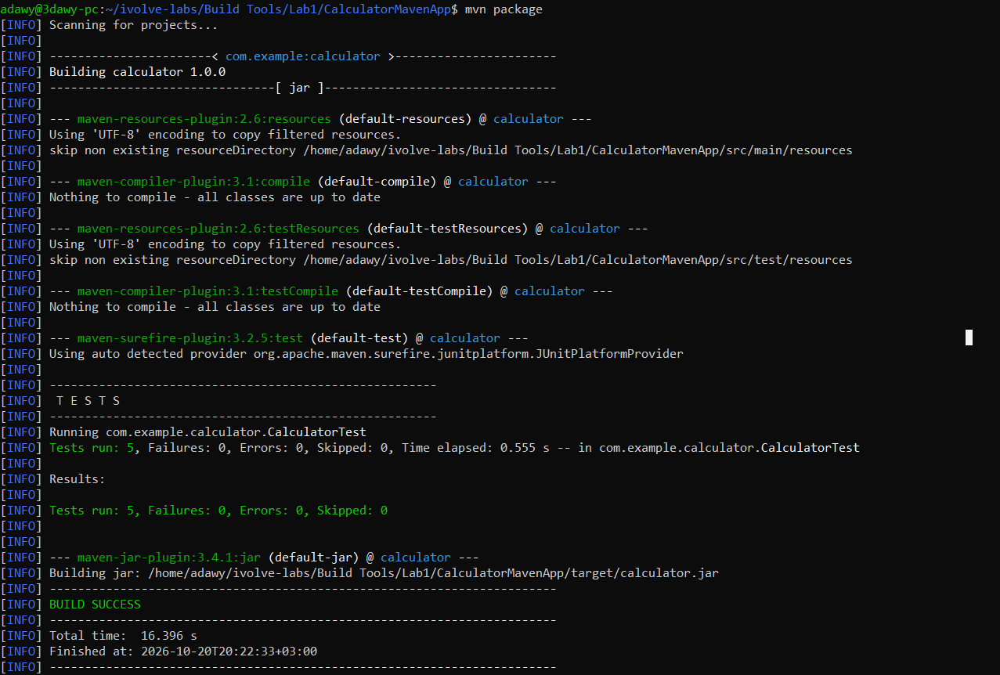
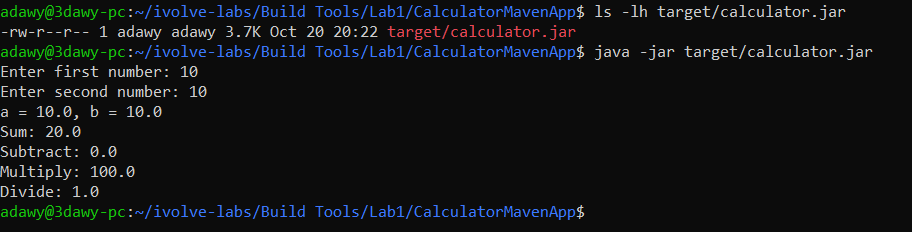

# Lab 1: Building and Packaging a Java Application with Maven

## Overview

This lab demonstrates how to test, build, package, and run a Java application using Apache Maven.

**Application:** CalculatorMavenApp  
**Build Tool:** Apache Maven  
**Java Version:** 17  
**Packaging:** JAR

## Objectives

- Verify the Java and Maven installation.
- Run unit tests using Maven.
- Build and package the application into a JAR file.
- Execute the packaged application and verify its output.

## Prerequisites

- Java Development Kit (JDK) 17
- Apache Maven
- Git

Verify the installed versions:

```bash
java -version
mvn -version
git --version
```

## Implementation

### 1. Clone the Repository

```bash
git clone https://github.com/Ibrahim-Adel15/CalculatorMavenApp.git
cd CalculatorMavenApp
```

### 2. Run Unit Tests

```bash
mvn test
```

**Result:** All 5 unit tests passed with zero failures or errors.

### 3. Build and Package the Application

```bash
mvn package
```

Maven compiles the source code, runs the tests, and packages the application into a JAR file.

Verify that the artifact was generated:

```bash
ls -lh target/calculator.jar
```

**Generated artifact:** `target/calculator.jar`

### 4. Run the Application

```bash
java -jar target/calculator.jar
```

Example input:

```text
Enter first number: 10
Enter second number: 10
```

Expected output:

```text
a = 10.0, b = 10.0
Sum: 20.0
Subtract: 0.0
Multiply: 100.0
Divide: 1.0
```

## Evidence

### Unit Tests and Build Success



### Generated Artifact and Application Execution



## Best Practices Applied

- Used Maven to automate testing and packaging.
- Configured JUnit 5 for unit testing.
- Configured the JAR manifest with the application's main class to support execution using `java -jar`.
- Excluded generated build output (`target/`) and IDE-specific files using `.gitignore`.
- Kept the lab documentation and screenshots separate from the application source code.

## Conclusion

The application was tested successfully, packaged into `target/calculator.jar`, and executed successfully using Java.