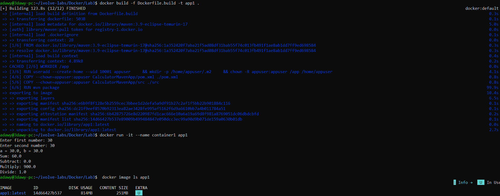
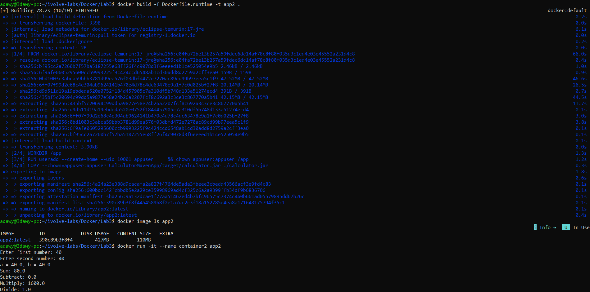

# Docker Lab 3 — Maven Application

## Overview

This lab demonstrates how to build and run a Java Maven calculator application using Docker. It compares two Docker images:

- **app1:** Uses a Maven image to build and run the application.
- **app2:** Uses a lightweight Java Runtime Environment (JRE) image to run the pre-built JAR file.

## Project Structure

```text
Lab3/
├── CalculatorMavenApp/
│   ├── pom.xml
│   └── src/
├── screenshots/
├── Dockerfile.build
├── Dockerfile.runtime
└── README.md
```

## Dockerfile 1 — Build and Run with Maven

The `Dockerfile.build` uses `maven:3.9-eclipse-temurin-17`.

It copies the Maven project files into the image, builds the application with `mvn package`, and runs the generated JAR file.

### Build the image

```bash
docker build -f Dockerfile.build -t app1 .
```

### Run the container

```bash
docker run -it --name container1 app1
```

### Test the application

Example input:

```text
Enter first number: 30
Enter second number: 30
```

Expected results:

```text
Sum: 60.0
Subtract: 0.0
Multiply: 900.0
Divide: 1.0
```

## Dockerfile 2 — Run with a Java Runtime Image

The `Dockerfile.runtime` uses `eclipse-temurin:17-jre`.

It copies the pre-built JAR file into the image and runs it with Java. Maven is not required in the runtime image.

### Build the application locally

Run these commands from the project root:

```bash
cd CalculatorMavenApp
mvn package
cd ..
```

### Build the runtime image

```bash
docker build -f Dockerfile.runtime -t app2 .
```

### Run the container

```bash
docker run -it --name container2 app2
```

### Test the application

Example input:

```text
Enter first number: 40
Enter second number: 40
```

Expected results:

```text
Sum: 80.0
Subtract: 0.0
Multiply: 1600.0
Divide: 1.0
```

## Image Size Comparison

The following measurements were observed during the lab:

| Image | Base image | Disk usage | Content size |
|---|---|---:|---:|
| `app1` | Maven + Eclipse Temurin 17 | 814 MB | 251 MB |
| `app2` | Eclipse Temurin 17 JRE | 427 MB | 110 MB |

The runtime image is smaller because it does not include the Maven build environment.

*Note: Docker's reported disk usage and content size are different measurements.*

## Security Considerations

Both Dockerfiles run the application as a non-root user named `appuser`, following the principle of least privilege.

## Screenshots

### 1. Build and Run — Maven Image



This screenshot shows the Maven-based Docker image build, calculator execution, and image size.

### 2. Build and Run — JRE Runtime Image



This screenshot shows the Java runtime image build, calculator execution, and image size comparison.

## Key Takeaways

- Docker images can include build tools or only the runtime environment.
- Maven builds the Java application into a JAR file.
- A JRE image can reduce the size of a runtime image.
- Running containers as non-root users improves security.
