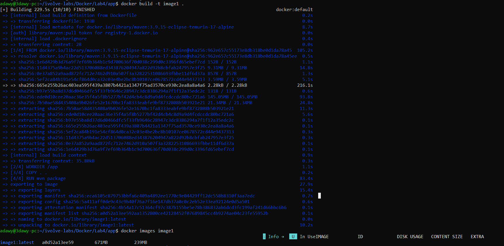
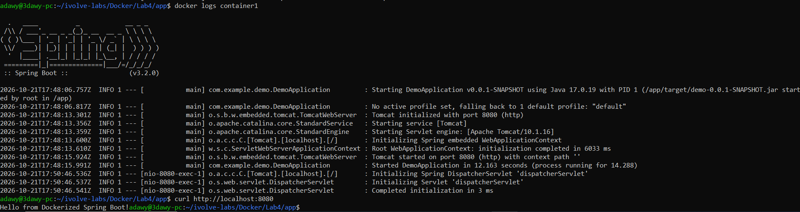
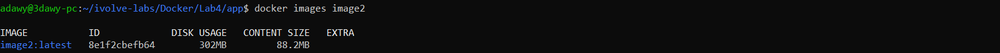
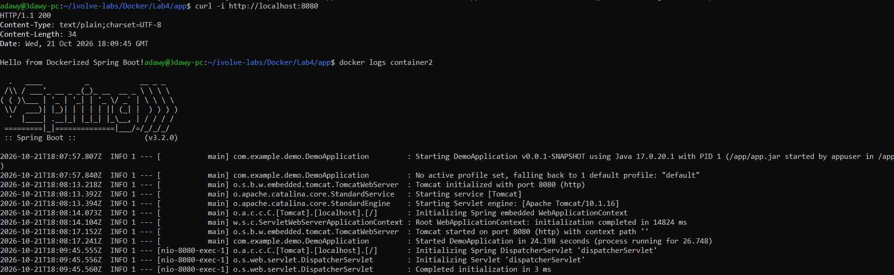
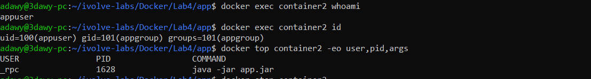
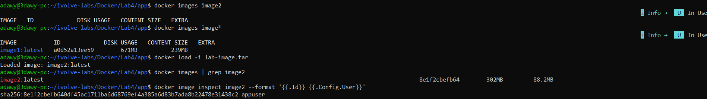

# Lab 4: Docker Image Optimization and Export/Load

## Objective
Build a Spring Boot (Java 17) image from a single-stage Dockerfile, optimize it with a multi-stage build running as a non-root user, compare the sizes, then export the image to a TAR file and restore it.

## Project Structure
```
Lab4/
├── app/                      # Application code (Spring Boot + Maven)
│   ├── Dockerfile            # Original single-stage Dockerfile
│   ├── Dockerfile.multistage # Optimized multi-stage Dockerfile
│   ├── pom.xml
│   └── src/
├── screenshots/
├── .gitignore                # Excludes lab-image.tar
└── README.md
```

## Steps

### 1. Clone the application and build image1
```bash
git clone https://github.com/Ibrahim-Adel15/ImageOptimization-.git app
rm -rf app/.git
cd app
docker build -t image1 .
docker images image1
```
The original Dockerfile uses a single stage with the full Maven image, so build tools and sources stay in the final image.



### 2. Run container1 and verify the app
```bash
docker run -d --name container1 -p 8080:8080 image1
docker logs container1
curl -i http://localhost:8080
```
The application listens on port 8080 (as in `EXPOSE 8080`). Spring Boot takes about 12 seconds to start, so requests sent immediately after `docker run` are reset.



### 3. Stop and delete container1
```bash
docker stop container1
docker rm container1
docker ps -a
```

### 4. Multi-stage Dockerfile with a non-root user
`Dockerfile.multistage`:
```dockerfile
# Stage 1: Build
FROM maven:3.9-eclipse-temurin-17 AS builder
WORKDIR /app
COPY pom.xml .
RUN mvn dependency:go-offline -B
COPY src ./src
RUN mvn clean package -DskipTests -B

# Stage 2: Runtime
FROM eclipse-temurin:17-jre-alpine
WORKDIR /app
RUN addgroup -S appgroup && adduser -S appuser -G appgroup
COPY --from=builder --chown=appuser:appgroup /app/target/*.jar app.jar
USER appuser
EXPOSE 8080
ENTRYPOINT ["java", "-jar", "app.jar"]
```
- Stage 1 builds the jar with Maven and the JDK.
- Stage 2 copies only the jar into a small JRE-only Alpine image.
- `pom.xml` is copied before `src` so the dependency layer is cached.
- `USER appuser` makes the application run without root privileges.

### 5. Build image2 and compare sizes
```bash
docker build -t image2 -f Dockerfile.multistage .
docker images
```

| Image  | Disk usage | Content size (compressed) |
|--------|-----------|---------------------------|
| image1 | 671 MB    | 239 MB                    |
| image2 | 302 MB    | 88.2 MB                   |

Image2 is about 55% smaller on disk (about 63% smaller in compressed content size).



### 6. Run container2 and verify non-root
```bash
docker run -d --name container2 -p 8080:8080 image2
curl -i http://localhost:8080
docker exec container2 whoami
docker exec container2 id
docker top container2 -eo user,pid,args
```
`whoami` returns `appuser` and `id` shows `uid=100`, not 0. `docker top` shows the host-side view, where UID 100 is displayed as `_rpc` because that is the name mapped to the same UID on the WSL host. It is the same non-root UID.




### 7. Stop and delete container2
```bash
docker stop container2
docker rm container2
```

### 8. Save image2 as a TAR file
```bash
docker save -o lab-image.tar image2
ls -lh lab-image.tar
```
The TAR file is excluded from Git through `.gitignore` because of its size.

### 9. Delete image2 from the local host
```bash
docker rmi image2
docker images
```

### 10. Load the image from the TAR file and verify
```bash
docker load -i lab-image.tar
docker images | grep image2
docker image inspect image2 --format '{{.Id}} {{.Config.User}}'
```
The image was restored with the same ID, and the configured user is still `appuser`.



## Notes
- Docker uses the containerd image store here, so `docker images` shows both disk usage and compressed content size.
- Port 8080 inside the container matches `EXPOSE 8080` in the Dockerfile.
