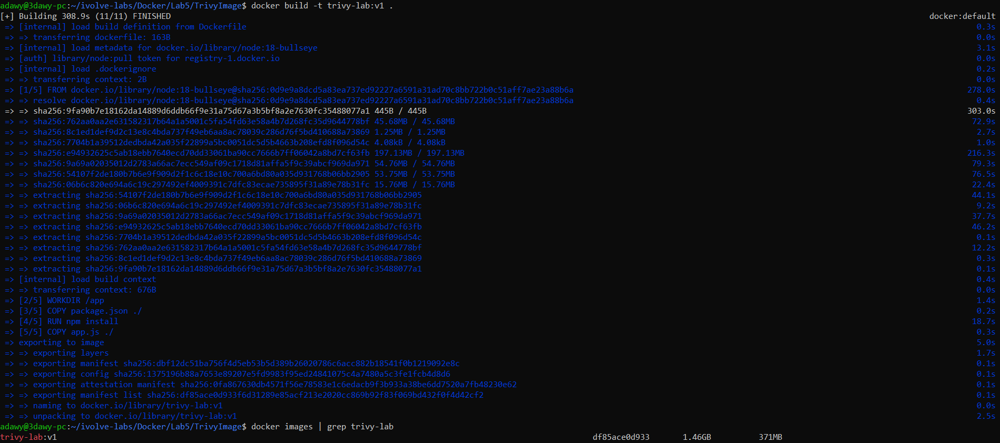
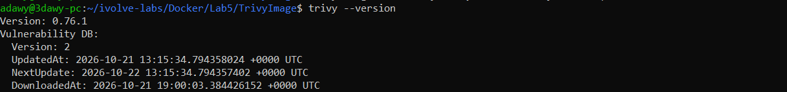
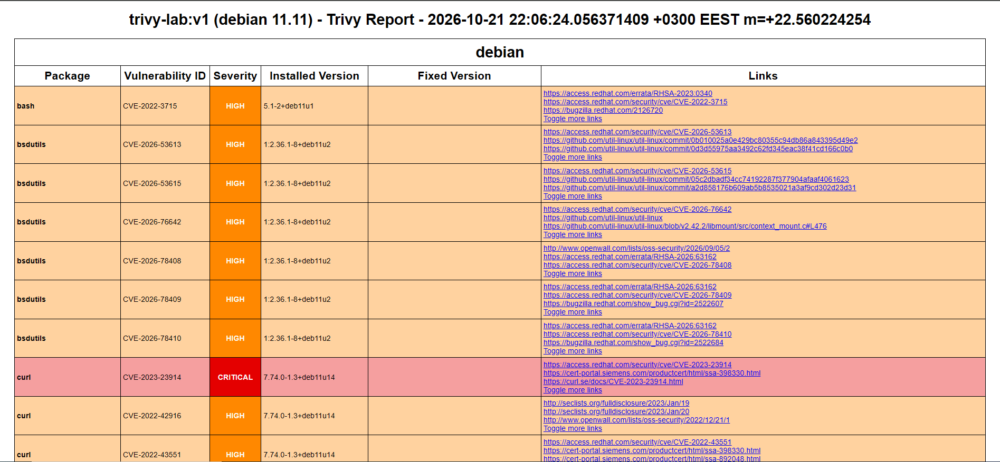
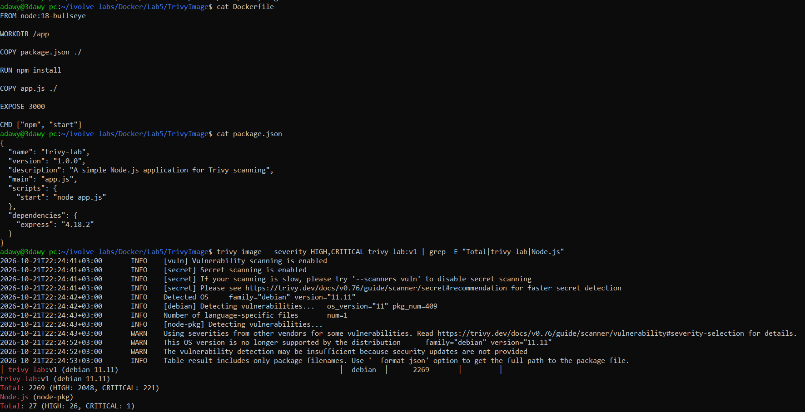
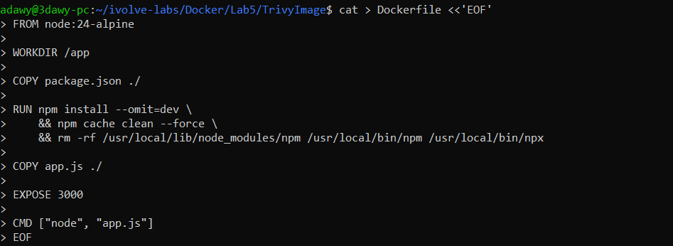
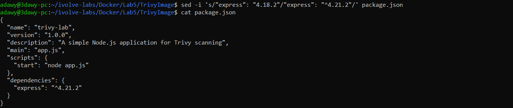
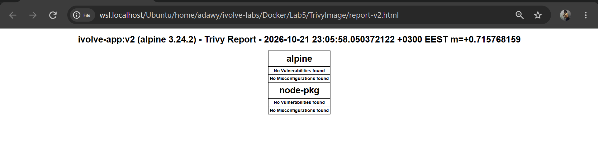
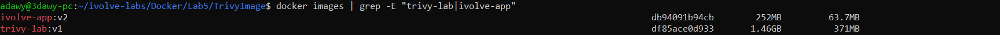

# Lab 5: Docker Image Vulnerability Scanning with Trivy

Scan a Docker image with [Trivy](https://trivy.dev), review the findings, then remediate them and prove the fix with a second scan.

## Project structure

```
Lab5/
├── TrivyImage/
│   ├── Dockerfile
│   ├── app.js
│   ├── package.json
│   ├── report-v1.html   # scan of the vulnerable image (HIGH + CRITICAL)
│   └── report-v2.html   # scan of the remediated image
├── screenshots/
└── README.md
```

---

## Part 1: Scan the vulnerable image

### 1. Clone the application

```bash
git clone https://github.com/Ibrahim-Adel15/TrivyImage.git
cd TrivyImage
rm -rf .git   # avoid a nested git repo inside this repository
```

Original `Dockerfile`:

```dockerfile
FROM node:18-bullseye
WORKDIR /app
COPY package.json ./
RUN npm install
COPY app.js ./
EXPOSE 3000
CMD ["npm", "start"]
```

### 2. Build the image as `trivy-lab:v1`

```bash
docker build -t trivy-lab:v1 .
docker images | grep trivy-lab
```

`-t trivy-lab:v1` sets the name and tag. Image size: **1.46GB**.



### 3. Install Trivy and verify

```bash
sudo apt-get install -y wget gnupg
wget -qO - https://aquasecurity.github.io/trivy-repo/deb/public.key | gpg --dearmor | sudo tee /usr/share/keyrings/trivy.gpg > /dev/null
echo "deb [signed-by=/usr/share/keyrings/trivy.gpg] https://aquasecurity.github.io/trivy-repo/deb generic main" | sudo tee /etc/apt/sources.list.d/trivy.list
sudo apt-get update
sudo apt-get install -y trivy
trivy --version
```



### 4. Scan the image

```bash
trivy image trivy-lab:v1
```

Trivy checks the OS packages and the Node.js dependencies against its vulnerability database.

### 5. Only HIGH and CRITICAL

```bash
trivy image --severity HIGH,CRITICAL trivy-lab:v1
```

| Target | Total | HIGH | CRITICAL |
|---|---|---|---|
| OS (Debian 11.11) | 2269 | 2048 | 221 |
| Node.js packages | 27 | 26 | 1 |

### 6. Generate the HTML report

```bash
trivy image --severity HIGH,CRITICAL \
  --format template --template "@/usr/local/share/trivy/templates/html.tpl" \
  -o report-v1.html trivy-lab:v1
```

Report: [`TrivyImage/report-v1.html`](TrivyImage/report-v1.html)



### Why so many vulnerabilities?

- `node:18-bullseye` is built on **Debian 11 and Node 18, both end of life**. Trivy itself warned that the OS is no longer supported and security updates are not provided, so these CVEs will never be fixed in that tag.
- The full Debian-based image ships hundreds of packages (409 detected) the app does not need, and each one adds attack surface.
- `express 4.18.2` is outdated.

---

## Part 2 (Bonus): Vulnerability remediation

### 1. Investigate

After moving to a supported base image, the remaining HIGH findings were all in the Node.js section. I searched where the vulnerable libraries live inside the image:

```bash
docker run --rm --entrypoint sh ivolve-app:v2 -c \
  'find / -type d \( -name brace-expansion -o -name undici \) -not -path "/proc/*" 2>/dev/null'
```

Both were under `/usr/local/lib/node_modules/npm/node_modules/`, so they come from the **npm bundled in the base image**, not from the application's dependencies.

| Library | CVE | Installed | Fix |
|---|---|---|---|
| brace-expansion | CVE-2026-102276, CVE-2026-102278 | 5.0.9 | 5.0.10 / 5.0.11 |
| undici | CVE-2026-19534 | 6.28.0 | 6.28.1 |
| http-cache-semantics | CVE-2026-93748 | 4.2.0 | **no fix available** |



### 2. Fix

**Base image:** `node:18-bullseye` to `node:24-alpine` (supported, and about 19 OS packages instead of 409). I also rebuilt with `docker build --pull --no-cache` to make sure the latest base image was used, but the npm-bundled findings remained.

**Dependencies:** `express` `4.18.2` to `^4.21.2`. I stayed on the 4.x line to avoid breaking changes, so `app.js` works unchanged.

**npm:** the app runs with `node app.js` and does not need a package manager at runtime. After installing the dependencies, npm and corepack are removed in the **same `RUN` layer** (a separate `RUN` would leave them in the earlier layer, where Trivy still sees them). This is image hardening: fewer tools in the image means a smaller attack surface.

New `Dockerfile`:

```dockerfile
FROM node:24-alpine
WORKDIR /app
COPY package.json ./
RUN npm install --omit=dev \
    && npm cache clean --force \
    && rm -rf /usr/local/lib/node_modules/npm /usr/local/lib/node_modules/corepack \
              /usr/local/bin/npm /usr/local/bin/npx /usr/local/bin/corepack
COPY app.js ./
EXPOSE 3000
CMD ["node", "app.js"]
```




### 3. Rebuild as `ivolve-app:v2` and test

```bash
docker build -t ivolve-app:v2 .
docker run -d --name ivolve-test -p 3000:3000 ivolve-app:v2
sleep 3
curl localhost:3000        # Welcome to the Trivy Security Lab!
docker rm -f ivolve-test
```

### 4. Rescan and generate the new report

```bash
trivy image --severity HIGH,CRITICAL --ignore-unfixed ivolve-app:v2
trivy image --severity HIGH,CRITICAL --ignore-unfixed \
  --format template --template "@/usr/local/share/trivy/templates/html.tpl" \
  -o report-v2.html ivolve-app:v2
```

`--ignore-unfixed` hides vulnerabilities that have no fix yet, which matches the lab requirement: no HIGH/CRITICAL left *where fixes are available*.

Report: [`TrivyImage/report-v2.html`](TrivyImage/report-v2.html)



---

## Results

| | `trivy-lab:v1` | `ivolve-app:v2` |
|---|---|---|
| Base image | node:18-bullseye (Debian 11, EOL) | node:24-alpine |
| HIGH + CRITICAL (OS) | 2269 | 0 |
| HIGH + CRITICAL (Node.js) | 27 | 0 |
| Image size | 1.46GB | 252MB |



## Notes

- `http-cache-semantics` (CVE-2026-93748) had **no fix available**. It was part of npm, so it was removed together with it.
- Updating the base image alone was not enough, because the latest `node:24-alpine` still bundled an npm with vulnerable internal libraries. Removing npm is only valid because the app does not need it at runtime. If a build step needed npm, a multi-stage build (npm in the build stage, only `node` and `node_modules` in the final stage) would be the cleaner approach.
- The `v1` Dockerfile is kept in the git history (commit `19532aa`).

## Key commands

| Command | Purpose |
|---|---|
| `docker build -t name:tag .` | Build an image from the Dockerfile |
| `trivy image <image>` | Scan an image for vulnerabilities |
| `--severity HIGH,CRITICAL` | Show only high-risk findings |
| `--ignore-unfixed` | Hide findings that have no fix yet |
| `--format template --template ...` | Generate the HTML report |
