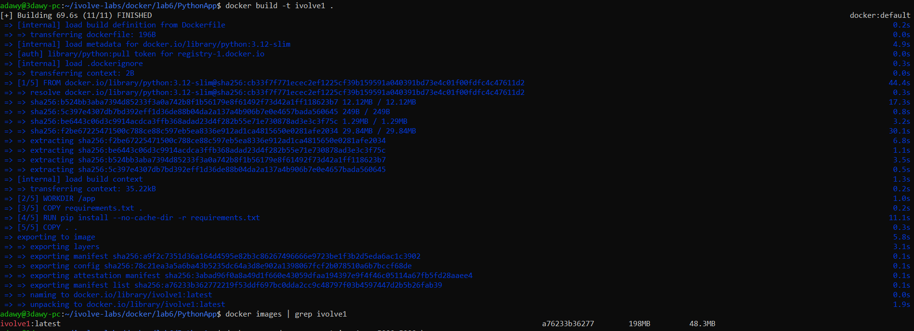
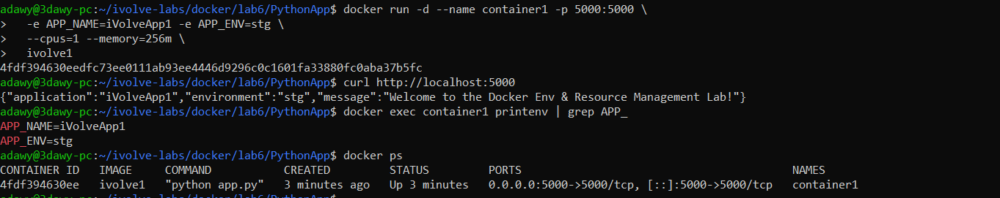
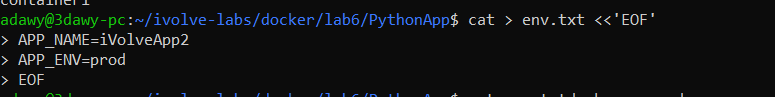
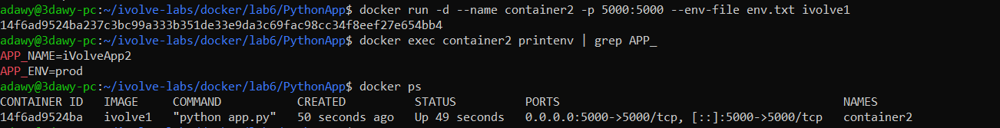
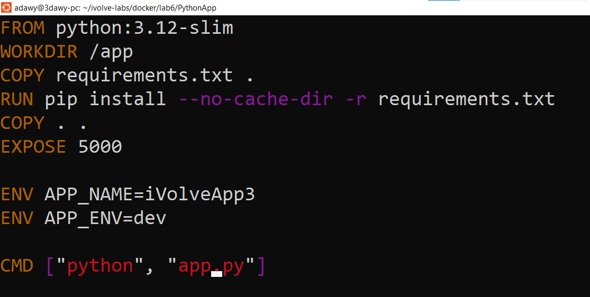
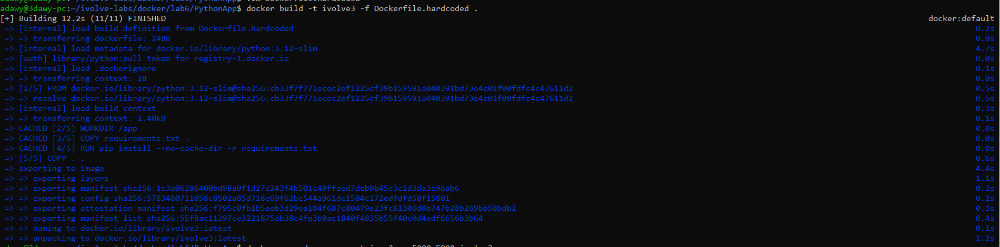
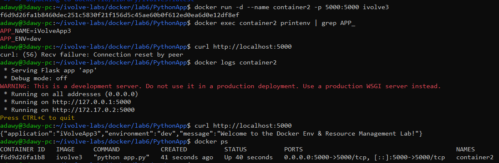

# Docker Lab 6: Environment Variables and Resource Management

## Overview

This lab demonstrates how to configure Docker containers using environment variables and manage container resource limits.

The lab covers three methods of configuring environment variables:
- Passing variables directly using the `-e` option.
- Loading variables from an environment file using `--env-file`.
- Defining default environment variables in a Dockerfile using `ENV`.

It also covers building Docker images, running containers, verifying configurations, and inspecting resource usage.

## Objectives

- Build and inspect Docker images.
- Run containers with custom names and port mappings.
- Configure runtime environment variables.
- Load configuration from an environment file.
- Define default environment variables in a Dockerfile.
- Apply CPU and memory limits.
- Verify container configuration and application availability.

## Project Structure

```text
ivolve-labs/
└── Docker/
    └── Lab6/
        ├── README.md
        ├── PythonApp/
        │   ├── Dockerfile
        │   ├── Dockerfile.hardcoded
        │   ├── app.py
        │   ├── env.txt
        │   └── requirements.txt
        └── screenshots/
            ├── 01-image-build-and-size.png
            ├── 02-container1-running-and-env.png
            ├── 03-create-env-file.png
            ├── 04-container2-env-file.png
            ├── 05-hardcoded-env-dockerfile.png
            ├── 06-build-hardcoded-image.png
            └── 07-run-container-and-curl.png
```
## Prerequisites

- Docker installed and running.
- A terminal with access to the project directory.

Run the Docker commands in this lab from the `PythonApp` directory:

```bash
cd ~/ivolve-labs/Docker/Lab6/PythonApp

## Step 1: Build the Docker Image

Build the application image:

```bash
docker build -t ivolve1 .
```

Inspect the available images:

```bash
docker images
docker image inspect ivolve1
```

**Explanation:**
- `docker build` builds an image from a Dockerfile.
- `-t ivolve1` assigns a name to the image.
- `.` specifies the current directory as the build context.
- `docker images` lists local images.
- `docker image inspect` displays detailed image metadata.



## Step 2: Run Container 1 with Environment Variables and Resource Limits

Run the container with custom environment variables and resource limits:

```bash
docker run -d \
  --name container1 \
  -p 5000:5000 \
  -e APP_NAME=iVolveApp1 \
  -e APP_ENV=stg \
  --cpus=1 \
  --memory=256m \
  ivolve1
```

Verify that the container is running:

```bash
docker ps
```

Inspect the application environment variables:

```bash
docker exec container1 printenv | grep '^APP_'
```

**Explanation:**
- `-d` runs the container in the background.
- `--name` assigns a container name.
- `-p 5000:5000` maps host port 5000 to container port 5000.
- `-e` defines an environment variable at runtime.
- `--cpus=1` limits CPU usage to one CPU's worth of processing time.
- `--memory=256m` sets a memory limit of 256 MiB.
- `docker exec` runs a command inside a running container.

Expected environment variables:

```text
APP_NAME=iVolveApp1
APP_ENV=stg
```



## Step 3: Create an Environment File

Create an environment file containing the application's configuration:

```bash
cat > env.txt <<'ENV_EOF'
APP_NAME=iVolveApp2
APP_ENV=prod
ENV_EOF
```

Display its contents:

```bash
cat env.txt
```

**Explanation:**

An environment file stores configuration as `KEY=VALUE` pairs. It separates configuration from the image and avoids specifying multiple `-e` options individually.



## Step 4: Run Container 2 Using the Environment File

Remove Container 1 if it is still running, releasing host port 5000:

```bash
docker rm -f container1
```

Start Container 2 using the environment file:

```bash
docker run -d \
  --name container2 \
  -p 5000:5000 \
  --env-file env.txt \
  ivolve1
```

Verify the container and its environment variables:

```bash
docker ps
docker exec container2 printenv | grep '^APP_'
```

**Explanation:**
- `--env-file env.txt` loads variables from the specified file.
- The same image can be reused with different configuration without rebuilding it.
- `docker rm -f` forcefully removes the specified container.

Expected environment variables:

```text
APP_NAME=iVolveApp2
APP_ENV=prod
```



## Step 5: Define Environment Variables in a Dockerfile

The `Dockerfile.hardcoded` file defines default environment variables using `ENV` instructions.

Add these lines before the `CMD` instruction:

```dockerfile
ENV APP_NAME=iVolveApp3
ENV APP_ENV=dev
```

Inspect the complete file:

```bash
cat Dockerfile.hardcoded
```

**Explanation:**
- `ENV` defines default environment variables in the image.
- Containers created from this image inherit these default values.
- Runtime environment variables can override image defaults.
- A separate Dockerfile preserves the original Dockerfile.



## Step 6: Build the New Image

Build an image using the modified Dockerfile:

```bash
docker build -t ivolve3 -f Dockerfile.hardcoded .
```

Inspect the generated image:

```bash
docker images
docker image inspect ivolve3
```

**Explanation:**
- `-t ivolve3` assigns a distinct name to the new image.
- `-f Dockerfile.hardcoded` specifies the Dockerfile to use.
- The new image contains the default environment variables defined in that file.



## Step 7: Run the New Image and Test the Application

Remove the previous Container 2 if it still exists:

```bash
docker rm -f container2
```

Run a container using the new image:

```bash
docker run -d \
  --name container2 \
  -p 5000:5000 \
  ivolve3
```

Verify its environment variables:

```bash
docker exec container2 printenv | grep '^APP_'
```

Test the application:

```bash
curl http://localhost:5000
```

**Explanation:**

The container inherits the default environment variables from `Dockerfile.hardcoded`. The `curl` command sends an HTTP request to the application through host port 5000.

Expected environment variables:

```text
APP_NAME=iVolveApp3
APP_ENV=dev
```

The HTTP response depends on the application's implementation.



## Resource Monitoring

Monitor a running container:

```bash
docker stats container2 --no-stream
```

Inspect the container configuration:

```bash
docker inspect container2
```

**Important:** The CPU and memory limits specified in Step 2 apply to `container1`. Containers started in later steps do not inherit those container-specific limits automatically.

To verify the resource limits from Step 2, run `docker stats container1 --no-stream` while Container 1 is still running.

## Key Takeaways

- Docker images can be reused with different runtime configurations.
- The `-e` option passes individual environment variables to a container.
- The `--env-file` option loads multiple variables from a file.
- Dockerfile `ENV` instructions define image-level defaults.
- Runtime environment variables can override image defaults.
- CPU and memory limits help control container resource consumption.
- `docker exec`, `docker inspect`, `docker stats`, and `curl` help verify configuration, resource usage, and application availability.

## Cleanup

Remove the test container:

```bash
docker rm -f container2
```

Verify that the container has been removed:

```bash
docker ps -a
```

---

## Conclusion

This lab demonstrated how to build Docker images, configure containers using environment variables, apply resource limits, and verify application behavior.

It also highlighted the importance of separating application configuration from Docker images and validating container settings using Docker inspection and monitoring commands.

## Author

**Ahmed Ibrahim Adawy**

- GitHub: [AdawyDevOps](https://github.com/AdawyDevOps)
- LinkedIn: [ahmed-3dawy](https://www.linkedin.com/in/ahmed-3dawy/)
