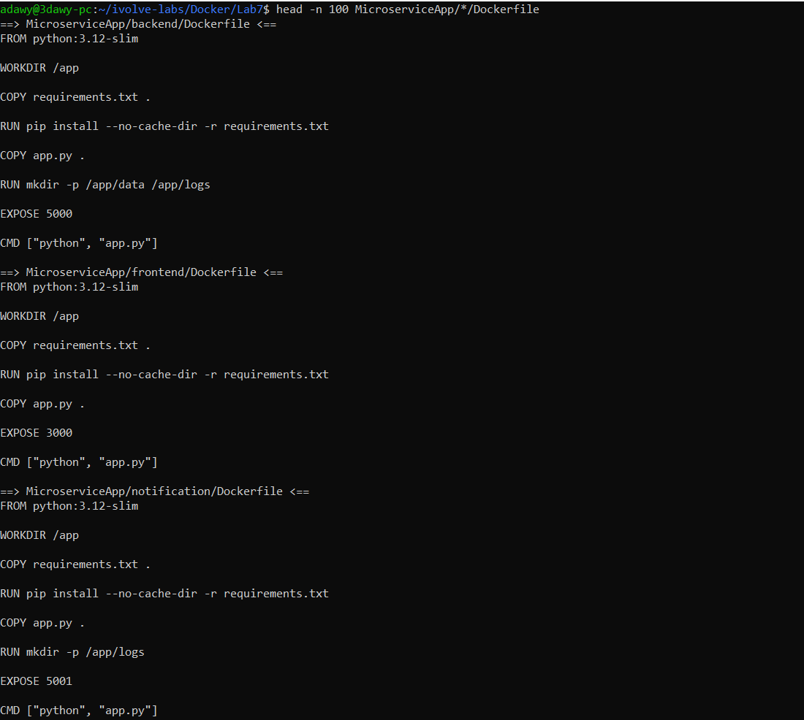
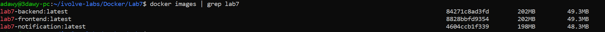
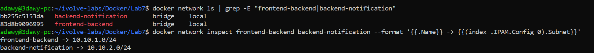
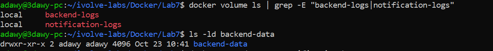
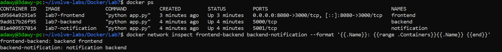
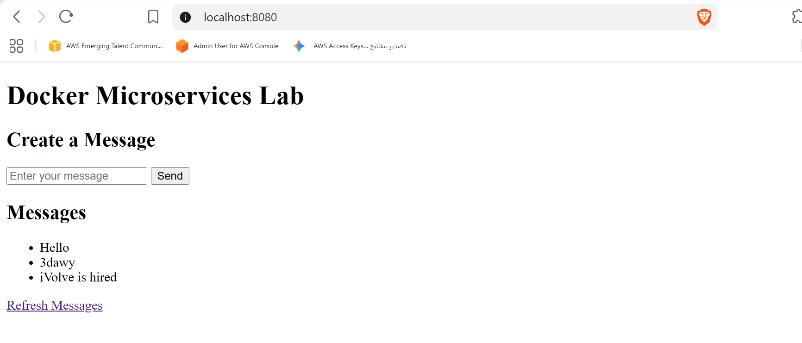
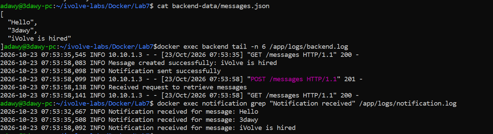
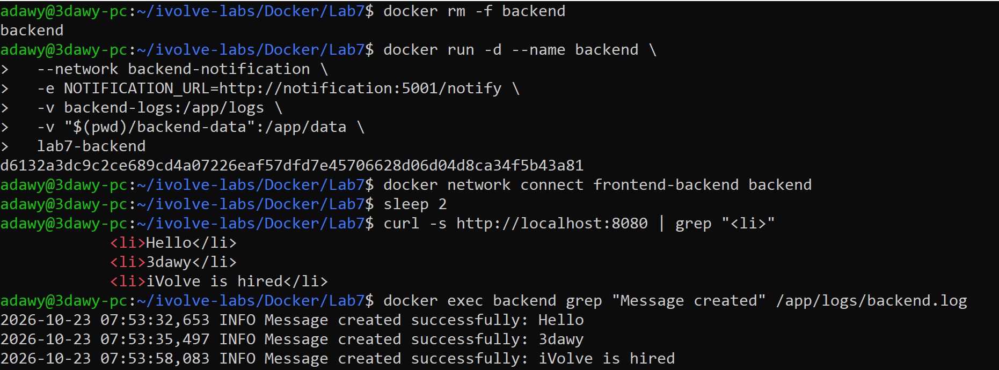

# Lab 7: Multi-Network Microservices, Volumes, and Bind Mounts

## Objective

Run a three-service application (frontend, backend, notification) with plain Docker commands, using:

- Two user-defined bridge networks with separate subnets, so the frontend can reach the backend but cannot reach the notification service.
- Two named volumes that hold the backend and notification logs.
- One bind mount that stores the backend data (`messages.json`) in a directory on the host.

Source application: <https://github.com/Ibrahim-Adel15/MicroserviceApp.git>

## How the application works

| Service | Port | Configuration | Writes to |
|---|---|---|---|
| frontend | 3000 | `BACKEND_URL=http://backend:5000` | stdout only |
| backend | 5000 | `NOTIFICATION_URL=http://notification:5001/notify` | `/app/data/messages.json`, `/app/logs/backend.log` |
| notification | 5001 | none | `/app/logs/notification.log` |

Request flow: the browser talks to the frontend, the frontend calls the backend (`GET` and `POST /messages`), and the backend saves the message and then calls the notification service (`POST /notify`). The frontend never calls the notification service, which is why the backend is the only container attached to both networks.

```text
Browser --:8080--> [frontend] --frontend-backend--> [backend] --backend-notification--> [notification]
                                                       |                                      |
                                       bind mount ./backend-data -> /app/data     volume notification-logs -> /app/logs
                                       volume backend-logs -> /app/logs
```

## Resources created

| Type | Name | Details |
|---|---|---|
| Network | `frontend-backend` | subnet `10.10.1.0/24` |
| Network | `backend-notification` | subnet `10.10.2.0/24` |
| Volume | `backend-logs` | mounted at `/app/logs` in the backend |
| Volume | `notification-logs` | mounted at `/app/logs` in the notification service |
| Bind mount | `./backend-data` | mounted at `/app/data` in the backend |

---

## Step 1: Clone the application and remove its nested `.git`

The lab folder lives inside the `ivolve-labs` repository. If the cloned project kept its own `.git` folder, Git would treat it as an embedded repository and would not track its files, so the `.git` folder is removed.

```bash
cd ~/ivolve-labs/Docker
mkdir Lab7 && cd Lab7
mkdir screenshots
git clone https://github.com/Ibrahim-Adel15/MicroserviceApp.git
rm -rf MicroserviceApp/.git
find MicroserviceApp -type f | sort
```

The project contains one folder per service, each with `app.py`, `requirements.txt` and a `Dockerfile`.

## Step 2: Review the Dockerfiles

The repository already includes a Dockerfile for each service.

```bash
head -n 100 MicroserviceApp/*/Dockerfile
```



All three follow the same pattern:

| Instruction | Purpose |
|---|---|
| `FROM python:3.12-slim` | Small Python base image |
| `WORKDIR /app` | Working directory inside the image |
| `COPY requirements.txt .` then `RUN pip install --no-cache-dir -r requirements.txt` | Dependencies are installed before the code is copied, so Docker caches this layer and rebuilds are fast |
| `COPY app.py .` | Application code |
| `RUN mkdir -p /app/data /app/logs` | Creates the data and log directories used as mount points (backend creates both, notification only `logs`, frontend none) |
| `EXPOSE` | Documents the port (3000, 5000 or 5001); it does not publish it |
| `CMD ["python", "app.py"]` | Starts the service |

## Step 3: Build the images

```bash
cd MicroserviceApp
docker build -t lab7-frontend ./frontend
docker build -t lab7-backend ./backend
docker build -t lab7-notification ./notification
cd ..
docker images | grep lab7
```



## Step 4: Create the two bridge networks

```bash
docker network create --driver bridge --subnet 10.10.1.0/24 frontend-backend
docker network create --driver bridge --subnet 10.10.2.0/24 backend-notification
docker network ls | grep -E "frontend-backend|backend-notification"
docker network inspect frontend-backend backend-notification --format '{{.Name}} -> {{(index .IPAM.Config 0).Subnet}}'
```



User-defined bridge networks provide DNS by container name, which is what lets `http://backend:5000` and `http://notification:5001` resolve.

## Step 5: Create the log volumes and the host directory

```bash
docker volume create backend-logs
docker volume create notification-logs
mkdir -p backend-data
docker volume ls | grep -E "backend-logs|notification-logs"
ls -ld backend-data
```



## Step 6: Run the containers

**Notification service** on `backend-notification` only:

```bash
docker run -d --name notification \
  --network backend-notification \
  -v notification-logs:/app/logs \
  lab7-notification
```

**Backend** on both networks. `docker run` attaches a container to one network at start, so it is started on `backend-notification` and then connected to `frontend-backend`. The bind mount uses an absolute host path.

```bash
docker run -d --name backend \
  --network backend-notification \
  -e NOTIFICATION_URL=http://notification:5001/notify \
  -v backend-logs:/app/logs \
  -v "$(pwd)/backend-data":/app/data \
  lab7-backend

docker network connect frontend-backend backend
```

**Frontend** on `frontend-backend`, with port 8080 published:

```bash
docker run -d --name frontend \
  --network frontend-backend \
  -p 8080:3000 \
  -e BACKEND_URL=http://backend:5000 \
  lab7-frontend
```

Verify the containers and the network membership:

```bash
docker ps
docker network inspect frontend-backend backend-notification --format '{{.Name}}: {{range .Containers}}{{.Name}} {{end}}'
```



`frontend-backend` contains `frontend` and `backend`; `backend-notification` contains `notification` and `backend`. The backend appears in both.

## Step 7: Use the web page

Open <http://localhost:8080>, create messages (`Hello`, `3dawy`, `iVolve`) and confirm they appear in the list after each submission.



## Step 8: Verify the bind mount and the logs

```bash
cat backend-data/messages.json
docker exec backend tail -n 6 /app/logs/backend.log
docker exec notification grep "Notification received" /app/logs/notification.log
```



`messages.json` exists on the host, written by the backend container through the bind mount. The notification log lists every message, which proves the backend reached the notification service over `backend-notification`.

## Step 9: Verify network isolation

The frontend is not attached to `backend-notification`, so it must not resolve or reach the notification service, while the backend must.

```bash
docker exec frontend python -c "import urllib.request as u; print(u.urlopen('http://notification:5001/health', timeout=3).read())" 2>&1 | tail -1
docker exec backend python -c "import urllib.request as u; print(u.urlopen('http://notification:5001/health', timeout=3).read())"
```

The frontend fails with `No address associated with hostname`; the backend returns `{"status":"healthy"}`.

## Step 10: Verify persistence

Remove the backend container and start a new one with the same volume and bind mount. The messages and logs must survive.

```bash
docker rm -f backend
docker run -d --name backend \
  --network backend-notification \
  -e NOTIFICATION_URL=http://notification:5001/notify \
  -v backend-logs:/app/logs \
  -v "$(pwd)/backend-data":/app/data \
  lab7-backend
docker network connect frontend-backend backend
sleep 2
curl -s http://localhost:8080 | grep "<li>"
docker exec backend grep "Message created" /app/logs/backend.log
```



The messages are still returned by the new backend because they live in `./backend-data`, and the old log lines are still present because `/app/logs` is a named volume.

## Cleanup (optional)

```bash
docker rm -f frontend backend notification
docker network rm frontend-backend backend-notification
docker volume rm backend-logs notification-logs
docker rmi lab7-frontend lab7-backend lab7-notification
```

## Notes

- A bind mount maps a chosen host directory, so the data is visible and editable on the host. A named volume is managed by Docker and suits logs.
- The backend saves a message before notifying, so a notification failure does not lose messages.
- Only the backend is on both networks, which isolates the notification service from the frontend.
