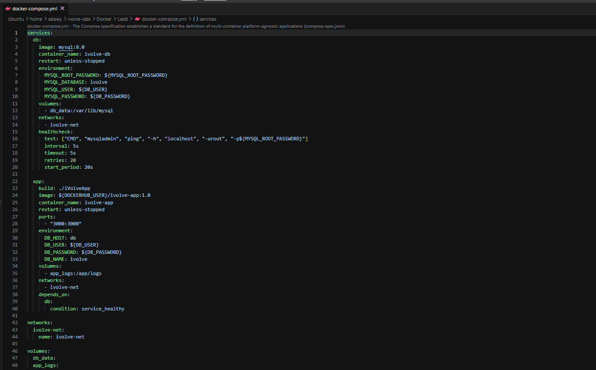
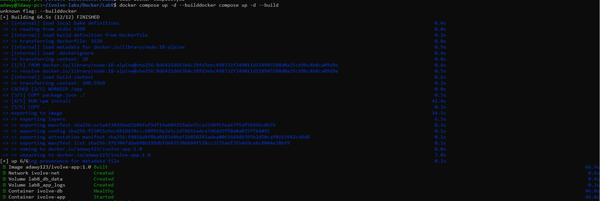
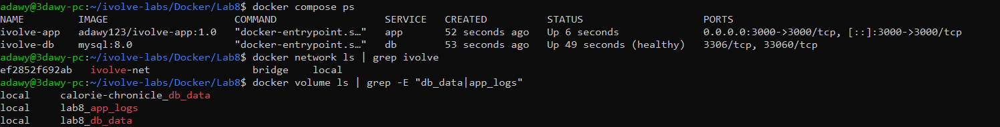
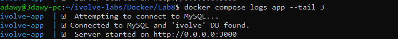
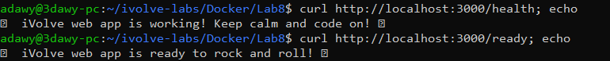
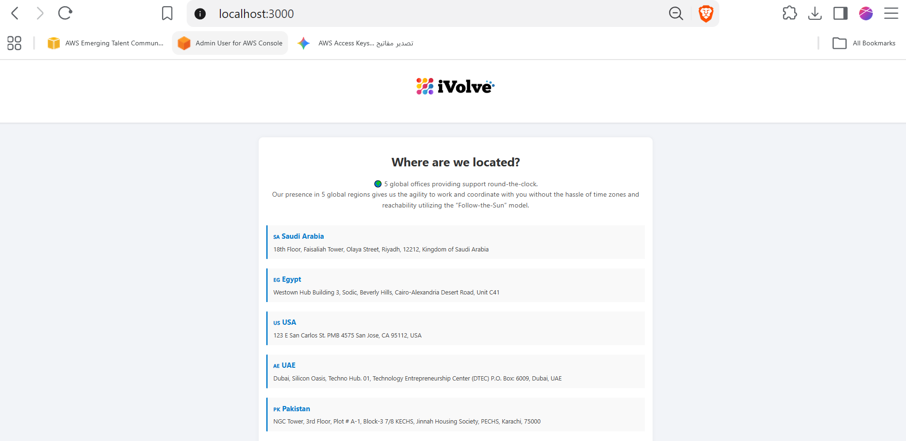
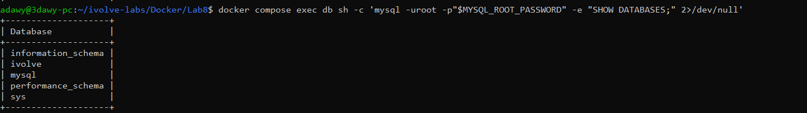
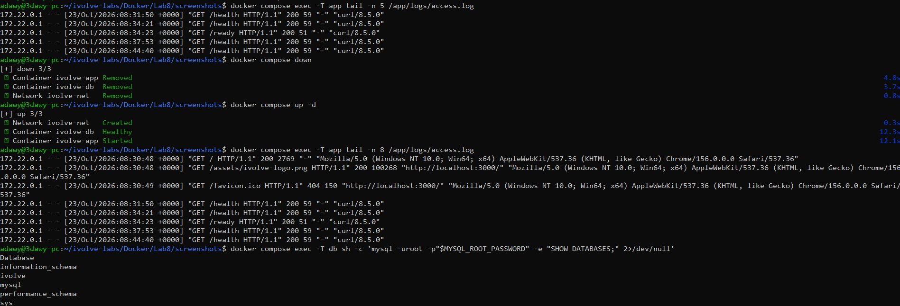
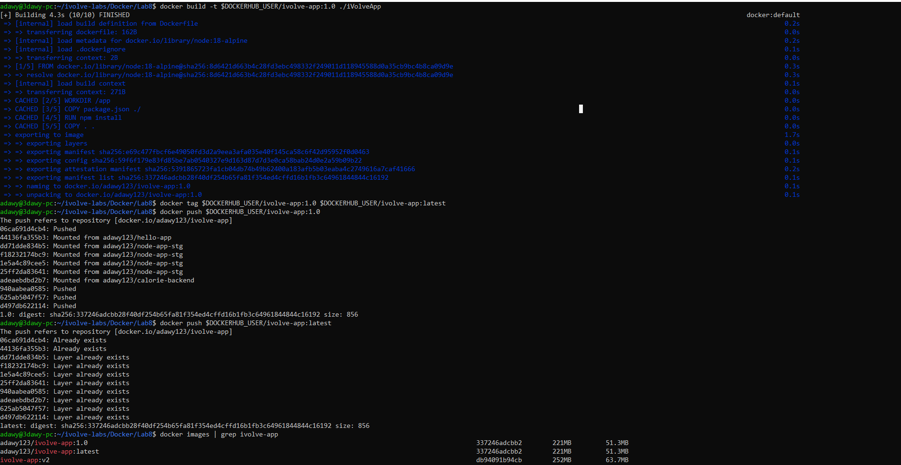
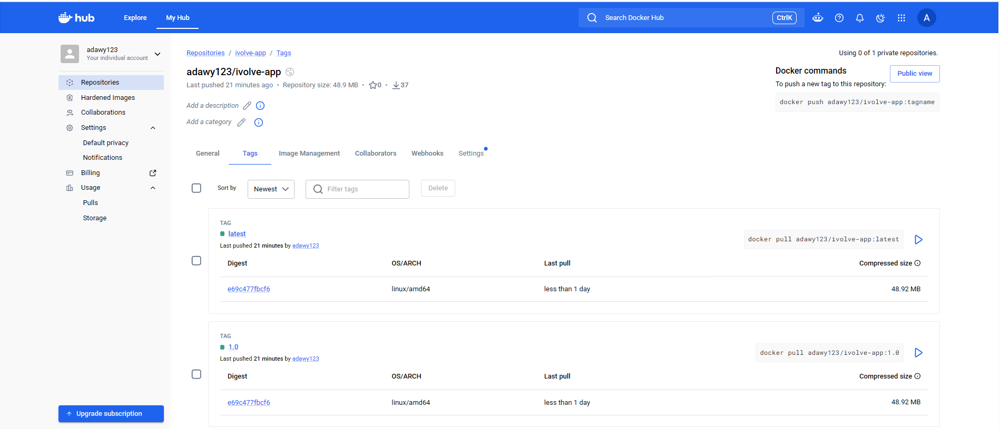

# Lab 8: Containerized Node.js and MySQL Stack Using Docker Compose

Runs the iVolve Node.js app with a MySQL database using Docker Compose, a custom network `ivolve-net`, and persistent volumes for the database and the application logs.

Application source: https://github.com/Ibrahim-Adel15/iVolveApp.git

## About the application

- Node.js 18 (Express, mysql2, morgan), listens on port 3000
- Reads `DB_HOST`, `DB_USER`, `DB_PASSWORD` from the environment; the database name `ivolve` is hardcoded
- On startup it connects to MySQL and retries every 5 seconds until the `ivolve` database exists, so the MySQL service creates it with `MYSQL_DATABASE=ivolve`
- `/health` and `/ready` run `SELECT 1` against the DB
- morgan writes the access log to `/app/logs/access.log`

## Compose design

| Part | Configuration |
|------|---------------|
| db | `mysql:8.0`, env `MYSQL_ROOT_PASSWORD`, `MYSQL_DATABASE=ivolve`, `MYSQL_USER`, `MYSQL_PASSWORD`, volume `db_data:/var/lib/mysql`, healthcheck |
| app | built from `./iVolveApp/Dockerfile`, port `3000:3000`, env `DB_HOST=db`, `DB_USER`, `DB_PASSWORD`, `DB_NAME`, volume `app_logs:/app/logs`, waits for a healthy DB |
| network | custom bridge network `ivolve-net` |
| volumes | `db_data` (database files), `app_logs` (application logs) |

Credentials live in a `.env` file that is git-ignored; `.env.example` shows the required variables.

## Steps

### 1. Clone the app and remove its nested .git

The lab lives inside my own Git repo, so the cloned app must not keep its own `.git` (repo inside a repo).

```bash
mkdir Lab8 && cd Lab8
git clone https://github.com/Ibrahim-Adel15/iVolveApp.git
rm -rf iVolveApp/.git
```

### 2. Create docker-compose.yml, .env, .env.example and .gitignore

The compose file defines the `db` and `app` services, the `ivolve-net` network, and the `db_data` and `app_logs` volumes.

### 3. Validate the compose file

```bash
docker compose config
```



### 4. Build and start the stack

```bash
docker compose up -d --build
```



### 5. Check containers, network and volumes

```bash
docker compose ps
docker network ls | grep ivolve
docker volume ls | grep -E "db_data|app_logs"
```



### 6. Verify the application and the DB connection

On the first start MySQL needs about 30 seconds to initialize, so the app logs a few connection retries and then connects.

```bash
docker compose logs app --tail 3
```



```bash
curl http://localhost:3000/health
curl http://localhost:3000/ready
```



The application in the browser at http://localhost:3000:



### 7. Verify the ivolve database exists

```bash
docker compose exec db sh -c 'mysql -uroot -p"$MYSQL_ROOT_PASSWORD" -e "SHOW DATABASES;"'
```



### 8. Verify persistence

The containers are removed and recreated. The access log and the database are still there because the named volumes are kept.

```bash
docker compose exec -T app tail -n 5 /app/logs/access.log
docker compose down
docker compose up -d
docker compose exec -T app tail -n 8 /app/logs/access.log
docker compose exec -T db sh -c 'mysql -uroot -p"$MYSQL_ROOT_PASSWORD" -e "SHOW DATABASES;"'
```



### 9. Build, tag and push the image to Docker Hub

```bash
docker login
docker build -t adawy123/ivolve-app:1.0 ./iVolveApp
docker tag adawy123/ivolve-app:1.0 adawy123/ivolve-app:latest
docker push adawy123/ivolve-app:1.0
docker push adawy123/ivolve-app:latest
```



Docker Hub repository: https://hub.docker.com/r/adawy123/ivolve-app



## Cleanup

```bash
docker compose down
docker compose down -v
```

The second command also deletes the `db_data` and `app_logs` volumes.
