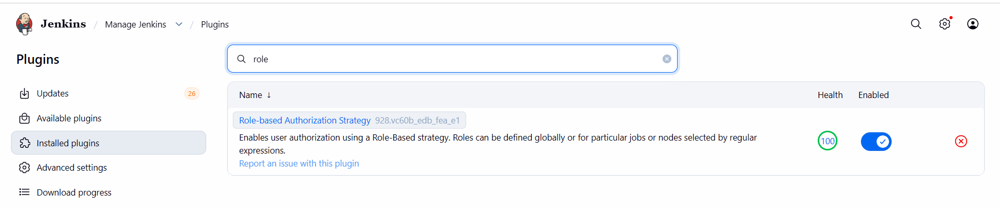
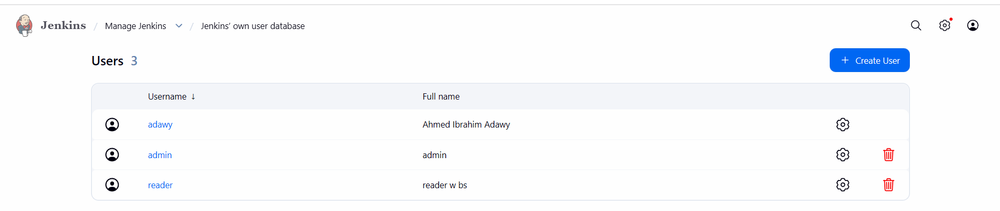
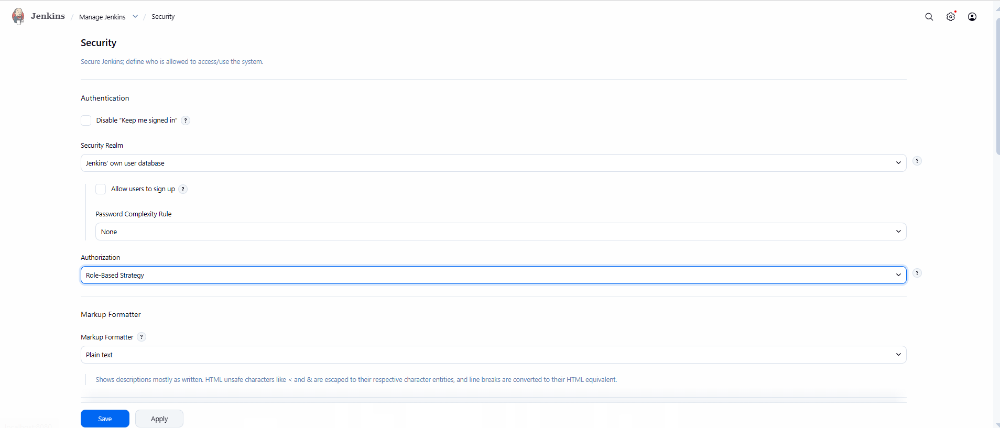
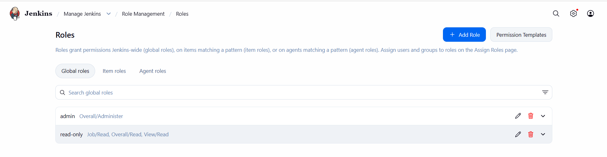
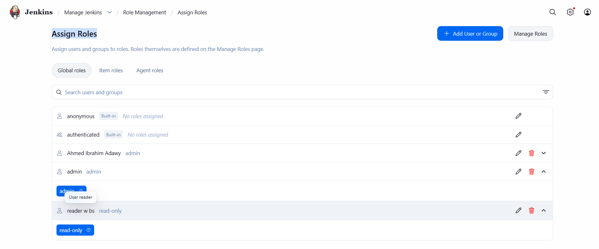
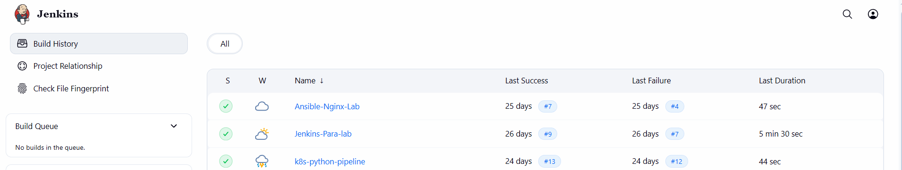

# Lab 20: Role-Based Authorization in Jenkins

## Objective
Secure Jenkins by replacing the default permissive authorization (`Logged-in users can do anything`) with the **Role-based Authorization Strategy** plugin. Create users with distinct privileges (`admin` and `read-only`), define global roles with precise permissions, assign the roles to the users, and validate their access levels.

## Requirements

| Item | Requirement |
|---|---|
| Plugin | `Role-based Authorization Strategy` installed and enabled |
| Security Strategy | `Role-Based Strategy` configured under Jenkins Security settings |
| Users | Administrator accounts (`adawy`, `admin`) and a Read-Only account (`reader`) |
| Global Roles | `admin` (`Overall/Administer`) and `read-only` (`Job/Read`, `Overall/Read`, `View/Read`) |
| Validation | `admin` has full management access; `reader` can only view dashboards and jobs without administrative or build creation controls |

## Environment
- Windows + WSL2 (Ubuntu 24.04) + Docker Desktop
- Jenkins running in a Docker container (`jenkins/jenkins:lts`)
- Jenkins Web UI exposed on `http://localhost:8080`

## Folder Structure

```text
Lab20/
├── README.md
└── screenshots/
    ├── 01-plugin-installed.png
    ├── 02-users-created.png
    ├── 03-enable-role-based-strategy.png
    ├── 04-manage-global-roles.png
    ├── 05-assign-roles.png
    └── 06-read-only-user-login-verify-access.png
```

## Components

| Component | Name | Role |
|---|---|---|
| Plugin | `Role-based Authorization Strategy` | Extends Jenkins security to support global, item, and agent roles |
| Global Role | `admin` | Grants full administrative control (`Overall/Administer`) over the Jenkins instance |
| Global Role | `read-only` | Grants restricted viewing permissions (`Overall/Read`, `Job/Read`, `View/Read`) |
| Users | `adawy`, `admin`, `reader` | Local users stored in Jenkins' own user database and mapped to specific roles |

## Workflow

```text
  User Login (Jenkins' own user database)
        |
        | 1. Authentication (username + password)
        v
  +-------------------------------------------------------------------+
  |                       Jenkins Security                            |
  |                                                                   |
  |  2. Authorization (Role-Based Strategy):                          |
  |     Checks Global Role Assignments                                |
  |       ├── adawy / admin  ──> Role: admin                          |
  |       |     └── Overall/Administer (Manage Jenkins, New Item,     |
  |       |         Configure, Build, Delete)            --> ALLOWED  |
  |       |                                                           |
  |       └── reader         ──> Role: read-only                      |
  |             ├── Overall/Read, Job/Read, View/Read    --> ALLOWED  |
  |             └── Manage Jenkins, New Item, Build Now  --> HIDDEN   |
  +-------------------------------------------------------------------+
```

## Authorization Strategies Compared

| Strategy | Behavior | Use Case |
|---|---|---|
| `Logged-in users can do anything` | Every authenticated user has full admin rights | Local testing only (unsafe for teams) |
| `Matrix-based security` | Permissions are checked per user in a single large table | Very small setups with few users |
| `Role-Based Strategy` | Permissions are grouped into reusable Roles (Global, Item, Agent) and assigned to users or groups | Production CI/CD teams enforcing least privilege |

## Design Decisions
- **Dockerized Jenkins (`jenkins/jenkins:lts`):** Running Jenkins inside a container isolates its Java runtime and dependencies from the WSL2 host while persisting data on a Docker volume.
- **Principle of Least Privilege:** The `read-only` role grants only `Overall/Read`, `Job/Read`, and `View/Read`. Without `Overall/Read`, a user cannot load the Jenkins dashboard at all; without `Job/Read`, the dashboard loads as an empty page. All destructive or state-changing actions (`Build`, `Configure`, `Delete`, `Administer`) remain unselected.
- **Redundant Admin Accounts:** Keeping both the primary account (`adawy`) and `admin` assigned to the `admin` role prevents accidental lockouts when switching the authorization strategy.

## Relation to Previous Labs

| Previous Lab | Relation |
|---|---|
| Lab 19 (Kubernetes RBAC) | Lab 19 secured the Kubernetes API Server for Jenkins (`jenkinssa` ServiceAccount + `Role` + `RoleBinding`). Lab 20 secures the Jenkins UI itself so only authorized users can manage pipelines that talk to the cluster. |

## Steps

### Step 1: Install the Role-based Authorization Strategy Plugin
Navigate to **Manage Jenkins** -> **Plugins** -> **Available plugins**, search for `Role-based Authorization Strategy`, and install it. Confirm the plugin is enabled under **Installed plugins**.



### Step 2: Create Users in Jenkins
Go to **Manage Jenkins** -> **Users** -> **Create User** and create the administrator account (`admin`) and the read-only account (`reader` / `reader w bs`) alongside the primary admin account (`adawy`).



### Step 3: Enable the Role-Based Strategy
Navigate to **Manage Jenkins** -> **Security**. Under **Security Realm**, keep `Jenkins’ own user database`. Under **Authorization**, change the selection to **Role-Based Strategy** and click **Save**.



### Step 4: Configure Global Roles
Go to **Manage Jenkins** -> **Manage and Assign Roles** -> **Manage Roles**:
- Keep the built-in **`admin`** role with `Overall/Administer`.
- Click **+ Add Role**, create **`read-only`**, and grant it `Job/Read`, `Overall/Read`, and `View/Read`.



### Step 5: Assign Roles to Users
Navigate to **Manage Jenkins** -> **Manage and Assign Roles** -> **Assign Roles**. Click **+ Add User or Group** and bind each user to their respective role:
- `adawy` (`Ahmed Ibrahim Adawy`) -> `admin`
- `admin` -> `admin`
- `reader` (`reader w bs`) -> `read-only`



### Step 6: Validate Read-Only Access
Log in as `reader` in an incognito browser session:
- The user can view the main dashboard, existing views, and the list of pipelines (`Ansible-Nginx-Lab`, `Jenkins-Para-lab`, `k8s-python-pipeline`, `node-app-docker-pipeline`, `node-app-multibranch-pipeline`, `nti-lab-1`).
- Administrative and creation controls (**New Item**, **Manage Jenkins**, **Build Now**, **Configure**, **Delete**) are completely hidden from the sidebar.



## Notes
- **Why `Overall/Read` is mandatory:** In Jenkins, `Overall/Read` is the base permission required to view the UI. Granting `Job/Read` without `Overall/Read` results in an `is missing the Overall/Read permission` error page upon login.
- **Stopping a stuck build in Build Executor Status:** If an older pipeline build (`Jenkins-Para-lab #6`) stays running in the **Build Executor Status** widget on the bottom-left, log in with an `admin` account, click the build number (`#6`), and click **Abort** (or the red `X` next to the progress bar). A `read-only` user cannot abort builds because they lack `Job/Cancel`.
- **Item Roles (Regex-based):** Beyond Global Roles, the plugin supports **Item roles** (matching job names by regular expression, such as `^k8s-.*`) to restrict teams to specific folders or project prefixes.

## Push to GitHub

```bash
cd ~/ivolve-labs
find jenkins/Lab20 -name "*Zone.Identifier" -type f -delete
git status
git add jenkins/Lab20
git commit -m "Add Lab20: Role-based Authorization in Jenkins"
git -c http.version=HTTP/1.1 push origin main
```