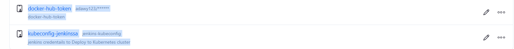
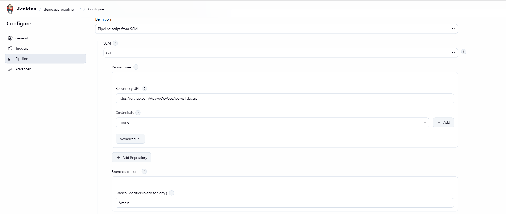
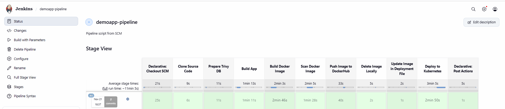

# Lab 21: Jenkins Pipeline for Application Deployment

## Objective

Build a Jenkins pipeline that takes the `DemoApp` source code from GitHub and automatically builds it, packages it as a Docker image, scans the image for vulnerabilities, pushes it to Docker Hub, removes the local copy, updates the image in the Kubernetes deployment file and deploys it to the cluster, with `post` actions for `always`, `success` and `failure`.

## Requirements

| # | Stage | Done with |
|---|---|---|
| - | Clone source code and Dockerfile | `git` from `https://github.com/Ibrahim-Adel15/DemoApp.git` |
| 1 | Build app | Maven (`mvn clean package`) |
| 2 | Build Docker image | `docker build` |
| 3 | Scan Docker image | Trivy |
| 4 | Push image to Docker Hub | `docker push` |
| 5 | Delete image locally | `docker rmi` |
| 6 | Update image in deployment file | `sed` |
| 7 | Deploy to Kubernetes | `kubectl apply` |
| - | Post actions | `always`, `success`, `failure` |

## Environment

- Windows + WSL2 (Ubuntu 24.04) + Docker Desktop
- Jenkins running as a Docker container named `jenkins` (`jenkins/jenkins:lts`, ports 8080 and 50000)
- Minikube (docker driver), single node, namespace `ivolve`
- Docker Hub account: `adawy123`, image: `adawy123/demoapp`

## Folder Structure

```
Lab21/
├── README.md
├── Jenkinsfile
├── manifests/
│   ├── deployment.yaml
│   ├── jenkinssa-token.yaml
│   └── pipeline-role.yaml
├── logs/
│   ├── console-output-build-1.txt
│   ├── console-output-build-3.txt
│   └── console-output-build-4.txt
└── screenshots/
    ├── 01-jenkins-credentials.png
    ├── 02-pipeline-running-successfully.png
    └── 03-pipeline-job-configuration.png
```

The application source is **not** stored here: the pipeline clones it from the DemoApp repository on every run.

## Workflow

```
 GitHub: ivolve-labs (Jenkinsfile + deployment.yaml)     GitHub: DemoApp (source + Dockerfile)
              |                                                       |
              v                                                       v
   Jenkins job "demoapp-pipeline"  ------------------------------------+
   |
   |-- 0. Prepare Trivy DB    refresh the vulnerability database only when it is stale
   |-- 1. Build App           mvn clean package        -> target/demo-0.0.1-SNAPSHOT.jar
   |-- 2. Build Docker Image  docker build             -> adawy123/demoapp:<BUILD_NUMBER>
   |-- 3. Scan Docker Image   trivy image              -> trivy-report.txt (archived)
   |-- 4. Push to DockerHub   docker push
   |-- 5. Delete Image Locally docker rmi
   |-- 6. Update deployment   sed: image: adawy123/demoapp:<BUILD_NUMBER>
   '-- 7. Deploy              kubectl apply + rollout status   (as ServiceAccount jenkinssa, namespace ivolve)

   post { always | success | failure | aborted | cleanup }
```

Every build gets its own image tag (the build number), so each deployed version can be traced back to the build that produced it and rolled back.

## Design Decisions

- **Pipeline as code:** the `Jenkinsfile` lives in Git and the job uses *Pipeline script from SCM*. The same repository also provides `manifests/deployment.yaml`.
- **Docker from Jenkins:** the Jenkins container uses the Docker daemon of the host through `docker.sock`, so images are built without running Docker inside Docker.
- **Deploy with least privilege:** Jenkins deploys as the ServiceAccount `jenkinssa` from Lab 19, not with admin rights. Lab 19 only granted `create/update` on Deployments, but `kubectl apply` also needs `get` and `patch` and `rollout status` needs `get/list/watch`. RBAC is additive, so a **second Role** (`ivolvepipelinerole`) was added and the Lab 19 Role is untouched.
- **Long-lived token:** `kubectl create token` expires after one hour, so Jenkins uses a ServiceAccount token Secret (`jenkinssa-token`) that the cluster fills in.
- **Image tag = build number**, never `latest`.
- **Scan is report-only** (`TRIVY_EXIT_CODE = '0'`): the scan of build #4 reports 9 CRITICAL and 38 HIGH findings, almost all of them in the libraries bundled in the application JAR (Spring Boot 3.2.0 and the embedded Tomcat 10.1.16 come from the project's `pom.xml`). Fixing them means upgrading those dependencies, which belongs to the application and not to this pipeline lab, so the scan reports instead of failing the build. Setting the value to `'1'` turns it into a gate.

## Relation to Previous Labs

| Lab | Relation |
|---|---|
| **Lab 8** | `docker build`, `docker push` and Docker Hub, now automated. |
| **Lab 10** | The Pods need `nodeSelector project=ivolve` and a toleration for the taint `workload=ivolveApp:NoSchedule`. |
| **Lab 15** | Same Deployment pattern, in the same `ivolve` namespace. |
| **Lab 16** | The Deployment sets resource requests and limits. |
| **Lab 19** | The ServiceAccount `jenkinssa` is the identity Jenkins uses to deploy. |
| **Lab 20** | Jenkins already has role-based authorization; the job is created and run as `admin`. |

---

## Preparation

### Step 1: What the Jenkins container needs

The Jenkins container already had `docker.sock` mounted, the Docker CLI and `kubectl`. Trivy and Maven were missing and were installed into it (the base image already provides Java 21):

```bash
docker exec jenkins bash -c 'curl -sfL https://raw.githubusercontent.com/aquasecurity/trivy/main/contrib/install.sh | sh -s -- -b /usr/local/bin && trivy --version'
docker exec jenkins bash -c 'curl -fsSL https://archive.apache.org/dist/maven/maven-3/3.9.9/binaries/apache-maven-3.9.9-bin.tar.gz | tar xz -C /opt && ln -sf /opt/apache-maven-3.9.9/bin/mvn /usr/local/bin/mvn && mvn -v'
docker exec jenkins docker ps
```

### Step 2: Let Jenkins reach the cluster

The Kubernetes API of Minikube is published on `127.0.0.1:<port>` of the host, which does not work from another container. Jenkins is connected to the Minikube Docker network and uses the internal address:

```bash
docker network connect minikube jenkins
docker exec jenkins curl -sk https://$(minikube ip):8443/version | head -5
```

### Step 3: Token and permissions for `jenkinssa`

`manifests/jenkinssa-token.yaml` (the cluster generates the token, the file contains no secret):

```yaml
apiVersion: v1
kind: Secret
metadata:
  name: jenkinssa-token
  namespace: ivolve
  annotations:
    kubernetes.io/service-account.name: jenkinssa
type: kubernetes.io/service-account-token
```

`manifests/pipeline-role.yaml`:

```yaml
apiVersion: rbac.authorization.k8s.io/v1
kind: Role
metadata:
  name: ivolvepipelinerole
  namespace: ivolve
rules:
  - apiGroups: ["apps"]
    resources: ["deployments"]
    verbs: ["get", "list", "watch", "create", "update", "patch"]
  - apiGroups: [""]
    resources: ["pods"]
    verbs: ["get", "list", "watch"]
---
apiVersion: rbac.authorization.k8s.io/v1
kind: RoleBinding
metadata:
  name: ivolvepipelinerolebinding
  namespace: ivolve
subjects:
  - kind: ServiceAccount
    name: jenkinssa
    namespace: ivolve
roleRef:
  apiGroup: rbac.authorization.k8s.io
  kind: Role
  name: ivolvepipelinerole
```

```bash
kubectl apply -f manifests/jenkinssa-token.yaml -f manifests/pipeline-role.yaml
```

### Step 4: A kubeconfig for Jenkins (kept outside the repository)

```bash
JTOKEN=$(kubectl get secret jenkinssa-token -n ivolve -o jsonpath='{.data.token}' | base64 -d)
KCFG=$HOME/jenkins-kubeconfig
kubectl config set-cluster minikube --server=https://$(minikube ip):8443 --certificate-authority=$HOME/.minikube/ca.crt --embed-certs=true --kubeconfig=$KCFG
kubectl config set-credentials jenkinssa --token="$JTOKEN" --kubeconfig=$KCFG
kubectl config set-context jenkins --cluster=minikube --user=jenkinssa --namespace=ivolve --kubeconfig=$KCFG
kubectl config use-context jenkins --kubeconfig=$KCFG
```

It was tested from inside the Jenkins container:

```bash
docker cp $HOME/jenkins-kubeconfig jenkins:/tmp/kc
docker exec jenkins kubectl --kubeconfig=/tmp/kc auth whoami
docker exec jenkins kubectl --kubeconfig=/tmp/kc get deployments -n ivolve
docker exec jenkins kubectl --kubeconfig=/tmp/kc get nodes
docker exec jenkins rm /tmp/kc
```

`whoami` returns `system:serviceaccount:ivolve:jenkinssa`, `get deployments` works and `get nodes` is `Forbidden` (the permissions are limited to `ivolve`).

### Step 5: Credentials in Jenkins

Manage Jenkins > Credentials > Global:

| ID | Kind | Content |
|---|---|---|
| `docker-hub-token` | Username with password | `adawy123` and a Docker Hub **access token** (Read & Write), not the account password |
| `kubeconfig-jenkinssa` | Secret file | the kubeconfig of Step 4 |



> The kubeconfig contains a token, so it is never committed. It is stored in `$HOME`, and the temporary copy used for the upload was deleted.

## The Application

`DemoApp` is a Spring Boot 3.2.0 Maven project (Java 17, one class, port 8080, no Kubernetes files). Its Dockerfile copies a **pre-built** JAR, which is why the pipeline needs a build stage before the image build:

```dockerfile
FROM maven:sapmachine
WORKDIR /app
COPY target/demo-0.0.1-SNAPSHOT.jar .
CMD ["java", "-jar", "demo-0.0.1-SNAPSHOT.jar"]
EXPOSE 8080
```

## Deployment Manifest

`manifests/deployment.yaml` (the image tag is replaced by the pipeline in every build, the committed file keeps `PLACEHOLDER`):

```yaml
apiVersion: apps/v1
kind: Deployment
metadata:
  name: demoapp
  namespace: ivolve
  labels:
    app: demoapp
spec:
  replicas: 2
  selector:
    matchLabels:
      app: demoapp
  template:
    metadata:
      labels:
        app: demoapp
    spec:
      nodeSelector:
        project: ivolve
      tolerations:
        - key: "workload"
          operator: "Equal"
          value: "ivolveApp"
          effect: "NoSchedule"
      containers:
        - name: demoapp
          image: adawy123/demoapp:PLACEHOLDER
          ports:
            - containerPort: 8080
          readinessProbe:
            tcpSocket:
              port: 8080
            initialDelaySeconds: 10
            periodSeconds: 5
          resources:
            requests:
              cpu: 100m
              memory: 256Mi
            limits:
              cpu: 500m
              memory: 768Mi
```

- `nodeSelector` and `tolerations` match the node label and taint from Lab 10.
- The `readinessProbe` makes `rollout status` wait until Tomcat really listens on 8080 (Spring Boot needs a while to start).
- The resource requests and limits keep the JVM from taking the whole node.

## The Jenkinsfile

```groovy
pipeline {
    agent any

    options {
        timeout(time: 45, unit: 'MINUTES')
        disableConcurrentBuilds()
    }

    parameters {
        booleanParam(name: 'FORCE_FAILURE', defaultValue: false,
                     description: 'Simulate a failure after the image is built (to demonstrate the failure post action)')
    }

    environment {
        IMAGE           = 'adawy123/demoapp'
        FULL_IMAGE      = "${IMAGE}:${BUILD_NUMBER}"
        K8S_NAMESPACE   = 'ivolve'
        MANIFEST        = 'jenkins/Lab21/manifests/deployment.yaml'
        TRIVY_EXIT_CODE = '0'
        TRIVY_CACHE_DIR = '/var/jenkins_home/trivy-cache'
    }

    stages {

        stage('Clone Source Code') {
            steps {
                dir('app') {
                    git url: 'https://github.com/Ibrahim-Adel15/DemoApp.git', branch: 'main'
                }
            }
        }

        stage('Prepare Trivy DB') {
            steps {
                retry(2) {
                    timeout(time: 20, unit: 'MINUTES') {
                        sh '''#!/bin/bash
set -eo pipefail
trivy image --timeout 20m --no-progress --download-db-only
trivy image --timeout 20m --no-progress --download-java-db-only
'''
                    }
                }
            }
        }

        stage('Build App') {
            steps {
                dir('app') {
                    sh 'mvn -B clean package'
                    sh 'ls -lh target/*.jar'
                }
            }
        }

        stage('Build Docker Image') {
            steps {
                dir('app') {
                    sh 'docker build -t ${FULL_IMAGE} .'
                }
            }
        }

        stage('Scan Docker Image') {
            steps {
                sh '''#!/bin/bash
set -eo pipefail
trivy image --timeout 10m --no-progress --skip-db-update --skip-java-db-update --scanners vuln --severity HIGH,CRITICAL --exit-code ${TRIVY_EXIT_CODE} ${FULL_IMAGE} | tee trivy-report.txt
'''
                script {
                    if (params.FORCE_FAILURE) {
                        error('FORCE_FAILURE is enabled: simulated failure')
                    }
                }
            }
        }

        stage('Push Image to DockerHub') {
            steps {
                withCredentials([usernamePassword(credentialsId: 'docker-hub-token',
                                                  usernameVariable: 'DH_USER',
                                                  passwordVariable: 'DH_PASS')]) {
                    sh 'echo "$DH_PASS" | docker login -u "$DH_USER" --password-stdin'
                    retry(2) {
                        sh 'docker push ${FULL_IMAGE}'
                    }
                }
            }
        }

        stage('Delete Image Locally') {
            steps {
                sh 'docker rmi ${FULL_IMAGE}'
            }
        }

        stage('Update Image in Deployment File') {
            steps {
                sh 'sed -i "s|image: ${IMAGE}:.*|image: ${FULL_IMAGE}|" ${MANIFEST}'
                sh 'grep -n "image:" ${MANIFEST}'
            }
        }

        stage('Deploy to Kubernetes') {
            steps {
                withCredentials([file(credentialsId: 'kubeconfig-jenkinssa', variable: 'KUBECONFIG')]) {
                    sh '''
                        kubectl apply -f ${MANIFEST}
                        kubectl rollout status deployment/demoapp -n ${K8S_NAMESPACE} --timeout=600s
                        kubectl get pods -n ${K8S_NAMESPACE} -l app=demoapp -o wide
                    '''
                }
            }
        }
    }

    post {
        always {
            echo "Pipeline #${env.BUILD_NUMBER} finished with status: ${currentBuild.currentResult}"
            sh 'docker logout || true'
            archiveArtifacts artifacts: 'trivy-report.txt', allowEmptyArchive: true
        }
        success {
            echo "SUCCESS: ${env.FULL_IMAGE} was built, scanned, pushed and deployed to namespace ${env.K8S_NAMESPACE}"
        }
        failure {
            echo 'FAILURE: check the stage that failed in the console output'
            sh 'docker rmi -f ${FULL_IMAGE} || true'
        }
        aborted {
            echo 'ABORTED: the build was interrupted'
            sh 'docker rmi -f ${FULL_IMAGE} || true'
        }
        cleanup {
            deleteDir()
        }
    }
}
```

### What each part does

| Part | Explanation |
|---|---|
| `options` | The whole build is limited to 45 minutes and two builds never run at the same time (they would fight over the Docker image tag and the Trivy cache). |
| `parameters` | `FORCE_FAILURE` simulates a failure on demand, to demonstrate the `failure` post action. |
| `environment` | Shared variables: image name, tag (= build number), namespace, manifest path and the Trivy settings. |
| **Clone Source Code** | Clones DemoApp into `app/`. (The pipeline itself was already fetched from `ivolve-labs` by the automatic *Checkout SCM* step.) |
| **Prepare Trivy DB** | Refreshes the vulnerability databases. Trivy only downloads when the local copy has expired, so most builds pass in seconds. It has its own `retry` and `timeout`, and it runs first so a network problem fails the build early. |
| **Build App** | `mvn -B clean package` builds the JAR (`-B` = batch mode, no progress bars; `clean` removes an old `target/`). |
| **Build Docker Image** | `docker build -t adawy123/demoapp:<N> .` in `app/`, where `target/*.jar` exists. |
| **Scan Docker Image** | Trivy reports HIGH and CRITICAL findings. `--skip-db-update` makes the scan independent of the network. `tee` prints the report and saves it as `trivy-report.txt`. |
| **Push Image to DockerHub** | Logs in with the credential (injected as masked variables, the password goes through `--password-stdin`) and pushes, with one retry. |
| **Delete Image Locally** | `docker rmi` so the Jenkins host does not collect an image per build. |
| **Update Image in Deployment File** | `sed -i "s|image: ...|image: ...|"` writes the new tag into the manifest (`|` is used as separator because the image name contains `/`). |
| **Deploy to Kubernetes** | `kubectl apply` with the `jenkinssa` kubeconfig, then `rollout status` waits (up to 10 minutes) until the new Pods are ready. |

### Post actions

| Condition | When | What it does |
|---|---|---|
| `always` | every build, first | prints the result, `docker logout` (removes the Docker Hub login from the container), archives the Trivy report |
| `success` | the build succeeded | prints which image was deployed |
| `failure` | a stage failed | prints a message and removes the local image if the pipeline stopped before *Delete Image Locally* |
| `aborted` | the build was stopped manually | the same local image cleanup (an aborted build does not trigger `failure`) |
| `cleanup` | last, always | deletes the workspace. It is in `cleanup` and not in `always` because `always` runs *before* `success` and `failure`, which still need the workspace |

## Creating the Job

Jenkins (as `admin`): New Item > `demoapp-pipeline` > Pipeline > OK, then:

| Setting | Value |
|---|---|
| Definition | Pipeline script from SCM |
| SCM | Git |
| Repository URL | `https://github.com/AdawyDevOps/ivolve-labs.git` |
| Branch Specifier | `*/main` |
| Script Path | `jenkins/Lab21/Jenkinsfile` |

The repository is public, so no credentials are needed.



---

## Results

### Successful run

Build #4 passed every stage. The new *Prepare Trivy DB* stage took about 11 seconds because the database was already up to date.



The complete console output of build #4 is saved in [`logs/console-output-build-4.txt`](logs/console-output-build-4.txt). The Trivy summary from it (the full report is also archived with the build as `trivy-report.txt`):

```
adawy123/demoapp:4 (ubuntu 24.04)
Total: 2 (HIGH: 2, CRITICAL: 0)

Java (jar)
Total: 47 (HIGH: 38, CRITICAL: 9)
```

46 of the Java findings are in the application JAR itself and 1 is in a Guava library shipped with Maven inside the base image. The Ubuntu layer only has 2 HIGH findings.

The push to Docker Hub from the same log. Most layers already existed on Docker Hub, so only the new layers were uploaded:

```
+ docker push adawy123/demoapp:4
...
4: digest: sha256:3120266c6d3d94bb4d430d70ec068b4a7f691db05e5a713643b7c3e65e82f533 size: 2056
```

### Verification in Kubernetes

```bash
kubectl get deploy,pods -n ivolve -l app=demoapp -o wide
kubectl get deployment demoapp -n ivolve -o jsonpath='{.spec.template.spec.containers[0].image}'; echo
kubectl logs deploy/demoapp -n ivolve | grep -E "Started|Tomcat started"
docker images | grep demoapp || echo "no local demoapp image (deleted as expected)"
```

The log of build #4 already shows the result. The local image is removed right after the push (*Delete Image Locally*):

```
+ docker rmi adawy123/demoapp:4
Untagged: adawy123/demoapp:4
Deleted: sha256:3120266c6d3d94bb4d430d70ec068b4a7f691db05e5a713643b7c3e65e82f533
```

The new tag is written into the manifest and applied. The rolling update replaces the old Pod and `rollout status` waits until it is complete:

```
+ grep -n image: jenkins/Lab21/manifests/deployment.yaml
27:          image: adawy123/demoapp:4
+ kubectl apply -f jenkins/Lab21/manifests/deployment.yaml
deployment.apps/demoapp configured
+ kubectl rollout status deployment/demoapp -n ivolve --timeout=600s
Waiting for deployment "demoapp" rollout to finish: 1 out of 2 new replicas have been updated...
deployment "demoapp" successfully rolled out
+ kubectl get pods -n ivolve -l app=demoapp -o wide
demoapp-5df4985898-7qsh8   1/1   Running       0   2m40s   10.244.0.12   minikube
demoapp-5df4985898-h66r7   1/1   Running       0   70s     10.244.0.13   minikube
demoapp-f566c97ff-lfm2t    1/1   Terminating   1   7h16m   10.244.0.6    minikube
```

Two new Pods (a new ReplicaSet) are `Running 1/1` and the Pod from the previous build is terminating.

### Post actions

On success the `always` and `success` blocks run (end of the build #4 log):

```
Pipeline #4 finished with status: SUCCESS
+ docker logout
Removing login credentials for https://index.docker.io/v1/
Archiving artifacts
SUCCESS: adawy123/demoapp:4 was built, scanned, pushed and deployed to namespace ivolve
Finished: SUCCESS
```

Build #3 failed in the last stage (see below), so the end of its log, [`logs/console-output-build-3.txt`](logs/console-output-build-3.txt), shows the `always` block followed by the `failure` block (`FAILURE: check the stage that failed in the console output`).

## Build History and Problems Solved

| Build | Result | Cause and fix |
|---|---|---|
| #1 | Failed in *Scan Docker Image* | Trivy has a default **5 minute timeout for the whole run**, and downloading its vulnerability database took about 6.5 minutes on this connection. The deadline expired before it could read the image (`context deadline exceeded`). The other errors in the log (containerd, podman, remote registry) are just fallbacks that Trivy tries when it cannot read the image from Docker. |
| #2 | Stopped manually | Superseded by the improved Jenkinsfile. |
| #3 | Failed in *Deploy to Kubernetes* | `kubectl apply` worked, but `rollout status` timed out after 180 s: the node was still pulling the large `maven:sapmachine` based image from Docker Hub. The Pods became `Running` a few minutes later. |
| #4 | **Success** | All stages passed. |

The complete logs of the two failed builds are saved in [`logs/console-output-build-1.txt`](logs/console-output-build-1.txt) (Trivy timeout) and [`logs/console-output-build-3.txt`](logs/console-output-build-3.txt) (rollout timeout).

**Permanent fix for the Trivy problem** (instead of updating the database by hand):

- The Trivy cache is on the persistent Jenkins volume (`TRIVY_CACHE_DIR=/var/jenkins_home/trivy-cache`), so it survives restarts.
- A separate **Prepare Trivy DB** stage refreshes the database only when it has expired, with its own `retry` and a 20 minute `timeout`, and it runs first so a network problem fails the build early.
- The scan itself uses `--skip-db-update --skip-java-db-update`, so it never touches the network and takes a predictable time.
- `rollout status` now waits up to 600 s, and the `docker push` is retried once.

## Notes

- **Runtime Java:** the JAR is compiled for Java 17, but the Dockerfile's base image `maven:sapmachine` provides a newer JDK at runtime. The `WARNING: ... restricted method ... --enable-native-access` lines in the Pod log are harmless.
- **No endpoints:** the application has a single class and no controller, so there is nothing to call over HTTP (an HTTP request would be answered with `404`). Tomcat starting and the Pods becoming ready is the proof that it runs.
- **Report-only scan:** a scan that never fails is only a report. In a real pipeline it gates on `CRITICAL` findings (build #4 reports 9) and the fix is to upgrade the vulnerable dependencies of the application (for example the Spring Boot version in `pom.xml`). A smaller base image than `maven:sapmachine` would also remove the Maven libraries and tools from the runtime image.
- **Tools live inside the Jenkins container:** Trivy and Maven were installed into the running container. They survive restarts but not re-creation of the container. The lasting fix is a Dockerfile that builds a Jenkins image with the tools.
- **Production variants:** a scheduled job (or a Trivy server) that updates the vulnerability database, and a GitOps tool (Argo CD or Flux) that applies the manifest instead of `kubectl apply` from Jenkins.
- `docker.sock` gives the Jenkins container control of the host's Docker daemon, which is acceptable in a lab but not in production.
- `docker login` stores the credentials unencrypted in `/root/.docker/config.json` inside the container (the log prints a warning). That is why the `always` block runs `docker logout`, which removes them at the end of every build.

## Cleanup (optional)

```bash
kubectl delete -f manifests/deployment.yaml
```

## Push to GitHub

```bash
cd ~/ivolve-labs
find jenkins/Lab21 -name "*Zone.Identifier" -type f -delete
git status
git add jenkins/Lab21
git commit -m "Add Lab21: Jenkins pipeline for application deployment"
git -c http.version=HTTP/1.1 push origin main
```
