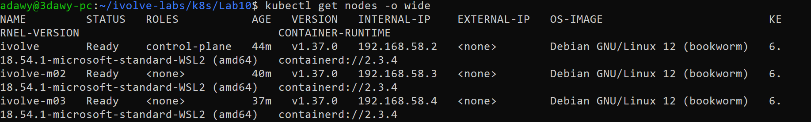
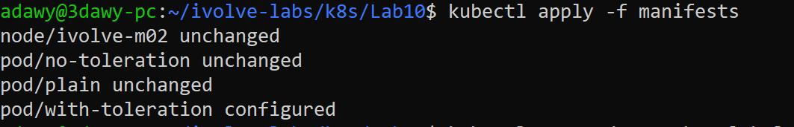
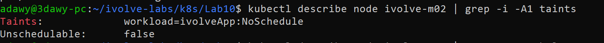
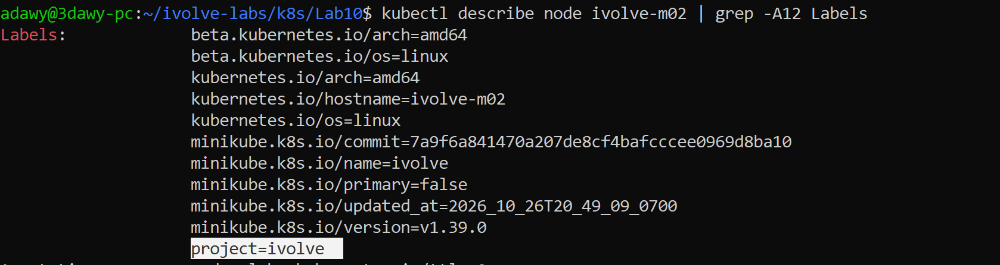
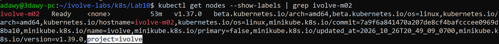
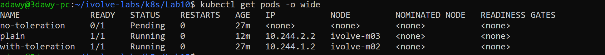
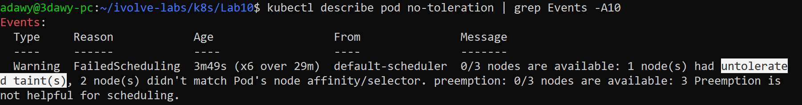

# Lab 10: Node Isolation Using Taints and Labels in Kubernetes

## Objective

Dedicate a worker node to a specific workload using Kubernetes scheduling controls:

- Apply a **taint** `workload=ivolveApp:NoSchedule` to a worker node, so pods without a matching toleration are not scheduled on it.
- Apply a **label** `project=ivolve` to the same node, so pods can target it with `nodeSelector`.
- Verify both with `kubectl describe node` and `kubectl get nodes --show-labels`.
- Prove the behavior by running three test pods.

All resources are created **declaratively** with YAML manifests and `kubectl apply`.

## Concepts

| Concept | Applied on | Role |
|---|---|---|
| **Taint** | Node | Repels pods that do not tolerate it |
| **Toleration** | Pod | Allows a pod to be scheduled on a tainted node (it does not force it) |
| **Label** + `nodeSelector` | Node / Pod | Attracts a pod to nodes that carry the label |

A taint has the form `key=value:effect`. Here: `workload=ivolveApp:NoSchedule`.

Taint effects:

- `NoSchedule`: new pods without a toleration are not scheduled on the node. Pods already running are not evicted.
- `PreferNoSchedule`: the scheduler tries to avoid the node, but it is not enforced.
- `NoExecute`: no new pods, and existing pods without a toleration are evicted.

A taint alone only **repels**, and a toleration alone only **permits**. To dedicate a node to a workload, combine the taint (keep others out), the label with `nodeSelector` (steer our pods in), and the toleration (let our pods through).

## Environment

- WSL2 + Docker Desktop
- Minikube profile `ivolve` with 3 nodes (Docker driver)
- Kubernetes v1.37.0

| Node | Role |
|---|---|
| `ivolve` | control-plane |
| `ivolve-m02` | worker (tainted and labeled in this lab) |
| `ivolve-m03` | worker |

Cluster creation:

```bash
minikube start -p ivolve --nodes 3 --driver=docker
```

## Project Structure

```
Lab10/
├── README.md
├── manifests/
│   ├── node-isolation.yaml
│   ├── pod-plain.yaml
│   ├── pod-no-toleration.yaml
│   └── pod-with-toleration.yaml
└── screenshots/
    ├── 01-get-nodes.png
    ├── 02-apply-node-and-pods.png
    ├── 03-describe-taint.png
    ├── 04-describe-labels.png
    ├── 05-show-labels.png
    ├── 06-pods-status.png
    └── 07-pending-reason.png
```

## Steps

### 1. Check the cluster nodes

```bash
kubectl config current-context
kubectl get nodes -o wide
```

The cluster has one control-plane node and two workers, all `Ready`. `ivolve-m02` is the target worker.



### 2. Apply the taint and label (declarative)

The Node is a Kubernetes object like any other. The taint goes under `spec.taints`, and the label under `metadata.labels`.

`manifests/node-isolation.yaml`:

```yaml
apiVersion: v1
kind: Node
metadata:
  name: ivolve-m02
  labels:
    project: ivolve
spec:
  taints:
    - key: workload
      value: ivolveApp
      effect: NoSchedule
```

```bash
kubectl apply -f manifests/node-isolation.yaml
```

> Note: kubectl may warn that the Node is missing the `kubectl.kubernetes.io/last-applied-configuration` annotation. This is expected because the node was created by Minikube, not by `kubectl apply`. kubectl adds the annotation and continues.

The imperative equivalent, for reference:

```bash
kubectl taint nodes ivolve-m02 workload=ivolveApp:NoSchedule
kubectl label nodes ivolve-m02 project=ivolve
```

### 3. Create the test pods

Three pods are used to verify the behavior.

`manifests/pod-plain.yaml` (no `nodeSelector`, no toleration):

```yaml
apiVersion: v1
kind: Pod
metadata:
  name: plain
spec:
  containers:
    - name: nginx
      image: nginx
```

`manifests/pod-no-toleration.yaml` (targets the labeled node, but has no toleration):

```yaml
apiVersion: v1
kind: Pod
metadata:
  name: no-toleration
spec:
  nodeSelector:
    project: ivolve
  containers:
    - name: nginx
      image: nginx
```

`manifests/pod-with-toleration.yaml` (targets the labeled node and tolerates the taint):

```yaml
apiVersion: v1
kind: Pod
metadata:
  name: with-toleration
spec:
  nodeSelector:
    project: ivolve
  tolerations:
    - key: workload
      operator: Equal
      value: ivolveApp
      effect: NoSchedule
  containers:
    - name: nginx
      image: nginx
```

```bash
kubectl apply -f manifests/
```



## Verification

### Taint

```bash
kubectl describe node ivolve-m02 | grep -i -A1 taints
```

Expected: `Taints: workload=ivolveApp:NoSchedule`



### Label

```bash
kubectl describe node ivolve-m02 | grep -A12 Labels
```

Expected: the label `project=ivolve` appears in the list.



```bash
kubectl get nodes --show-labels
```

Expected: `project=ivolve` appears on `ivolve-m02` only.



### Scheduling behavior

```bash
kubectl get pods -o wide
```



| Pod | Result | Reason |
|---|---|---|
| `plain` | Running on `ivolve-m03` | `ivolve-m02` is tainted and the control-plane carries its own taint, so the scheduler picked `m03` |
| `no-toleration` | **Pending** | It requires `project=ivolve` (only `m02`), but `m02` is tainted and the pod has no toleration |
| `with-toleration` | Running on `ivolve-m02` | The label attracts it and the toleration lets it through |

Why is `no-toleration` Pending?

```bash
kubectl describe pod no-toleration
```

The `Events` section shows a `FailedScheduling` event mentioning an untolerated taint.



## Notes

- `NoSchedule` only affects **new** scheduling decisions. System pods such as `kindnet` and `kube-proxy` keep running on `ivolve-m02` because they are managed by DaemonSets that tolerate all taints.
- `kubectl apply` replaces the whole `spec.taints` list. Any other taint on the node would be removed, so be careful when applying this to nodes that already have taints.
- In real environments, node taints are usually set when the node group is created (Terraform, EKS managed node groups, or `kubelet --register-with-taints`), for example for GPU nodes or dedicated database nodes.

## Cleanup (optional)

```bash
kubectl delete -f manifests/pod-plain.yaml -f manifests/pod-no-toleration.yaml -f manifests/pod-with-toleration.yaml
```

To remove the taint and label from the node (the trailing `-` removes them):

```bash
kubectl taint nodes ivolve-m02 workload=ivolveApp:NoSchedule-
kubectl label nodes ivolve-m02 project-
```

To delete the whole cluster:

```bash
minikube delete -p ivolve
```

## References

- [Taints and Tolerations](https://kubernetes.io/docs/concepts/scheduling-eviction/taint-and-toleration/)
- [Assigning Pods to Nodes](https://kubernetes.io/docs/concepts/scheduling-eviction/assign-pod-node/)
- `kubectl explain pod.spec.tolerations`
- `kubectl explain pod.spec.nodeSelector`
