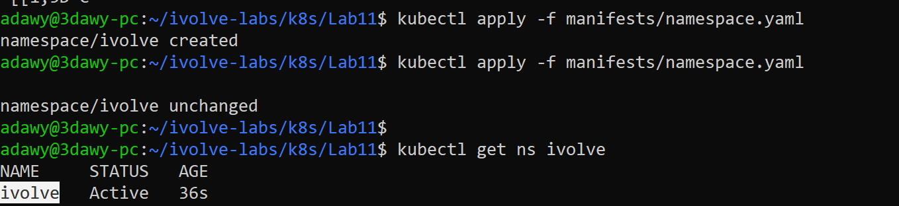
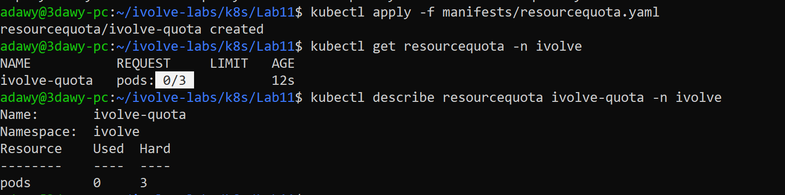
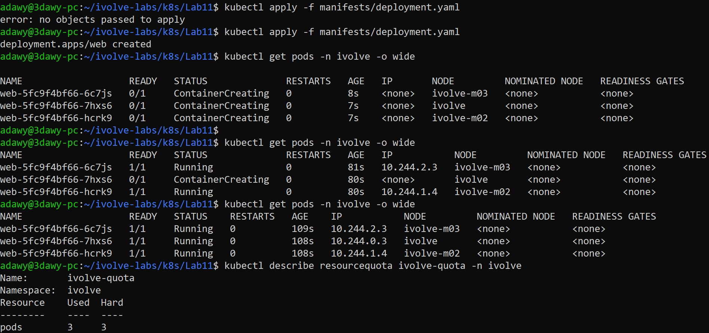
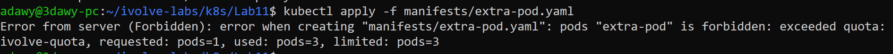
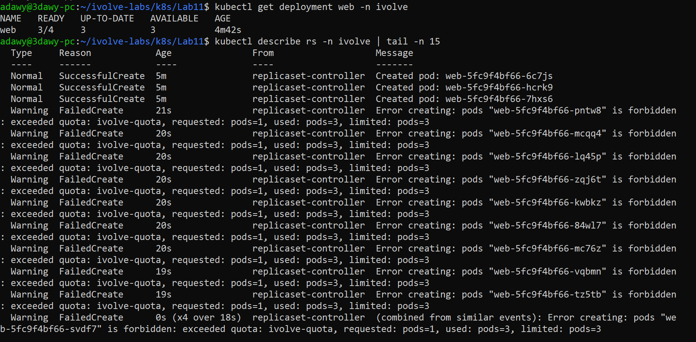

# Lab 11: Namespace Management and Resource Quota Enforcement

## Objective

- Create a Kubernetes namespace named `ivolve` to isolate application resources.
- Create a `ResourceQuota` in the `ivolve` namespace that limits the total number of pods to **3**.
- Verify that the quota is applied and that Kubernetes rejects any pod that would exceed the limit.

All resources are created **declaratively** with YAML manifests and `kubectl apply`.

## Concepts

**Namespace**: a logical partition inside a cluster. It isolates resource names (the same pod name can exist in two namespaces), and it is the scope where RBAC and quotas are applied. It is an organizational boundary, not a full network or security boundary. Typical uses are one namespace per environment (dev/stg/prod) or per team.

**ResourceQuota**: a cap on the **total** consumption of a namespace, not per pod. It can limit object counts (pods, services, secrets, ...) and the sum of CPU, memory and storage. Here: `pods: "3"`.

**How it is enforced**: quotas are checked by the API server during admission, when an object is **created**. If `used + requested > hard`, the request is rejected immediately with `403 Forbidden: exceeded quota`. The pod is never created (it is not Pending and nothing is evicted). Pods that already exist keep running.

## Environment

- WSL2 + Docker Desktop
- Minikube profile `ivolve` with 3 nodes (Docker driver), Kubernetes v1.37.0

## Project Structure

```
Lab11/
├── README.md
├── manifests/
│   ├── 01-namespace.yaml
│   ├── 02-resourcequota.yaml
│   ├── 03-deployment.yaml
│   └── tests/
│       └── 04-extra-pod.yaml
└── screenshots/
    ├── 01-namespace.png
    ├── 02-quota-created.png
    ├── 03-deployment-for-full-quota.png
    ├── 04-extra-pod-quota-exceeded.png
    └── 05-deployment-scale-fail.png
```

`kubectl apply -f manifests/` does not descend into subfolders, so the files under `tests/` are applied only on purpose.

## Resource Name Note

The lab asks for a quota named `ivolveQuota`. Kubernetes resource names must be lowercase RFC 1123 names (lowercase letters, digits, `-` and `.`), so a name with a capital letter is rejected by the API server. The quota is therefore named **`ivolve-quota`**.

## Steps

### 1. Create the namespace

`manifests/01-namespace.yaml`:

```yaml
apiVersion: v1
kind: Namespace
metadata:
  name: ivolve
```

```bash
kubectl apply -f manifests/01-namespace.yaml
```



### 2. Create the ResourceQuota

`manifests/02-resourcequota.yaml`:

```yaml
apiVersion: v1
kind: ResourceQuota
metadata:
  name: ivolve-quota
  namespace: ivolve
spec:
  hard:
    pods: "3"
```

```bash
kubectl apply -f manifests/02-resourcequota.yaml
```

Verify the quota (nothing is used yet, so `Used` is 0 and `Hard` is 3):

```bash
kubectl get resourcequota -n ivolve
kubectl describe resourcequota ivolve-quota -n ivolve
```



### 3. Fill the quota with a Deployment

`manifests/03-deployment.yaml` runs 3 replicas, which uses the whole pod quota:

```yaml
apiVersion: apps/v1
kind: Deployment
metadata:
  name: web
  namespace: ivolve
spec:
  replicas: 3
  selector:
    matchLabels:
      app: web
  template:
    metadata:
      labels:
        app: web
    spec:
      containers:
        - name: nginx
          image: nginx
```

```bash
kubectl apply -f manifests/03-deployment.yaml
kubectl rollout status deployment/web -n ivolve
kubectl get pods -n ivolve -o wide
kubectl describe resourcequota ivolve-quota -n ivolve
```

Three pods are Running and the quota shows `pods 3 / 3`.



## Verification: the quota blocks the 4th pod

`manifests/tests/04-extra-pod.yaml`:

```yaml
apiVersion: v1
kind: Pod
metadata:
  name: extra-pod
  namespace: ivolve
spec:
  containers:
    - name: nginx
      image: nginx
```

Applied only after the Deployment finished rolling out, so the quota is already full:

```bash
kubectl apply -f manifests/tests/04-extra-pod.yaml
kubectl get pods -n ivolve
```

The API server rejects the request with a `Forbidden` error similar to:

```
pods "extra-pod" is forbidden: exceeded quota: ivolve-quota, requested: pods=1, used: pods=3, limited: pods=3
```

The pod is not created, and the original 3 pods are untouched.



### Same limit through a controller

Changing `replicas: 3` to `replicas: 4` in `03-deployment.yaml` and re-applying it shows the same enforcement through a controller:

```bash
kubectl apply -f manifests/03-deployment.yaml
kubectl get deployment web -n ivolve
kubectl get events -n ivolve --field-selector reason=FailedCreate
```

The Deployment stays at `3/4` ready. The ReplicaSet controller keeps trying to create the 4th pod and fails with `FailedCreate` events that mention the exceeded quota. The rejection happens at pod creation time, and the Deployment itself is accepted.



## Notes

- Quota enforcement is first come, first served. Whichever create request arrives after the limit is reached is the one rejected. That is why the extra pod is applied only after the rollout completes. Applying everything at once could let `extra-pod` win the race and make one of the Deployment pods fail instead.
- The ResourceQuota here only counts pods. If it also limited CPU or memory, every pod in the namespace would need to declare resource requests/limits, otherwise it would be rejected.
- The quota applies per namespace. Other namespaces are not affected.
- Declarative workflow: the YAML files are the source of truth. Change the file and re-apply it instead of using `kubectl scale`, so the cluster and the repository stay in sync.

## Cleanup (optional)

```bash
kubectl delete -f manifests/03-deployment.yaml
kubectl delete -f manifests/02-resourcequota.yaml
kubectl delete -f manifests/01-namespace.yaml
```

Deleting the namespace also removes everything inside it. Lab 12 also uses the `ivolve` namespace, so keep it if you continue with that lab.

## References

- [Namespaces](https://kubernetes.io/docs/concepts/overview/working-with-objects/namespaces/)
- [Resource Quotas](https://kubernetes.io/docs/concepts/policy/resource-quotas/)
- [Object names and IDs](https://kubernetes.io/docs/concepts/overview/working-with-objects/names/)
- `kubectl explain resourcequota.spec.hard`
