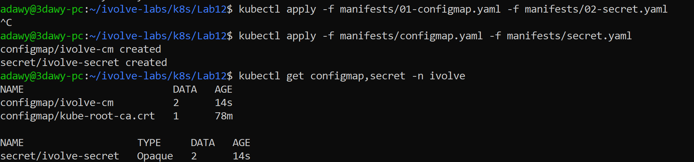
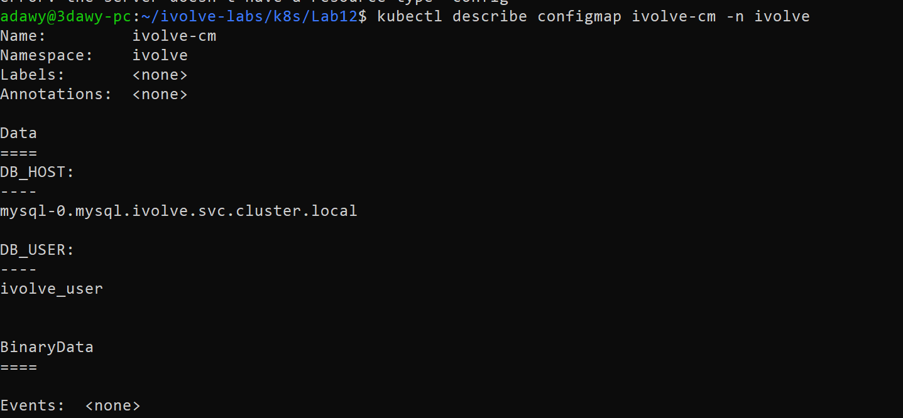
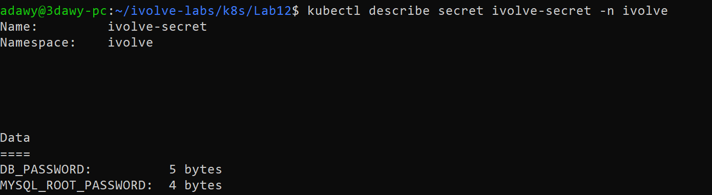

# Lab 12: Managing Configuration and Sensitive Data with ConfigMaps and Secrets

## Objective

- Create a **ConfigMap** in the `ivolve` namespace that stores the non-sensitive MySQL configuration:
  - `DB_HOST`: hostname of the MySQL StatefulSet's headless Service
  - `DB_USER`: application database user allowed to connect to the `ivolve` database
- Create a **Secret** in the `ivolve` namespace that stores the sensitive MySQL credentials:
  - `MYSQL_ROOT_PASSWORD`: root password of the MySQL database
  - `DB_PASSWORD`: password of the application user (`DB_USER`)
- Use **Base64** encoding for the Secret values in the YAML manifest.

All resources are created **declaratively** with YAML manifests and `kubectl apply`.

## Concepts

Configuration should live outside the container image. Otherwise every change needs a rebuild, and credentials end up baked into images or pod specs.

| | ConfigMap | Secret |
|---|---|---|
| Stores | Non-sensitive settings | Sensitive data (passwords, tokens) |
| Values in YAML | Plain text under `data` | Base64 under `data` (or plain text under `stringData`) |
| `describe` output | Shows the values | Shows only key names and sizes |

Pods consume both as environment variables (`env` / `envFrom`) or as files (volume mounts).

**Base64 is encoding, not encryption.** Anyone with read access to the Secret can decode it with `base64 -d`. Kubernetes stores Secrets unencrypted in etcd unless encryption at rest is enabled. In real environments Secrets are protected with RBAC and managed through tools such as Sealed Secrets, External Secrets, SOPS, Vault or AWS Secrets Manager. Real credentials are never committed to Git.

## Environment

- WSL2 + Docker Desktop
- Minikube profile `ivolve` with 3 nodes (Docker driver), Kubernetes v1.37.0
- Namespace `ivolve` (created in Lab 11)

## Project Structure

```
Lab12/
├── .gitignore
├── README.md
├── manifests/
│   ├── configmap.yaml
│   └── secret.example.yaml
└── screenshots/
    ├── 01-apply-and-get-config-and-secret.png
    ├── 02-describe-configmap.png
    └── 02-describe-secret.png
```

The Secret manifest with the real values (`manifests/secret.yaml`) is kept **locally** and listed in `.gitignore`, so it is not part of the repository. The repository contains `secret.example.yaml`, the same manifest with placeholders instead of values.

## Resource Name Note

The lab names the resources `ivolveCM` and `ivolveSecret`. Kubernetes resource names must be lowercase RFC 1123 names, so names with capital letters are rejected by the API server. They are therefore named **`ivolve-cm`** and **`ivolve-secret`**. The keys inside (`DB_HOST`, `DB_USER`, `MYSQL_ROOT_PASSWORD`, `DB_PASSWORD`) keep their capital letters, which is allowed for keys.

## Steps

### 1. Create the ConfigMap

`manifests/configmap.yaml`:

```yaml
apiVersion: v1
kind: ConfigMap
metadata:
  name: ivolve-cm
  namespace: ivolve
data:
  DB_HOST: mysql-0.mysql.ivolve.svc.cluster.local
  DB_USER: ivolve_user
```

`DB_HOST` follows the DNS format of a pod behind a headless Service: `<pod>.<service>.<namespace>.svc.cluster.local`. Here the StatefulSet pod is `mysql-0` and the headless Service is `mysql`, which gives a stable name for that specific pod.

### 2. Encode the Secret values with Base64

```bash
echo -n '<root-password>' | base64
echo -n '<app-password>' | base64
```

`-n` is important. Without it `echo` appends a newline, which becomes part of the encoded password and breaks authentication later.

### 3. Create the Secret

`manifests/secret.example.yaml` is the template kept in the repository:

```yaml
apiVersion: v1
kind: Secret
metadata:
  name: ivolve-secret
  namespace: ivolve
type: Opaque
data:
  MYSQL_ROOT_PASSWORD: <BASE64_ENCODED_VALUE>
  DB_PASSWORD: <BASE64_ENCODED_VALUE>
```

Create the real manifest from the template and put the encoded values from step 2 in it:

```bash
cp manifests/secret.example.yaml manifests/secret.yaml
nano manifests/secret.yaml
```

`manifests/secret.yaml` is ignored by Git (see `.gitignore`).

### 4. Apply both manifests

```bash
kubectl apply -f manifests/configmap.yaml -f manifests/secret.yaml
kubectl get configmap,secret -n ivolve
```

The ConfigMap `kube-root-ca.crt` also appears in the list. Kubernetes creates it automatically in every namespace.



## Verification

### ConfigMap

```bash
kubectl describe configmap ivolve-cm -n ivolve
```

The `Data` section shows `DB_HOST` and `DB_USER` with their values.



### Secret

```bash
kubectl describe secret ivolve-secret -n ivolve
```

The `Data` section shows only the key names (`MYSQL_ROOT_PASSWORD`, `DB_PASSWORD`) and their size in bytes. The values are not printed, which is the default protection of `describe` for Secrets.



## Notes

- A stored value can still be read back by anyone allowed to `get` the Secret, for example with `kubectl get secret ivolve-secret -n ivolve -o jsonpath='{.data.DB_PASSWORD}' | base64 -d`. That is why Base64 is not a security mechanism, and why access to Secrets is restricted with RBAC.
- Secret manifests with real values are not committed to Git. This repository keeps a placeholder template and ignores the real file. In production the usual approaches are Sealed Secrets or SOPS (encrypted values that can be stored in Git), or External Secrets Operator with AWS Secrets Manager or Vault (the value lives outside the cluster and Git).
- Secrets and ConfigMaps are namespaced. A pod can only reference them from its own namespace, which is why both are created in `ivolve`.
- Pods consume these objects with `envFrom` (`configMapRef` / `secretRef`) or per variable with `valueFrom`. Consuming them from a MySQL StatefulSet is outside the scope of this lab.
- The ResourceQuota from Lab 11 limits only the number of pods, so creating a ConfigMap or Secret is not affected by it.

## Cleanup (optional)

```bash
kubectl delete -f manifests/configmap.yaml -f manifests/secret.yaml
```

## References

- [ConfigMaps](https://kubernetes.io/docs/concepts/configuration/configmap/)
- [Secrets](https://kubernetes.io/docs/concepts/configuration/secret/)
- [Headless Services and Pod DNS](https://kubernetes.io/docs/concepts/services-networking/dns-pod-service/)
- `kubectl explain secret.data`
