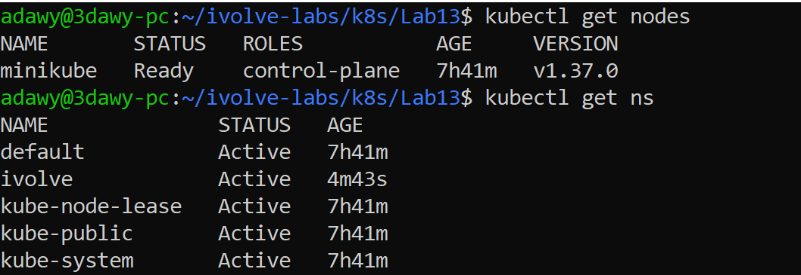
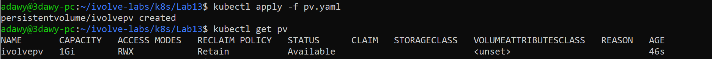
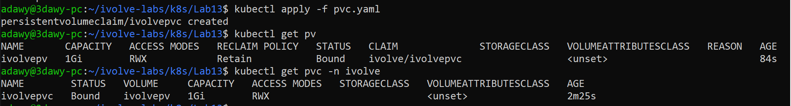
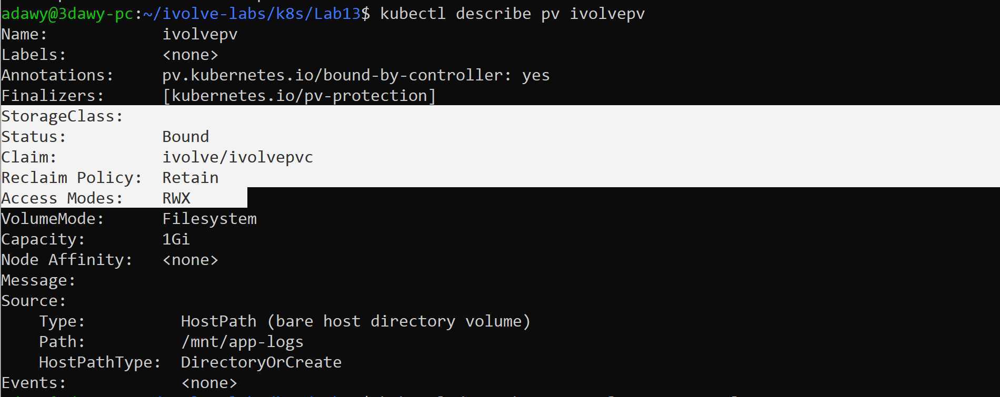
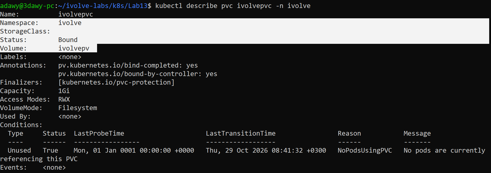
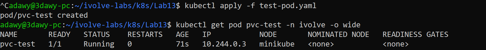
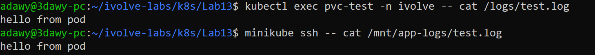
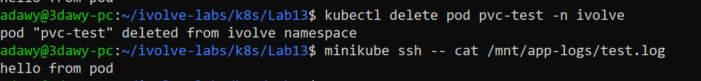

# Lab 13: Persistent Storage Setup for Application Logging

## Objective

Containers have an ephemeral filesystem: when a Pod is deleted, everything written inside it is lost.
In this lab I create **persistent storage** for application logs using a **PersistentVolume (PV)** and a **PersistentVolumeClaim (PVC)**, without any StorageClass (static provisioning), and then prove that data survives Pod deletion.

## Requirements

| Object | Requirement |
|---|---|
| PV | Name `ivolvepv`, size `1Gi`, type `hostPath`, path `/mnt/app-logs`, access mode `ReadWriteMany`, reclaim policy `Retain` |
| PVC | Name `ivolvepvc`, requests `1Gi`, access mode `ReadWriteMany` (matches the PV) |
| StorageClass | Not used |

> Kubernetes object names must be lowercase (RFC 1123), so `ivolvePV` / `ivolvePVC` are written as `ivolvepv` / `ivolvepvc`.

## Environment

- Windows + WSL2 (Ubuntu 24.04) + Docker Desktop
- Minikube (docker driver) running inside WSL
- Namespace: `ivolve`

## Folder Structure

```
Lab13/
├── README.md
├── manifests/
│   ├── pv.yaml
│   ├── pvc.yaml
│   └── test-pod.yaml
└── screenshots/
    ├── 01-nodes-and-namespace.png
    ├── 02-pv-available.png
    ├── 03-pv-pvc-bound.png
    ├── 04-describe-pv.png
    ├── 05-describe-pvc.png
    ├── 06-test-pod-running.png
    ├── 07-pod-to-node-storage-sync.png
    └── 08-data-persisted.png
```

## Concepts

| Object | Role | Analogy |
|---|---|---|
| **PV** | The actual storage, prepared by the admin. Cluster-wide (no namespace). | A hall ready to be rented |
| **PVC** | A request for storage made by an application. Namespaced. | A booking request for the hall |
| **Pod** | Uses the PVC only; it never needs to know where the storage really is. | The guest |

Kubernetes binds a PVC to a PV when **size, access mode and storageClassName match**. Once matched, both show `Bound`.

Key settings explained:

- **`ReadWriteMany`**: many nodes/replicas can read and write at the same time.
- **`Retain`**: if the PVC is deleted, the PV and its data are kept (the opposite of `Delete`).
- **`storageClassName: ""`**: means "no StorageClass". This matters on Minikube, which has a default StorageClass called `standard`. Without this line the PVC could be given that default class and would not bind to our manual PV.
- **`hostPath`**: uses a directory on the node's filesystem. In Minikube the node is the Minikube container, **not** the WSL filesystem.

## Relation to Previous Labs

| Previous Lab | Relation |
|---|---|
| **Lab 8** (Docker Compose) | Same idea as the `db_data` and logs volumes, now done the Kubernetes way with PV/PVC. |
| **Lab 9** (kubeadm) | Here I use Minikube instead as the cluster. |
| **Lab 10** (taints and labels) | Not needed in this lab because PV/PVC are storage objects and are not scheduled on nodes. It is used in Lab 14. |
| **Lab 11** (namespace) | The PVC lives in the `ivolve` namespace. |
| **Lab 12** (ConfigMap/Secret) | Not needed here. Used in Lab 14. |

This lab is the base for **Lab 14**, where a StatefulSet (MySQL) uses persistent storage the same way.

> Note: the Minikube cluster was recreated before this lab, so the `ivolve` namespace was created again with `kubectl create ns ivolve`.

---

## Steps

### Step 1: Verify the cluster and namespace

```bash
kubectl get nodes
kubectl get ns
```

If the namespace is missing:

```bash
kubectl create ns ivolve
```

Optional: make `ivolve` the default namespace of the current context so `-n ivolve` can be omitted:

```bash
kubectl config set-context --current --namespace=ivolve
```



### Step 2: Create the PersistentVolume

`manifests/pv.yaml`:

```yaml
apiVersion: v1
kind: PersistentVolume
metadata:
  name: ivolvepv
spec:
  capacity:
    storage: 1Gi
  accessModes:
    - ReadWriteMany
  persistentVolumeReclaimPolicy: Retain
  storageClassName: ""
  hostPath:
    path: /mnt/app-logs
    type: DirectoryOrCreate
```

```bash
kubectl apply -f manifests/pv.yaml
kubectl get pv
```

The status is `Available`: the PV exists and is waiting for a claim.



### Step 3: Create the PersistentVolumeClaim

`manifests/pvc.yaml`:

```yaml
apiVersion: v1
kind: PersistentVolumeClaim
metadata:
  name: ivolvepvc
  namespace: ivolve
spec:
  accessModes:
    - ReadWriteMany
  resources:
    requests:
      storage: 1Gi
  storageClassName: ""
```

```bash
kubectl apply -f manifests/pvc.yaml
kubectl get pv
kubectl get pvc -n ivolve
```

Both are now `Bound`, and the PV `CLAIM` column shows `ivolve/ivolvepvc`.



### Step 4: Inspect the details

```bash
kubectl describe pv ivolvepv
kubectl describe pvc ivolvepvc -n ivolve
```

Check: capacity `1Gi`, access mode `RWX`, reclaim policy `Retain`, path `/mnt/app-logs`, empty StorageClass, status `Bound`.





### Step 5: Prove the storage works with a test Pod

A `Bound` status only means Kubernetes matched the two objects on paper. To prove the storage really works, a small Pod mounts the PVC and writes a file into it.

`manifests/test-pod.yaml`:

```yaml
apiVersion: v1
kind: Pod
metadata:
  name: pvc-test
  namespace: ivolve
spec:
  containers:
    - name: busybox
      image: busybox
      command: ["sh", "-c", "echo 'hello from pod' > /logs/test.log && sleep 3600"]
      volumeMounts:
        - name: logs
          mountPath: /logs
  volumes:
    - name: logs
      persistentVolumeClaim:
        claimName: ivolvepvc
```

```bash
kubectl apply -f manifests/test-pod.yaml
kubectl get pod pvc-test -n ivolve -o wide
```



Read the file from inside the Pod and from the node itself:

```bash
kubectl exec pvc-test -n ivolve -- cat /logs/test.log
minikube ssh -- cat /mnt/app-logs/test.log
```

Both print `hello from pod`: the data written inside the Pod really lives at `/mnt/app-logs` on the node.



### Step 6: Prove the data survives Pod deletion

```bash
kubectl delete pod pvc-test -n ivolve
minikube ssh -- cat /mnt/app-logs/test.log
```

The Pod is gone but the file is still there. This is the whole purpose of persistent storage.



---

## Notes

- **Do not delete the PVC casually.** With `Retain`, deleting the PVC moves the PV to `Released`. It keeps the data but will not bind to a new PVC until it is cleaned manually (for example by removing `claimRef`, or deleting and recreating the PV).
- PV is cluster-scoped (no `-n`), PVC is namespaced (`-n ivolve`).
- `hostPath` is suitable for labs and single-node clusters like Minikube, not for production multi-node clusters.

## Cleanup (optional)

```bash
kubectl delete pod pvc-test -n ivolve --ignore-not-found
kubectl delete pvc ivolvepvc -n ivolve
kubectl delete pv ivolvepv
```

## Push to GitHub

```bash
cd ~/ivolve-labs
find k8s/Lab13 -name "*Zone.Identifier" -type f -delete
git status
git add k8s/Lab13
git commit -m "Add Lab13: PersistentVolume and PersistentVolumeClaim for app logs"
git push origin main
```
