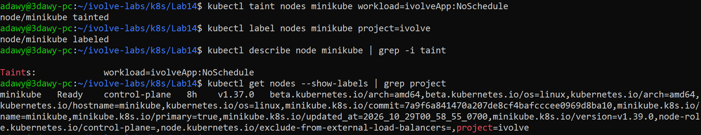
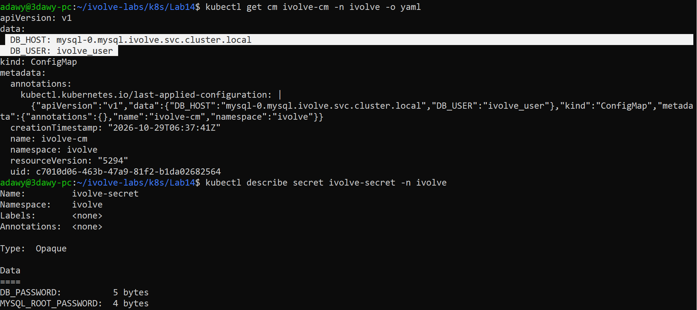
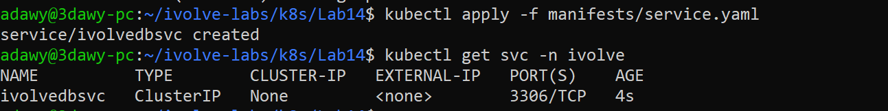
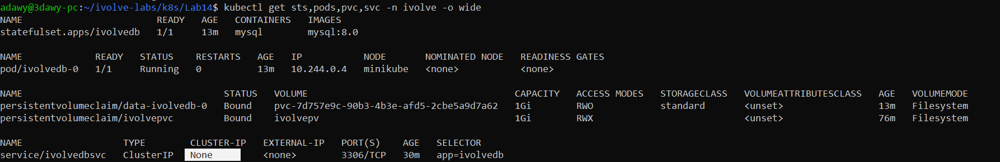
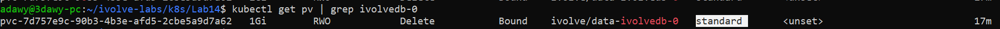
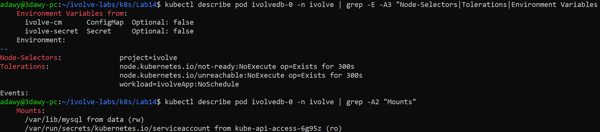
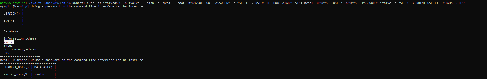
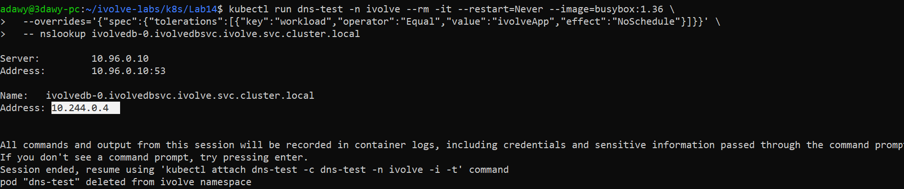

# Lab 14: StatefulSet with Headless Service

## Objective

Deploy a **MySQL database as a StatefulSet** in the `ivolve` namespace, exposed through a **headless Service**, configured from the ConfigMap and Secret created in Lab 12, scheduled on a dedicated node (Lab 10), and storing its data on a persistent volume created from a **PVC template**.

## Requirements

| Item | Requirement |
|---|---|
| StatefulSet | `ivolvedb` in namespace `ivolve`, 1 replica, running MySQL |
| Environment | Variables consumed from the ConfigMap and the Secret |
| Node selection | `nodeSelector: project=ivolve` |
| Toleration | key `workload`, value `ivolveApp`, effect `NoSchedule` |
| Storage | PVC template mounted at `/var/lib/mysql` |
| Service | Headless service `ivolvedbsvc` targeting the MySQL Pod |
| Verification | Connect with a MySQL client, verify Pod DNS resolution inside the cluster |

> Kubernetes names must be lowercase (RFC 1123), so `ivolveDB` and `ivolveDBSvc` are written as `ivolvedb` and `ivolvedbsvc`.

## Environment

- Windows + WSL2 (Ubuntu 24.04) + Docker Desktop
- Minikube (docker driver), single node named `minikube`
- Namespace: `ivolve`

## Folder Structure

```
Lab14/
├── README.md
├── manifests/
│   ├── service.yaml
│   └── statefulset.yaml
└── screenshots/
    ├── 01-node-taint-and-label.png
    ├── 02-configmap-and-secret.png
    ├── 03-headless-service.png
    ├── 04-statefulset-Headless-Service-and-pod-running.png
    ├── 05-pvc-template-bound.png
    ├── 06-pod-config-verification.png
    ├── 07-mysql-connection.png
    └── 08-dns-resolution.png
```

The ConfigMap and the Secret are **not** copied here. They are reused from `Lab12/manifests/` (the real Secret file is kept local and is not pushed to GitHub).

## Concepts

**StatefulSet vs Deployment**

| | Deployment | StatefulSet |
|---|---|---|
| Pod name | Random (`app-7d9f-xk2p`) | Stable and ordered (`ivolvedb-0`) |
| Storage | Shared volume or none | **Each Pod gets its own PVC** (from `volumeClaimTemplates`) |
| Pod deleted | Comes back with a new name | Comes back with the **same name and same PVC** |

That is why databases such as MySQL are run as StatefulSets.

**Headless Service** (`clusterIP: None`): it does not provide a single virtual IP. Instead DNS returns the Pod addresses directly and gives every Pod a stable DNS name:

```
<pod-name>.<service-name>.<namespace>.svc.cluster.local
ivolvedb-0.ivolvedbsvc.ivolve.svc.cluster.local
```

**PVC template naming:** a StatefulSet builds the PVC name as `<template name>-<statefulset name>-<ordinal>`, so the template `data` for `ivolvedb` produces the PVC `data-ivolvedb-0`. The ordinal is what ties a Pod to its own storage, so when `ivolvedb-0` is recreated it re-attaches to the same PVC and keeps its data.

**nodeSelector + toleration:** the taint (Lab 10) repels every Pod that does not tolerate it, the toleration lets this Pod onto the tainted node, and the nodeSelector makes sure the Pod goes only to the node labeled `project=ivolve`.

## Relation to Previous Labs

| Previous Lab | How it is used here |
|---|---|
| **Lab 8** (Docker Compose) | Same idea: MySQL with a persistent data volume and a database called `ivolve`. |
| **Lab 10** (taints and labels) | The node taint `workload=ivolveApp:NoSchedule` and label `project=ivolve` are what the toleration and nodeSelector match. |
| **Lab 11** (namespace) | Everything lives in the `ivolve` namespace. |
| **Lab 12** (ConfigMap/Secret) | `ivolve-cm` and `ivolve-secret` provide the MySQL environment variables. `DB_HOST` points to the headless service `ivolvedbsvc`. |
| **Lab 13** (PV/PVC) | Same storage concept, but here the PVC is created automatically by `volumeClaimTemplates` and the PV is provisioned dynamically by Minikube's default StorageClass. The Lab 13 `ivolvepvc` is not used by this StatefulSet. |

> The Minikube cluster was recreated before these labs, so the Lab 10 taint/label and the Lab 12 ConfigMap/Secret had to be applied again (Steps 1 and 2).

---

## Steps

### Step 1: Apply the node taint and label (Lab 10)

```bash
kubectl get nodes
kubectl taint nodes minikube workload=ivolveApp:NoSchedule
kubectl label nodes minikube project=ivolve
kubectl describe node minikube | grep -i taint
kubectl get nodes --show-labels | grep project
```



### Step 2: Apply the ConfigMap and the Secret (Lab 12)

```bash
kubectl apply -f ../Lab12/manifests/configmap.yaml -f ../Lab12/manifests/secret.yaml
kubectl get cm,secret -n ivolve
kubectl get cm ivolve-cm -n ivolve -o yaml
kubectl describe secret ivolve-secret -n ivolve
```

Checks before continuing:
- `DB_HOST` equals the headless service name `ivolvedbsvc`.
- `DB_USER` is not `root` (MySQL refuses `MYSQL_USER=root`).
- The Secret contains `MYSQL_ROOT_PASSWORD` and `DB_PASSWORD`. `describe` shows only the key names, never the values.



### Step 3: Create the headless Service

`manifests/service.yaml`:

```yaml
apiVersion: v1
kind: Service
metadata:
  name: ivolvedbsvc
  namespace: ivolve
spec:
  clusterIP: None
  selector:
    app: ivolvedb
  ports:
    - name: mysql
      port: 3306
      targetPort: 3306
```

- `clusterIP: None` makes the service headless (no virtual IP, DNS returns the Pod IPs).
- `selector: app=ivolvedb` must match the labels of the StatefulSet Pods.

```bash
kubectl apply -f manifests/service.yaml
kubectl get svc -n ivolve
```

`CLUSTER-IP` shows `None`.



### Step 4: Create the StatefulSet

`manifests/statefulset.yaml`:

```yaml
apiVersion: apps/v1
kind: StatefulSet
metadata:
  name: ivolvedb
  namespace: ivolve
spec:
  serviceName: ivolvedbsvc
  replicas: 1
  selector:
    matchLabels:
      app: ivolvedb
  template:
    metadata:
      labels:
        app: ivolvedb
    spec:
      nodeSelector:
        project: ivolve
      tolerations:
        - key: "workload"
          operator: "Equal"
          value: "ivolveApp"
          effect: "NoSchedule"
      containers:
        - name: mysql
          image: mysql:8.0
          ports:
            - name: mysql
              containerPort: 3306
          envFrom:
            - configMapRef:
                name: ivolve-cm
            - secretRef:
                name: ivolve-secret
          env:
            - name: MYSQL_DATABASE
              value: ivolve
            - name: MYSQL_USER
              valueFrom:
                configMapKeyRef:
                  name: ivolve-cm
                  key: DB_USER
            - name: MYSQL_PASSWORD
              valueFrom:
                secretKeyRef:
                  name: ivolve-secret
                  key: DB_PASSWORD
          volumeMounts:
            - name: data
              mountPath: /var/lib/mysql
  volumeClaimTemplates:
    - metadata:
        name: data
      spec:
        accessModes: ["ReadWriteOnce"]
        resources:
          requests:
            storage: 1Gi
```

What each part does:
- `serviceName: ivolvedbsvc` links the StatefulSet to the headless service (needed for the stable Pod DNS name).
- `nodeSelector` and `tolerations` place the Pod on the node prepared in Lab 10.
- `envFrom` loads **all** keys of the ConfigMap and the Secret as environment variables (this also provides `MYSQL_ROOT_PASSWORD`).
- The explicit `env` entries map the lab variables to the names the MySQL image understands: `DB_USER` to `MYSQL_USER`, `DB_PASSWORD` to `MYSQL_PASSWORD`, plus the database name `ivolve`.
- `volumeClaimTemplates` creates the PVC `data-ivolvedb-0`. No `storageClassName` is set, so Minikube's default StorageClass (`standard`) provisions the PV automatically.
- `mountPath: /var/lib/mysql` is the MySQL data directory.

```bash
kubectl apply -f manifests/statefulset.yaml
kubectl get pods -n ivolve -w
```

The first start takes a few minutes while the `mysql:8.0` image is pulled (`ContainerCreating`, then `1/1 Running`). The `-w` flag prints a new line each time the Pod state changes, it is still the same Pod.

```bash
kubectl get sts,pods,pvc,svc -n ivolve -o wide
kubectl get pv
```



The PVC `data-ivolvedb-0` is `Bound` to a PV that was created automatically:



### Step 5: Verify the Pod configuration

```bash
kubectl describe pod ivolvedb-0 -n ivolve | grep -E -A3 "Node-Selectors|Tolerations|Environment Variables from"
kubectl describe pod ivolvedb-0 -n ivolve | grep -A2 "Mounts"
```

Confirms the nodeSelector `project=ivolve`, the toleration `workload=ivolveApp:NoSchedule`, the ConfigMap and Secret as environment sources, and the mount at `/var/lib/mysql`.



### Step 6: Connect with a MySQL client

The client runs inside the Pod. The passwords are read from the container environment, so they never appear on the terminal.

```bash
kubectl exec -it ivolvedb-0 -n ivolve -- bash -c 'mysql -uroot -p"$MYSQL_ROOT_PASSWORD" -e "SELECT VERSION(); SHOW DATABASES;"; mysql -u"$MYSQL_USER" -p"$MYSQL_PASSWORD" ivolve -e "SELECT CURRENT_USER(), DATABASE();"'
```

- The first connection uses `root` and shows that the `ivolve` database exists.
- The second connection uses the application user from the ConfigMap/Secret, proving that they were applied correctly.

A warning about using a password on the command line is expected and harmless.



### Step 7: Verify DNS resolution inside the cluster

A temporary Pod is used to query the cluster DNS. The node is tainted, so the temporary Pod needs the toleration too (passed with `--overrides`), otherwise it would stay `Pending`.

```bash
kubectl run dns-test -n ivolve --rm -it --restart=Never --image=busybox:1.36 \
  --overrides='{"spec":{"tolerations":[{"key":"workload","operator":"Equal","value":"ivolveApp","effect":"NoSchedule"}]}}' \
  -- nslookup ivolvedb-0.ivolvedbsvc.ivolve.svc.cluster.local
kubectl get pod ivolvedb-0 -n ivolve -o wide
```

The DNS name resolves to the Pod IP, and it matches the `IP` column of `kubectl get pod -o wide`. The messages about the session being recorded and pressing Enter are printed by `kubectl run -it` and are not errors.



---

## Notes

- Apply order matters: node taint/label, ConfigMap/Secret, headless service, then the StatefulSet. Without the ConfigMap/Secret the Pod fails with `CreateContainerConfigError`, and without the node label it stays `Pending`.
- If the ConfigMap is edited after the Pod started, delete the Pod so it restarts with the new values.
- The real `secret.yaml` is kept out of Git (`.gitignore`); only a placeholder example is committed in Lab 12.
- Deleting the StatefulSet does not delete its PVCs. Remove `data-ivolvedb-0` manually if it is no longer needed.

## Cleanup (optional)

```bash
kubectl delete -f manifests/statefulset.yaml
kubectl delete -f manifests/service.yaml
kubectl delete pvc data-ivolvedb-0 -n ivolve
```

## Push to GitHub

```bash
cd ~/ivolve-labs
find k8s/Lab14 -name "*Zone.Identifier" -type f -delete
git status
git add k8s/Lab14
git commit -m "Add Lab14: MySQL StatefulSet with headless service and PVC template"
git push origin main
```
