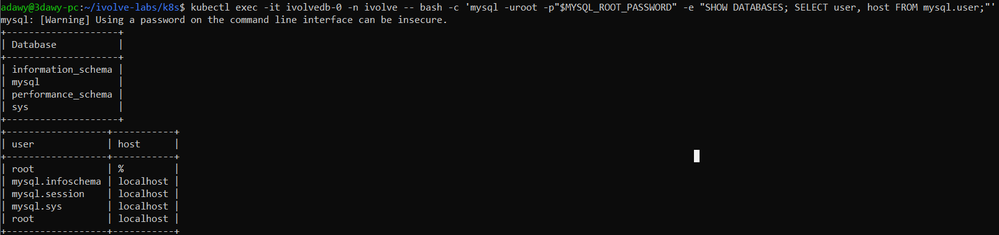
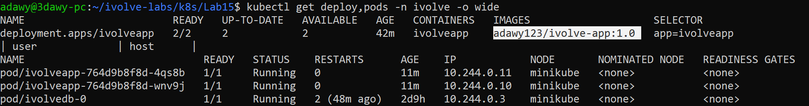
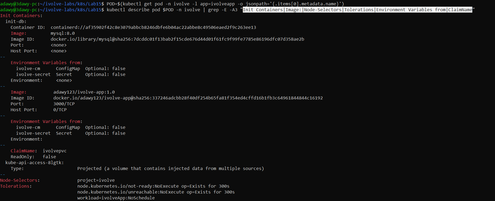
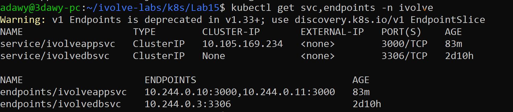
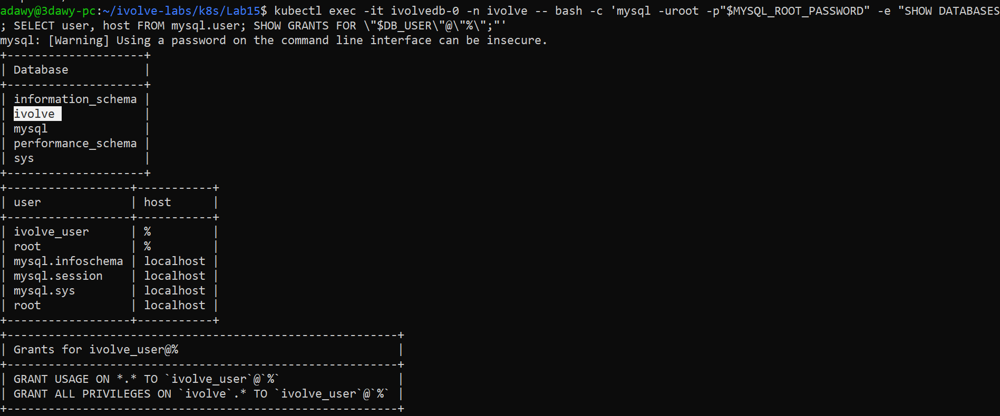
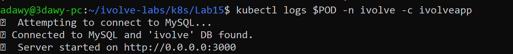

# Lab 15: Node.js Application Deployment with ClusterIP Service

## Objective

Deploy the iVolve Node.js application (the custom image built in Lab 8) on Kubernetes and connect it to the MySQL StatefulSet from Lab 14.
An **init container** prepares the `ivolve` database and the application user before the application starts, and a **ClusterIP Service** load-balances traffic across the application Pods.

## Requirements

| Item | Requirement |
|---|---|
| Deployment | `ivolveapp` in namespace `ivolve`, 2 replicas |
| Image | Custom image from Docker Hub created in Lab 8 |
| Environment | Variables from the existing ConfigMap and Secret |
| Node selection | `nodeSelector: project=ivolve` |
| Toleration | key `workload`, value `ivolveApp`, effect `NoSchedule` |
| Storage | Pods use the PersistentVolume from Lab 13 |
| Init container | MySQL client image: creates the `ivolve` database and grants the application user privileges, using ConfigMap/Secret variables |
| Service | ClusterIP service in `ivolve` to distribute traffic across the Pods |
| Verification | Connect to MySQL manually (database + privileges), check the application logs |

> Kubernetes names must be lowercase, so `ivolveApp` is `ivolveapp`. The service is named `ivolveappsvc`.

## Environment

- Windows + WSL2 (Ubuntu 24.04) + Docker Desktop
- Minikube (docker driver), single node `minikube`
- Namespace: `ivolve`
- Image: `adawy123/ivolve-app:1.0` (same image as the `latest` tag; a fixed tag is used so the manifest is reproducible)

## Folder Structure

```
Lab15/
├── README.md
├── manifests/
│   ├── deployment.yaml
│   └── service.yaml
└── screenshots/
    ├── 01-mysql-before-init.png
    ├── 02-deployment-and-pods-running.png
    ├── 03-pod-config-verification.png
    ├── 04-service-and-endpoints.png
    ├── 05-mysql-verification.png
    └── 06-app-logs-db-connection.png
```

The ConfigMap, the Secret, the PV/PVC, the StatefulSet and the headless service already exist in the cluster from previous labs, so they are **not copied** here.

## Workflow

```
 Docker Hub (image from Lab 8)
        |  pull
        v
 Deployment ivolveapp (2 replicas) --scheduled on--> node with label project=ivolve
 |                                                    and taint workload=ivolveApp (Lab 10)
 |  each Pod:
 |   1) init container (mysql:8.0) --> ivolvedbsvc:3306 --> ivolvedb-0 (Lab 14)
 |        waits for MySQL, then creates database ivolve, the app user and its privileges
 |        when it succeeds -->
 |   2) application container (Node.js, port 3000)
 |        |- environment from ivolve-cm + ivolve-secret (Lab 12)
 |        '- /app/logs --> PVC ivolvepvc --> PV ivolvepv --> /mnt/app-logs on the node (Lab 13)
 v
 Service ivolveappsvc (ClusterIP, port 3000) --> load-balances across the 2 Pods
```

## Concepts

- **Init container:** runs before the application container and must finish successfully, otherwise the Pod does not start. The Lab 8 application needs a MySQL connection and an existing `ivolve` database to start, so the init container guarantees both are ready first.
- **Idempotent SQL:** the init container uses `IF NOT EXISTS`, so it is safe to run on every Pod start, whether or not the database already exists.
- **ClusterIP Service:** gives the Pods one stable internal IP and DNS name, reachable from inside the cluster only. Requests are spread across the Pods listed in its endpoints.
- **`ReadWriteMany` (Lab 13):** both replicas mount the same PVC and write their logs to the same place.

## Relation to Previous Labs

| Previous Lab | How it is used here |
|---|---|
| **Lab 8** (Docker Compose) | The image `adawy123/ivolve-app:1.0`, port 3000, log path `/app/logs`, and the requirement that the `ivolve` database exists. |
| **Lab 10** (taints and labels) | The `nodeSelector` and the toleration match the node label `project=ivolve` and the taint `workload=ivolveApp:NoSchedule`. |
| **Lab 11** (namespace) | Everything runs in `ivolve`. |
| **Lab 12** (ConfigMap/Secret) | `ivolve-cm` and `ivolve-secret` feed both the init container and the application. |
| **Lab 13** (PV/PVC) | `ivolvepvc` is mounted on `/app/logs`, so logs end up in `/mnt/app-logs` on the node. |
| **Lab 14** (StatefulSet) | MySQL itself, reached through the headless service `ivolvedbsvc`. |

---

## Steps

### Step 1: Prerequisites from previous labs

These must already exist (created in Labs 10 to 14):

```bash
kubectl get nodes --show-labels | grep -o "project=ivolve"
kubectl describe node minikube | grep -i taint
kubectl get cm,secret,pvc,sts,pods,svc -n ivolve
```

### Step 2: Fix `DB_HOST` in the ConfigMap (Lab 12)

`DB_HOST` was written in Lab 12 before the MySQL names of Lab 14 existed, so it still pointed to a name that does not exist (`mysql-0.mysql.ivolve.svc.cluster.local`). The init container kept printing `Waiting for MySQL ...` because that name never resolved.

`DB_HOST` must be the headless service of the MySQL StatefulSet, `ivolvedbsvc`:

```bash
cd ~/ivolve-labs/k8s
sed -i 's|mysql-0.mysql.ivolve.svc.cluster.local|ivolvedbsvc|' Lab12/manifests/configmap.yaml
kubectl apply -f Lab12/manifests/configmap.yaml
kubectl get cm ivolve-cm -n ivolve -o jsonpath='{.data}'; echo
```

Pods read the ConfigMap only when they start, so the Deployment was restarted after this change (Step 5).

### Step 3: Create the Deployment

`manifests/deployment.yaml`:

```yaml
apiVersion: apps/v1
kind: Deployment
metadata:
  name: ivolveapp
  namespace: ivolve
spec:
  replicas: 2
  selector:
    matchLabels:
      app: ivolveapp
  template:
    metadata:
      labels:
        app: ivolveapp
    spec:
      nodeSelector:
        project: ivolve
      tolerations:
        - key: "workload"
          operator: "Equal"
          value: "ivolveApp"
          effect: "NoSchedule"
      initContainers:
        - name: init-db
          image: mysql:8.0
          envFrom:
            - configMapRef:
                name: ivolve-cm
            - secretRef:
                name: ivolve-secret
          command: ["sh", "-c"]
          args:
            - |
              until mysqladmin ping -h"$DB_HOST" -uroot -p"$MYSQL_ROOT_PASSWORD" --silent; do
                echo "Waiting for MySQL at $DB_HOST ..."
                sleep 3
              done
              mysql -h"$DB_HOST" -uroot -p"$MYSQL_ROOT_PASSWORD" -e "
                CREATE DATABASE IF NOT EXISTS ivolve;
                CREATE USER IF NOT EXISTS '$DB_USER'@'%' IDENTIFIED BY '$DB_PASSWORD';
                GRANT ALL PRIVILEGES ON ivolve.* TO '$DB_USER'@'%';
                FLUSH PRIVILEGES;"
              echo "Database ivolve is ready"
      containers:
        - name: ivolveapp
          image: adawy123/ivolve-app:1.0
          ports:
            - containerPort: 3000
          envFrom:
            - configMapRef:
                name: ivolve-cm
            - secretRef:
                name: ivolve-secret
          env:
            - name: DB_NAME
              value: ivolve
          volumeMounts:
            - name: app-logs
              mountPath: /app/logs
      volumes:
        - name: app-logs
          persistentVolumeClaim:
            claimName: ivolvepvc
```

What each part does:

- `nodeSelector` and `tolerations` place the Pods on the node prepared in Lab 10.
- **Init container `init-db`** (`mysql:8.0` image, which contains the MySQL client):
  - `envFrom` gives it `DB_HOST` and `DB_USER` from the ConfigMap, and `MYSQL_ROOT_PASSWORD` and `DB_PASSWORD` from the Secret.
  - The `until mysqladmin ping` loop waits until MySQL accepts connections.
  - It connects as `root` (only root can grant privileges), creates the database `ivolve`, creates the application user and grants it `ALL PRIVILEGES` on `ivolve.*` only (not on the whole server).
- **Application container:** `envFrom` loads the ConfigMap and the Secret, `DB_NAME` tells the application which database to use, and the port is 3000.
- **Volume:** the PVC `ivolvepvc` (bound to the PV of Lab 13) is mounted on `/app/logs`.

### Step 4: Create the ClusterIP Service

`manifests/service.yaml`:

```yaml
apiVersion: v1
kind: Service
metadata:
  name: ivolveappsvc
  namespace: ivolve
spec:
  type: ClusterIP
  selector:
    app: ivolveapp
  ports:
    - port: 3000
      targetPort: 3000
```

The `selector` matches the Pod label `app=ivolveapp`, so the Service sends traffic to every ready application Pod.

```bash
cd ~/ivolve-labs/k8s/Lab15
kubectl apply -f manifests/deployment.yaml -f manifests/service.yaml
```

### Step 5: Let the init container create the database and the user

In Lab 14 the MySQL image already created the `ivolve` database and the application user at first start. To prove that the **init container** does this work, both were dropped first and the Deployment was restarted:

```bash
kubectl exec -it ivolvedb-0 -n ivolve -- bash -c 'mysql -uroot -p"$MYSQL_ROOT_PASSWORD" -e "DROP DATABASE IF EXISTS ivolve; DROP USER IF EXISTS \"$DB_USER\"@\"%\";"'
kubectl exec -it ivolvedb-0 -n ivolve -- bash -c 'mysql -uroot -p"$MYSQL_ROOT_PASSWORD" -e "SHOW DATABASES; SELECT user, host FROM mysql.user;"'
```

The database `ivolve` and the user `ivolve_user` are gone:



```bash
kubectl rollout restart deployment/ivolveapp -n ivolve
kubectl rollout status deployment/ivolveapp -n ivolve --timeout=300s
kubectl get deploy,pods -n ivolve -o wide
```

The Deployment is `2/2`, which also means the init container finished successfully on both Pods:



### Step 6: Verify the Pod configuration

```bash
POD=$(kubectl get pod -n ivolve -l app=ivolveapp -o jsonpath='{.items[0].metadata.name}')
kubectl describe pod $POD -n ivolve | grep -E -A3 "Init Containers|Image:|Node-Selectors|Tolerations|Environment Variables from|ClaimName"
```

Shows the init container, the image, the nodeSelector `project=ivolve`, the toleration `workload=ivolveApp:NoSchedule`, the ConfigMap and Secret, and the claim `ivolvepvc`.



### Step 7: Verify the ClusterIP Service

```bash
kubectl get svc,endpoints -n ivolve
```

`ivolveappsvc` is of type `ClusterIP` and its endpoints list the IPs of both application Pods, so traffic is distributed across them.



### Step 8: Connect to MySQL manually

```bash
kubectl exec -it ivolvedb-0 -n ivolve -- bash -c 'mysql -uroot -p"$MYSQL_ROOT_PASSWORD" -e "SHOW DATABASES; SELECT user, host FROM mysql.user; SHOW GRANTS FOR \"$DB_USER\"@\"%\";"'
```

The database `ivolve` and the user `ivolve_user` exist again (created by the init container, since Step 5 showed they were missing), and the user has `ALL PRIVILEGES` on `ivolve.*`.



### Step 9: Check the application logs

```bash
kubectl logs $POD -n ivolve -c ivolveapp
```

The logs show that the Node.js application connected to MySQL and the `ivolve` database.



---

## Notes

- **Apply order:** node taint/label, ConfigMap/Secret, PV/PVC, StatefulSet with its headless service, then this Deployment. A wrong `DB_HOST` does not make the init container fail, it keeps waiting (`Init:0/1`). Check its log with `kubectl logs <pod> -n ivolve -c init-db`.
- **Rollout restart:** needed after changing the ConfigMap, because Pods read it only at start.
- **Image tag:** `1.0` is used instead of `latest` so the Deployment always runs a known version.
- **Permissions:** if the application cannot write to `/app/logs` (`EACCES`), the hostPath directory on the node is owned by root. Fix with `minikube ssh -- sudo chmod 777 /mnt/app-logs` and restart the Deployment.
- The real `secret.yaml` is not committed to Git (see Lab 12).

## Cleanup (optional)

```bash
kubectl delete -f manifests/service.yaml -f manifests/deployment.yaml
```

## Push to GitHub

This lab also modified Lab 12 (`DB_HOST`), so both folders are committed:

```bash
cd ~/ivolve-labs
find k8s/Lab12 k8s/Lab15 -name "*Zone.Identifier" -type f -delete
git status
git add k8s/Lab12 k8s/Lab15
git commit -m "Add Lab15: Node.js app Deployment with init container and ClusterIP service; fix Lab12 DB_HOST"
git push origin main
```
