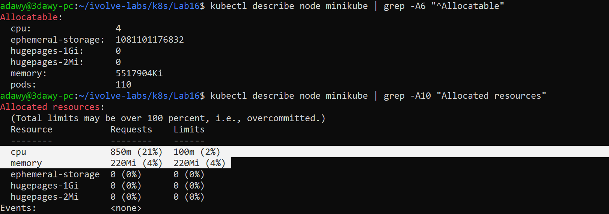
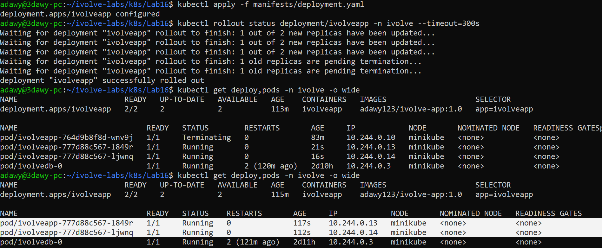
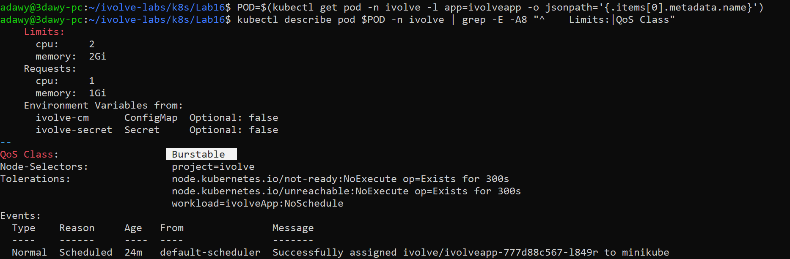
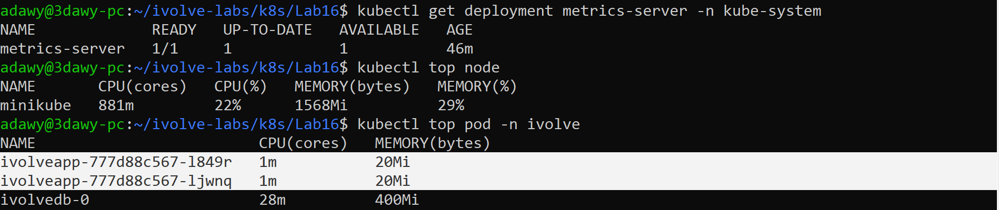

# Lab 16: Pod Resource Management with CPU and Memory Requests and Limits

## Objective

Update the existing `ivolveapp` Deployment (Lab 15) so that its application container has resource **requests** and **limits**, then verify them with `kubectl describe pod` and monitor real usage with `kubectl top pod` (this needs the metrics server running in the cluster).

## Requirements

| | Requests | Limits |
|---|---|---|
| CPU | `1` (1 vCPU) | `2` (2 vCPUs) |
| Memory | `1Gi` | `2Gi` |

## Environment

- Windows + WSL2 (Ubuntu 24.04) + Docker Desktop
- Minikube (docker driver), single node `minikube` (4 CPUs allocatable)
- Namespace: `ivolve`

## Folder Structure

```
Lab16/
├── README.md
├── manifests/
│   └── deployment.yaml
└── screenshots/
    ├── 01-check-MinikubeNode-used-and-remained-resources.png
    ├── 02-enable-metrics-server(to-use-kubectl-top).png
    ├── 03-give-it-taint-to-solve-pending-state(as-we-have-one-node-only).png
    ├── 04-verify-metrics-server-is-running.png
    ├── 05-same-lab15-deployment-but-only-add-resources(req-and-limits).png
    ├── 06-deployment-and-pods-running.png
    ├── 07-resources-and-QOS-describe.png
    └── 08-metrics-server-and-top-pods-and-nodes.png
```

`manifests/deployment.yaml` is the Lab 15 Deployment with the `resources` section added. The Lab 15 files are left as they were. Because the Deployment name is the same, `kubectl apply` updates the existing Deployment instead of creating a new one.

## Concepts

| | Meaning | Used by |
|---|---|---|
| **Requests** | The minimum amount **reserved** for the container | The **scheduler**: a Pod is placed only on a node that still has this much unreserved |
| **Limits** | The maximum amount the container may use **at runtime** | The **kubelet / container runtime** |

What happens when a container reaches its limit:

- **CPU:** the container is **throttled** (slowed down) but not killed.
- **Memory:** the container is killed (**OOMKilled**, exit code 137) and restarted, because memory cannot be throttled.

Units: `cpu: "1"` equals 1 vCPU (1000m), and `memory: 1Gi` is 1 gibibyte (1024 Mi).

**QoS class:** requests and limits are different, so the Pod gets QoS class `Burstable`. (`Guaranteed` needs requests equal to limits, `BestEffort` means no requests or limits at all.)

**Requests are a reservation, not usage:** the scheduler reserves 1 CPU and 1Gi per replica even if the application uses far less. The real usage is what `kubectl top` shows.

## Relation to Previous Labs

| Previous Lab | Relation |
|---|---|
| **Lab 15** | This is the same `ivolveapp` Deployment, only `resources` is added. Changing the Pod template triggers a **rolling update**: new Pods are created with the new settings, then the old ones are removed. |
| **Lab 10** | The node taint `workload=ivolveApp:NoSchedule` also affects the metrics-server Pod (see Step 2). |
| **Lab 11** | A ResourceQuota (if applied) limits the number of Pods only, not CPU or memory. |
| **Lab 14** | The MySQL StatefulSet has no requests or limits, so it reserves nothing. |

---

## Steps

### Step 1: Check that the node has enough capacity

The two replicas reserve 2 CPUs and 2Gi in total, and during the rolling update a temporary extra Pod reserves 1 CPU and 1Gi more. If the node cannot fit that, the new Pod stays `Pending`.

```bash
cd ~/ivolve-labs/k8s/Lab16
kubectl describe node minikube | grep -A6 "^Allocatable"
kubectl describe node minikube | grep -A10 "Allocated resources"
```

The node has `4` allocatable CPUs and about 5.2Gi of memory, and only `850m` CPU and `220Mi` memory were already requested by system Pods, so the new requests fit (850m + 2 x 1000m = 2850m of 4000m).



### Step 2: Enable the metrics server

`kubectl top` needs the metrics server. In Minikube it is an addon:

```bash
minikube addons enable metrics-server
kubectl get pods -n kube-system | grep metrics-server
```


The metrics-server Pod stayed `Pending`. The reason is in its events:

```bash
kubectl describe pod -n kube-system -l k8s-app=metrics-server | grep -A5 "Events:"
```

`0/1 nodes are available: 1 node(s) had untolerated taint(s)`: the only node carries the taint from Lab 10 and the Pod has no toleration for it. The fix is to give the metrics-server Deployment the same toleration used for the application:

```bash
kubectl patch deployment metrics-server -n kube-system -p '{"spec":{"template":{"spec":{"tolerations":[{"key":"workload","operator":"Equal","value":"ivolveApp","effect":"NoSchedule"}]}}}}'
```


```bash
kubectl get pods -n kube-system | grep metrics-server
```

The new metrics-server Pod is `1/1 Running`:


### Step 3: Add resources to the Deployment

`manifests/deployment.yaml` is a copy of the Lab 15 Deployment with this section added under the application container:

```yaml
          resources:
            requests:
              cpu: "1"
              memory: 1Gi
            limits:
              cpu: "2"
              memory: 2Gi
```

`diff` confirms it is the only difference from Lab 15:

```bash
diff ../Lab15/manifests/deployment.yaml manifests/deployment.yaml
```


### Step 4: Apply the change

```bash
kubectl apply -f manifests/deployment.yaml
kubectl rollout status deployment/ivolveapp -n ivolve --timeout=300s
kubectl get deploy,pods -n ivolve -o wide
```

The output says `configured` (the existing Deployment was updated). The rolling update replaces the old Pods with new ones, and the Deployment ends `2/2` with both new Pods `Running`.



### Step 5: Verify requests, limits and QoS with `kubectl describe pod`

```bash
POD=$(kubectl get pod -n ivolve -l app=ivolveapp -o jsonpath='{.items[0].metadata.name}')
kubectl describe pod $POD -n ivolve | grep -E -A8 "^    Limits:|QoS Class"
```

Limits are `cpu: 2` and `memory: 2Gi`, requests are `cpu: 1` and `memory: 1Gi`, and the QoS class is `Burstable`.



### Step 6: Monitor real usage with `kubectl top`

```bash
kubectl get deployment metrics-server -n kube-system
kubectl top node
kubectl top pod -n ivolve
```

The metrics server needs about a minute after startup before the first readings appear.

Each application Pod uses about `1m` CPU and `20Mi` memory, far below what it requested (1 CPU and 1Gi), which shows that requests are a reservation and not usage. MySQL (no requests set) uses more, about `28m` and `400Mi`.



---

## Notes

- **Capacity:** each replica reserves 1 CPU and 1Gi. With 4 CPUs on the node, two replicas plus a temporary surge Pod during a rolling update only just fit. On a smaller node the new Pod would stay `Pending` with `Insufficient cpu` or `Insufficient memory`.
- **Metrics server toleration:** it was added with `kubectl patch` directly on the `kube-system` Deployment (it is not part of the lab manifests). If the addon is disabled and enabled again, the patch must be repeated.
- **Metrics not available yet:** wait a minute after the metrics server starts before running `kubectl top`.
- **Memory limit:** a container that exceeds `2Gi` is OOMKilled. A container that needs more CPU than `2` is throttled.

## Cleanup (optional)

```bash
kubectl rollout undo deployment/ivolveapp -n ivolve
minikube addons disable metrics-server
```

## Push to GitHub

```bash
cd ~/ivolve-labs
find k8s -name "*Zone.Identifier" -type f -delete
git status
git add k8s/Lab12 k8s/Lab15 k8s/Lab16
git commit -m "Add Lab16: resource requests and limits for ivolveapp; update Lab12 and Lab15 READMEs"
git push origin main
```
