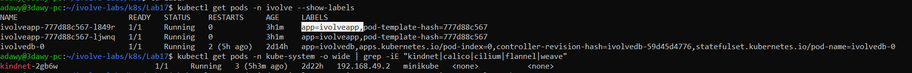
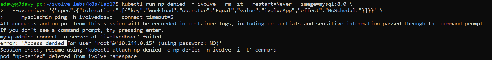
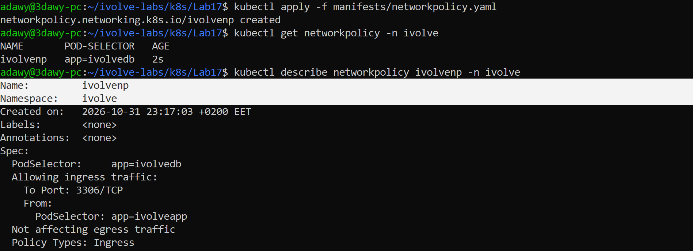
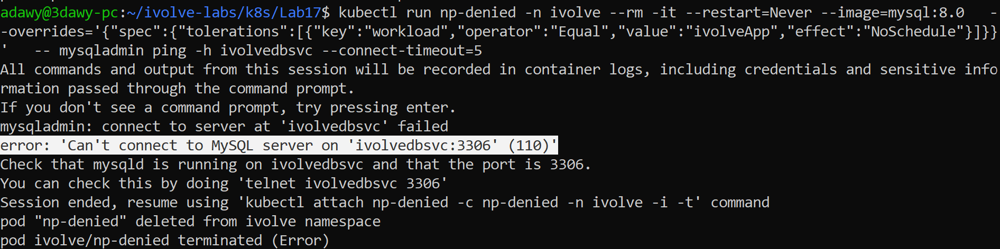
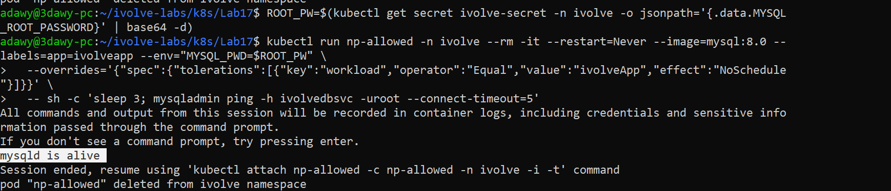

# Lab 17: Control Pod-to-Pod Traffic via Network Policy

## Objective

By default every Pod in a Kubernetes cluster can talk to every other Pod. In this lab a **NetworkPolicy** protects the MySQL Pod (Lab 14): only the application Pods (Lab 15) may connect to it, and only on port 3306.

## Requirements

| Item | Requirement |
|---|---|
| Name | `ivolveNP` (written `ivolvenp`, Kubernetes names must be lowercase) |
| Pod selector | The MySQL Pod |
| Policy types | Only `Ingress` |
| Ingress rule | Allow traffic only from the application Pods, only on port 3306 |

## Environment

- Windows + WSL2 (Ubuntu 24.04) + Docker Desktop
- Minikube (docker driver), single node, CNI: `kindnet`
- Namespace: `ivolve`

## Folder Structure

```
Lab17/
├── README.md
├── manifests/
│   └── networkpolicy.yaml
└── screenshots/
    ├── 01-check-labels-and-CNI-to-apply-NetPolicy-correctly.png
    ├── 02-before-policy-pod-can-reach-mysql.png
    ├── 03-networkpolicy-applied-and-described.png
    ├── 04-policy-denied-the-unlabeled-pod.png
    └── 05-policy-allowed-the-labeled-pod-only.png
```

## Concepts

- A Pod that **no policy selects** accepts traffic from anyone (the default, and the situation before this lab).
- As soon as a policy selects a Pod and lists `Ingress`, that Pod becomes an **allow-list**: any incoming traffic that is not explicitly allowed is dropped.
- Policies only **allow** (there are no deny rules), and several policies on the same Pod add up.
- A NetworkPolicy works on IPs, labels and ports (layer 3/4). It knows nothing about MySQL users or passwords.
- A NetworkPolicy is only a definition. It is **enforced by the CNI plugin**, so the cluster must use a CNI that supports it. This is verified by testing before and after (Steps 2, 4 and 5).

| Lab requirement | In the manifest |
|---|---|
| Targets the MySQL Pod | `podSelector: app=ivolvedb` (label set in Lab 14) |
| Only Ingress | `policyTypes: [Ingress]` (egress is not affected) |
| Only from the application Pods | `from: podSelector app=ivolveapp` (label set in Lab 15) |
| Port 3306 | `ports: TCP 3306` |

## Relation to Previous Labs

| Previous Lab | Relation |
|---|---|
| **Lab 14** | The protected Pod `ivolvedb-0` (label `app=ivolvedb`, port 3306), reached through the headless service `ivolvedbsvc`. |
| **Lab 15** | The allowed Pods `ivolveapp` (label `app=ivolveapp`). The init container belongs to the same Pod, so it carries the same label and is allowed too. |
| **Lab 11** | The policy lives in the `ivolve` namespace, and a `podSelector` inside `from` selects Pods of that same namespace. |
| **Lab 10** | The node is tainted, so the temporary test Pods need a toleration (passed with `--overrides`). |

---

## Steps

### Step 1: Check the Pod labels and the CNI

The selectors must match the real labels, so they are checked first:

```bash
cd ~/ivolve-labs/k8s/Lab17
kubectl get pods -n ivolve --show-labels
kubectl get pods -n kube-system -o wide | grep -iE "kindnet|calico|cilium|flannel|weave"
```

The application Pods have `app=ivolveapp`, the MySQL Pod has `app=ivolvedb`, and the cluster CNI is `kindnet`.



### Step 2: Test before the policy

A temporary Pod with **no** label tries to reach MySQL through the service. Because the node has a taint, the Pod gets the toleration through `--overrides`:

```bash
kubectl run np-denied -n ivolve --rm -it --restart=Never --image=mysql:8.0 \
  --overrides='{"spec":{"tolerations":[{"key":"workload","operator":"Equal","value":"ivolveApp","effect":"NoSchedule"}]}}' \
  -- mysqladmin ping -h ivolvedbsvc --connect-timeout=5
```

The answer is `Access denied for user 'root'... (using password: NO)`. That message comes from **MySQL itself**: the connection reached the server, and MySQL refused the login only because no password was supplied. So before the policy, an unrelated Pod can reach the database.



### Step 3: Create the NetworkPolicy

`manifests/networkpolicy.yaml`:

```yaml
apiVersion: networking.k8s.io/v1
kind: NetworkPolicy
metadata:
  name: ivolvenp
  namespace: ivolve
spec:
  podSelector:
    matchLabels:
      app: ivolvedb
  policyTypes:
    - Ingress
  ingress:
    - from:
        - podSelector:
            matchLabels:
              app: ivolveapp
      ports:
        - protocol: TCP
          port: 3306
```

- `spec.podSelector` is the Pod the policy protects (MySQL).
- `policyTypes: [Ingress]` controls incoming traffic only; outgoing traffic from MySQL is not affected.
- `from.podSelector` lists who may connect: Pods labeled `app=ivolveapp` in the same namespace.
- `ports` limits the allowed traffic to TCP 3306, so even the application Pods cannot reach any other MySQL port.

```bash
kubectl apply -f manifests/networkpolicy.yaml
kubectl get networkpolicy -n ivolve
kubectl describe networkpolicy ivolvenp -n ivolve
```



### Step 4: Test again with the unlabeled Pod (must be blocked)

```bash
kubectl run np-denied -n ivolve --rm -it --restart=Never --image=mysql:8.0 \
  --overrides='{"spec":{"tolerations":[{"key":"workload","operator":"Equal","value":"ivolveApp","effect":"NoSchedule"}]}}' \
  -- mysqladmin ping -h ivolvedbsvc --connect-timeout=5
```

The result is `Can't connect to MySQL server on 'ivolvedbsvc:3306' (110)`. Error 110 is a connection **timeout**: the policy silently drops the packets, so the request never reaches MySQL (a MySQL answer such as `Access denied` never appears). The command also ends with `terminated (Error)`.



### Step 5: Test with a Pod that has the application label (must be allowed)

```bash
kubectl run np-allowed -n ivolve --rm -it --restart=Never --image=mysql:8.0 --labels=app=ivolveapp \
  --overrides='{"spec":{"tolerations":[{"key":"workload","operator":"Equal","value":"ivolveApp","effect":"NoSchedule"}]}}' \
  -- mysqladmin ping -h ivolvedbsvc --connect-timeout=5
```

This Pod, labeled `app=ivolveapp`, simulates an application Pod. It reaches MySQL again and gets the same `Access denied ... (using password: NO)` answer as in Step 2, because the connection went through and MySQL itself answered. This time there is no timeout and the command does not end with an error status.



### How to read the results

| Result of `mysqladmin ping` | Meaning |
|---|---|
| `Access denied for user 'root'... (using password: NO)` | The connection **reached** MySQL (allowed by the network). Only the login failed because no password was given. |
| `mysqld is alive` | The connection reached MySQL and the login worked (when a password is supplied). |
| `Can't connect to MySQL server ... (110)` | The connection **never arrived**: the packets were dropped (blocked by the NetworkPolicy). |

---

## Notes

- Only the MySQL Pod is selected by the policy. The application Pods are not selected by any policy, so their own incoming traffic (for example through `ivolveappsvc`) is unchanged.
- Egress is not restricted, so MySQL and the application Pods can still use DNS and make outgoing connections.
- A policy affects new connections. `kubectl exec` into the MySQL Pod and connections over the local socket are not affected.
- The allow rule is based on **labels**, which are not authentication: any Pod in the namespace that carries `app=ivolveapp` is allowed, as Step 5 shows.
- `kubectl run -it` with a command that finishes very quickly can occasionally print no output, because the Pod ends before the terminal is attached. Running the command again, or starting it with `sh -c 'sleep 3; ...'`, avoids this.
- The NetworkPolicy only works because the cluster CNI enforces it. The block in Step 4 is the proof.

## Cleanup (optional)

```bash
kubectl delete -f manifests/networkpolicy.yaml
kubectl delete pod np-denied np-allowed -n ivolve --ignore-not-found
```

## Push to GitHub

```bash
cd ~/ivolve-labs
find k8s/Lab17 -name "*Zone.Identifier" -type f -delete
git status
git add k8s/Lab17
git commit -m "Add Lab17: NetworkPolicy allowing only application pods to reach MySQL on port 3306"
git push origin main
```
