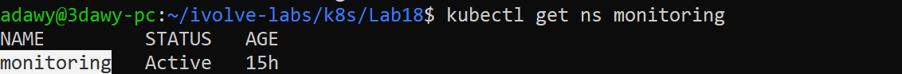
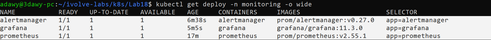
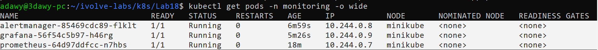
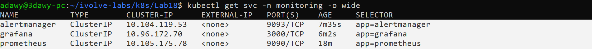
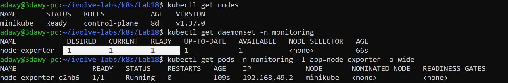
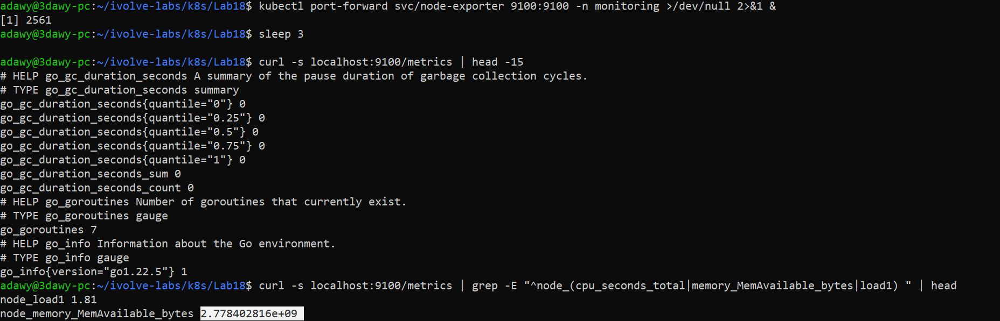
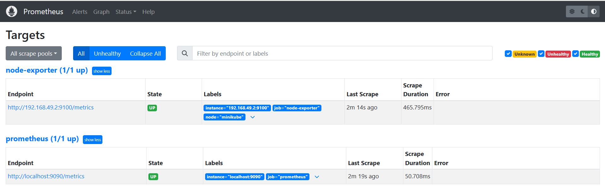
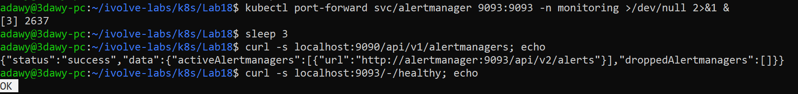
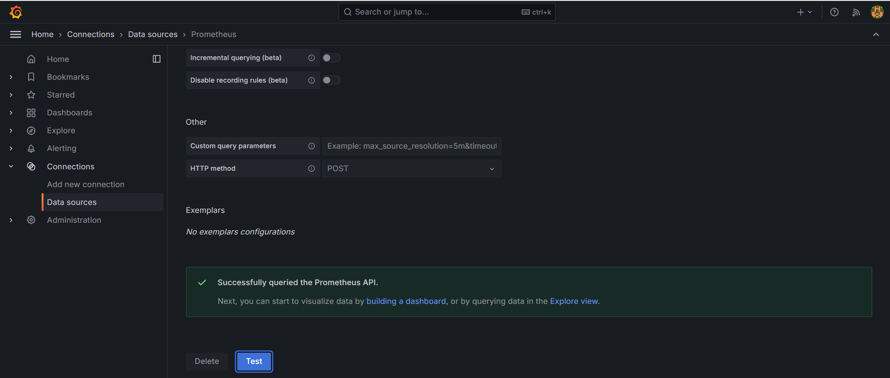
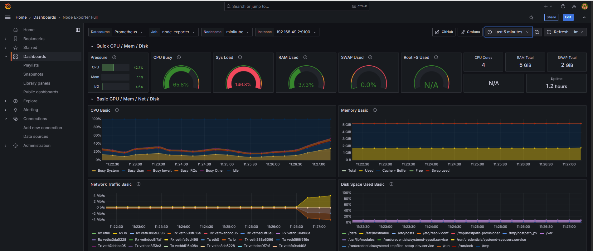

# Lab 18: Node-Wide Pod Management with DaemonSet

## Objective

Build a monitoring stack in its own `monitoring` namespace: **Prometheus**, **Alertmanager** and **Grafana**, plus a **DaemonSet** that runs **node-exporter** on every node. Prometheus collects the node metrics and Grafana shows them in a dashboard.

## Requirements

| Item | Requirement |
|---|---|
| Namespace | `monitoring` |
| Prometheus | Deployed in `monitoring` |
| Alertmanager | Deployed in `monitoring` |
| Grafana | Deployed in `monitoring` |
| node-exporter | DaemonSet in `monitoring` |
| Validation | A node-exporter Pod is scheduled on each node |
| Metrics | Confirm `:9100/metrics` is exposed |
| Prometheus | Configured to collect data from node-exporter |
| Grafana | A dashboard for Kubernetes |

## Environment

- Windows + WSL2 (Ubuntu 24.04) + Docker Desktop
- Minikube (docker driver), single node `minikube` (4 CPUs, taint `workload=ivolveApp:NoSchedule` from Lab 10)
- Namespace: `monitoring`

## Folder Structure

```
Lab18/
├── README.md
├── manifests/
│   ├── namespace.yaml
│   ├── prometheus-config.yaml
│   ├── prometheus.yaml
│   ├── alertmanager.yaml
│   ├── grafana.yaml
│   └── node-exporter.yaml
└── screenshots/
    ├── 00-monitoring-namespace.png
    ├── 01-deployment.png
    ├── 02-pods.png
    ├── 03-svc.png
    ├── 04-node-exporter-daemonset-one-pod-per-node.png
    ├── 05-node-exporter-metrics-endpoint.png
    ├── 06-prometheus-targets-node-exporter-up.png
    ├── 07-prometheus-sees-alertmanager.png
    ├── 08-grafana-prometheus-datasource.png
    └── 09-grafana-node-exporter-dashboard.png
```

## Components

| Component | Role |
|---|---|
| **node-exporter** (DaemonSet) | Reads the node's real metrics (from `/proc` and `/sys`) and exposes them on `:9100/metrics` |
| **Prometheus** | **Scrapes** (pulls) the metrics every 15 seconds and stores them as time series |
| **Alertmanager** | Receives alerts from Prometheus and routes them |
| **Grafana** | Draws dashboards by querying Prometheus with PromQL |

### Workflow

```
                    node: minikube
  +---------------------------------------------------------+
  | node-exporter (DaemonSet, hostNetwork)  :9100/metrics   |
  +---------------^-----------------------------------------+
                  | scrape every 15s (Pods found through the Kubernetes API: service discovery)
          +-------+--------+  alerts   +--------------+
          |   Prometheus   |---------->| Alertmanager |
          +-------^--------+           +--------------+
                  | PromQL
          +-------+--------+
          |    Grafana     |<-- browser (kubectl port-forward)
          +----------------+
```

### DaemonSet compared with the other controllers

| | Deployment | StatefulSet (Lab 14) | **DaemonSet** |
|---|---|---|---|
| Runs | N replicas anywhere | N replicas with stable identity and storage | **One Pod on every node** |
| New node joins | Nothing happens | Nothing happens | **A Pod is created on it automatically** |
| Used for | Applications | Databases | **Node-level agents**: monitoring, log collectors, CNI |

## Design Decisions

- **Plain YAML manifests** (no Helm), so every resource is visible and understood.
- **Tolerations:** the node carries the taint from Lab 10, so every Pod needs a toleration or it stays `Pending`. The Deployments tolerate `workload=ivolveApp:NoSchedule`. node-exporter uses `operator: Exists` (tolerates **any** taint) because a DaemonSet has to reach every node.
- **node-exporter uses `hostNetwork`, `hostPID` and read-only `hostPath` mounts** (`/proc`, `/sys`, `/`). Without them it would measure the container instead of the node.
- **Prometheus finds node-exporter through Kubernetes service discovery** instead of a fixed address, so a new node is picked up automatically. This needs permission to read Pods, given by a small `Role` limited to the `monitoring` namespace.
- **Grafana's Prometheus data source is provisioned from a ConfigMap**, so it exists from the first start.
- **Storage is `emptyDir`** (data is lost when a Pod is recreated). Persistent monitoring storage is not part of this lab.
- **Image versions are pinned** (`prom/prometheus:v2.55.1`, `prom/alertmanager:v0.27.0`, `grafana/grafana:11.3.0`, `prom/node-exporter:v1.8.2`).

## Relation to Previous Labs

| Previous Lab | Relation |
|---|---|
| **Lab 10** (taint/label) | The taint forces a toleration on every monitoring Pod. |
| **Lab 11** (namespace) | A separate namespace, `monitoring`. The quota and the NetworkPolicy of `ivolve` do not affect it. |
| **Lab 12** (ConfigMap) | ConfigMaps are used here as **configuration files** (`prometheus.yml`, `alertmanager.yml`, Grafana data source), not as environment variables. |
| **Lab 13 and 14** (storage, StatefulSet) | Here storage is only `emptyDir`; the DaemonSet is the third controller type next to Deployment and StatefulSet. |
| **Lab 15** (Deployment + Service) | Same pattern for Prometheus, Alertmanager and Grafana. |
| **Lab 16** (metrics-server) | metrics-server gives short-term numbers for `kubectl top`; Prometheus keeps the history and feeds the dashboards and alerts. |

---

## Steps

### Step 1: Create the namespace

`manifests/namespace.yaml`:

```yaml
apiVersion: v1
kind: Namespace
metadata:
  name: monitoring
```

```bash
cd ~/ivolve-labs/k8s/Lab18
kubectl apply -f manifests/namespace.yaml
kubectl get ns monitoring
```

Everything below lives in this namespace, so it has to exist before any other manifest is applied.



### Step 2: Deploy Prometheus

First the configuration file. At this point Prometheus only monitors itself and knows where Alertmanager is (`manifests/prometheus-config.yaml`):

```yaml
apiVersion: v1
kind: ConfigMap
metadata:
  name: prometheus-config
  namespace: monitoring
data:
  prometheus.yml: |
    global:
      scrape_interval: 15s
      evaluation_interval: 15s
    alerting:
      alertmanagers:
        - static_configs:
            - targets: ["alertmanager:9093"]
    scrape_configs:
      - job_name: prometheus
        static_configs:
          - targets: ["localhost:9090"]
```

Then the ServiceAccount, the permission to read Pods, the Deployment and the Service (`manifests/prometheus.yaml`):

```yaml
apiVersion: v1
kind: ServiceAccount
metadata:
  name: prometheus
  namespace: monitoring
---
apiVersion: rbac.authorization.k8s.io/v1
kind: Role
metadata:
  name: prometheus
  namespace: monitoring
rules:
  - apiGroups: [""]
    resources: ["pods"]
    verbs: ["get", "list", "watch"]
---
apiVersion: rbac.authorization.k8s.io/v1
kind: RoleBinding
metadata:
  name: prometheus
  namespace: monitoring
roleRef:
  apiGroup: rbac.authorization.k8s.io
  kind: Role
  name: prometheus
subjects:
  - kind: ServiceAccount
    name: prometheus
    namespace: monitoring
---
apiVersion: apps/v1
kind: Deployment
metadata:
  name: prometheus
  namespace: monitoring
spec:
  replicas: 1
  selector:
    matchLabels:
      app: prometheus
  template:
    metadata:
      labels:
        app: prometheus
    spec:
      serviceAccountName: prometheus
      tolerations:
        - key: "workload"
          operator: "Equal"
          value: "ivolveApp"
          effect: "NoSchedule"
      containers:
        - name: prometheus
          image: prom/prometheus:v2.55.1
          args:
            - --config.file=/etc/prometheus/prometheus.yml
            - --storage.tsdb.path=/prometheus
          ports:
            - containerPort: 9090
          volumeMounts:
            - name: config
              mountPath: /etc/prometheus
            - name: data
              mountPath: /prometheus
      volumes:
        - name: config
          configMap:
            name: prometheus-config
        - name: data
          emptyDir: {}
---
apiVersion: v1
kind: Service
metadata:
  name: prometheus
  namespace: monitoring
spec:
  type: ClusterIP
  selector:
    app: prometheus
  ports:
    - port: 9090
      targetPort: 9090
```

- The ConfigMap is mounted as a file, so `prometheus.yml` appears in `/etc/prometheus/`.
- Prometheus will ask the Kubernetes API which Pods are node-exporter, so its ServiceAccount gets `get/list/watch` on Pods in this namespace only (least privilege).
- The toleration lets the Pod run on the tainted node.

```bash
kubectl apply -f manifests/prometheus-config.yaml -f manifests/prometheus.yaml
kubectl rollout status deployment/prometheus -n monitoring --timeout=300s
```

### Step 3: Deploy Alertmanager

`manifests/alertmanager.yaml`:

```yaml
apiVersion: v1
kind: ConfigMap
metadata:
  name: alertmanager-config
  namespace: monitoring
data:
  alertmanager.yml: |
    route:
      receiver: default
    receivers:
      - name: default
---
apiVersion: apps/v1
kind: Deployment
metadata:
  name: alertmanager
  namespace: monitoring
spec:
  replicas: 1
  selector:
    matchLabels:
      app: alertmanager
  template:
    metadata:
      labels:
        app: alertmanager
    spec:
      tolerations:
        - key: "workload"
          operator: "Equal"
          value: "ivolveApp"
          effect: "NoSchedule"
      containers:
        - name: alertmanager
          image: prom/alertmanager:v0.27.0
          args:
            - --config.file=/etc/alertmanager/alertmanager.yml
            - --storage.path=/alertmanager
            - --cluster.listen-address=
          ports:
            - containerPort: 9093
          volumeMounts:
            - name: config
              mountPath: /etc/alertmanager
            - name: storage
              mountPath: /alertmanager
      volumes:
        - name: config
          configMap:
            name: alertmanager-config
        - name: storage
          emptyDir: {}
---
apiVersion: v1
kind: Service
metadata:
  name: alertmanager
  namespace: monitoring
spec:
  type: ClusterIP
  selector:
    app: alertmanager
  ports:
    - port: 9093
      targetPort: 9093
```

- Every alert goes to a receiver named `default` that sends nothing anywhere (no email or Slack in this lab).
- `--cluster.listen-address=` (empty) disables high-availability mode because there is a single replica.
- The Service name `alertmanager` is the address written in the Prometheus configuration (`alertmanager:9093`).

```bash
kubectl apply -f manifests/alertmanager.yaml
kubectl rollout status deployment/alertmanager -n monitoring --timeout=300s
```

### Step 4: Deploy Grafana

`manifests/grafana.yaml`:

```yaml
apiVersion: v1
kind: ConfigMap
metadata:
  name: grafana-datasources
  namespace: monitoring
data:
  datasources.yaml: |
    apiVersion: 1
    datasources:
      - name: Prometheus
        type: prometheus
        access: proxy
        url: http://prometheus:9090
        isDefault: true
---
apiVersion: apps/v1
kind: Deployment
metadata:
  name: grafana
  namespace: monitoring
spec:
  replicas: 1
  selector:
    matchLabels:
      app: grafana
  template:
    metadata:
      labels:
        app: grafana
    spec:
      tolerations:
        - key: "workload"
          operator: "Equal"
          value: "ivolveApp"
          effect: "NoSchedule"
      containers:
        - name: grafana
          image: grafana/grafana:11.3.0
          ports:
            - containerPort: 3000
          volumeMounts:
            - name: datasources
              mountPath: /etc/grafana/provisioning/datasources
            - name: data
              mountPath: /var/lib/grafana
      volumes:
        - name: datasources
          configMap:
            name: grafana-datasources
        - name: data
          emptyDir: {}
---
apiVersion: v1
kind: Service
metadata:
  name: grafana
  namespace: monitoring
spec:
  type: ClusterIP
  selector:
    app: grafana
  ports:
    - port: 3000
      targetPort: 3000
```

The ConfigMap registers Prometheus as a data source automatically (provisioning), using the Service address `http://prometheus:9090`.

```bash
kubectl apply -f manifests/grafana.yaml
kubectl rollout status deployment/grafana -n monitoring --timeout=300s
```

Check that the three components are running:

```bash
kubectl get deploy -n monitoring -o wide
kubectl get pods -n monitoring -o wide
kubectl get svc -n monitoring -o wide
```

Prometheus, Alertmanager and Grafana are `1/1 Running` with their image versions:





All three Services are `ClusterIP`:



### Step 5: Deploy the node-exporter DaemonSet

`manifests/node-exporter.yaml`:

```yaml
apiVersion: apps/v1
kind: DaemonSet
metadata:
  name: node-exporter
  namespace: monitoring
  labels:
    app: node-exporter
spec:
  selector:
    matchLabels:
      app: node-exporter
  template:
    metadata:
      labels:
        app: node-exporter
    spec:
      hostNetwork: true
      hostPID: true
      tolerations:
        - operator: Exists
      containers:
        - name: node-exporter
          image: prom/node-exporter:v1.8.2
          args:
            - --path.procfs=/host/proc
            - --path.sysfs=/host/sys
            - --path.rootfs=/host/root
            - "--collector.filesystem.mount-points-exclude=^/(dev|proc|sys|var/lib/docker/.+|var/lib/kubelet/.+)($|/)"
          ports:
            - name: metrics
              containerPort: 9100
          volumeMounts:
            - name: proc
              mountPath: /host/proc
              readOnly: true
            - name: sys
              mountPath: /host/sys
              readOnly: true
            - name: root
              mountPath: /host/root
              mountPropagation: HostToContainer
              readOnly: true
      volumes:
        - name: proc
          hostPath:
            path: /proc
        - name: sys
          hostPath:
            path: /sys
        - name: root
          hostPath:
            path: /
---
apiVersion: v1
kind: Service
metadata:
  name: node-exporter
  namespace: monitoring
spec:
  clusterIP: None
  selector:
    app: node-exporter
  ports:
    - name: metrics
      port: 9100
      targetPort: 9100
```

- `hostNetwork` and `hostPID` make the Pod share the node's network and processes, so it sees the real node.
- The `hostPath` mounts (read-only) are where node-exporter reads the metrics; the `--path.*` arguments tell it where to look.
- `tolerations: - operator: Exists` tolerates every taint, so the Pod reaches every node.
- The headless Service is only used to reach the Pods by name.

```bash
kubectl apply -f manifests/node-exporter.yaml
kubectl rollout status daemonset/node-exporter -n monitoring --timeout=300s
```

### Step 6: Validate one node-exporter Pod per node

```bash
kubectl get nodes
kubectl get daemonset -n monitoring
kubectl get pods -n monitoring -l app=node-exporter -o wide
```

`DESIRED`, `CURRENT` and `READY` of the DaemonSet equal the number of nodes (1), and the Pod runs on the node `minikube`.



### Step 7: Confirm the metrics on `:9100/metrics`

```bash
kubectl port-forward svc/node-exporter 9100:9100 -n monitoring >/dev/null 2>&1 &
sleep 3
curl -s localhost:9100/metrics | head -15
curl -s localhost:9100/metrics | grep -E "^node_(cpu_seconds_total|memory_MemAvailable_bytes|load1) " | head
```

The endpoint returns metrics in Prometheus format, including node metrics such as `node_load1` and `node_memory_MemAvailable_bytes`.



### Step 8: Configure Prometheus to collect from node-exporter

The Prometheus configuration gets a second job. It uses service discovery: Prometheus asks the Kubernetes API for the Pods labeled `app=node-exporter` in `monitoring` and scrapes them. `manifests/prometheus-config.yaml` (final version):

```yaml
apiVersion: v1
kind: ConfigMap
metadata:
  name: prometheus-config
  namespace: monitoring
data:
  prometheus.yml: |
    global:
      scrape_interval: 15s
      evaluation_interval: 15s
    alerting:
      alertmanagers:
        - static_configs:
            - targets: ["alertmanager:9093"]
    scrape_configs:
      - job_name: prometheus
        static_configs:
          - targets: ["localhost:9090"]
      - job_name: node-exporter
        kubernetes_sd_configs:
          - role: pod
            namespaces:
              names: ["monitoring"]
        relabel_configs:
          - source_labels: [__meta_kubernetes_pod_label_app]
            regex: node-exporter
            action: keep
          - source_labels: [__meta_kubernetes_pod_node_name]
            target_label: node
```

```bash
kubectl apply -f manifests/prometheus-config.yaml
kubectl rollout restart deployment/prometheus -n monitoring
kubectl rollout status deployment/prometheus -n monitoring --timeout=300s
```

The restart is required: Prometheus reads its configuration file only at startup, so changing the ConfigMap alone is not enough.

- `action: keep` keeps only the Pods labeled `app=node-exporter` and drops everything else.
- `target_label: node` adds the node name as a label on every metric.

```bash
kubectl port-forward svc/prometheus 9090:9090 -n monitoring >/dev/null 2>&1 &
```

Open `http://localhost:9090/targets`. The job `node-exporter` is **UP** (target `192.168.49.2:9100`, the node's IP because the Pod uses the host network), next to the `prometheus` job.



### Step 9: Confirm Prometheus is connected to Alertmanager

```bash
kubectl port-forward svc/alertmanager 9093:9093 -n monitoring >/dev/null 2>&1 &
sleep 3
curl -s localhost:9090/api/v1/alertmanagers; echo
curl -s localhost:9093/-/healthy; echo
```

`activeAlertmanagers` lists `http://alertmanager:9093/api/v2/alerts` and Alertmanager answers `OK`.



### Step 10: Grafana data source and Kubernetes dashboard

```bash
kubectl port-forward svc/grafana 3000:3000 -n monitoring >/dev/null 2>&1 &
```

Open `http://localhost:3000` and sign in with `admin` / `admin` (Grafana asks for a new password, which can be skipped in this lab).

**Data source:** Connections > Data sources > Prometheus > **Save & test** returns *Successfully queried the Prometheus API*. The data source exists because of the provisioning ConfigMap.



**Dashboard:** Dashboards > New > Import > ID `1860` (**Node Exporter Full**) > Load > select the `Prometheus` data source > Import. The Job is `node-exporter`, the node is `minikube`, and the dashboard shows CPU, memory, load, disk and network of the node, fed by the DaemonSet.

If importing by ID fails (no internet from the Pod), download `https://grafana.com/api/dashboards/1860/revisions/latest/download` in the browser and use *Upload dashboard JSON file*.



Stop the port-forwards when finished:

```bash
pkill -f "kubectl port-forward"
```

### Step 11: Check that the manifests match the cluster

Before committing, `kubectl diff` compares the files with what is running:

```bash
kubectl diff -f manifests/ && echo "OK: files match the cluster"
```

No differences were reported, so the committed files are exactly what is deployed (including the final `prometheus-config.yaml`).

---

## Notes

- **Access:** every Service is `ClusterIP`; the UIs are reached with `kubectl port-forward` (Prometheus 9090, Alertmanager 9093, Grafana 3000, node-exporter 9100).
- **Data is not persistent:** Prometheus and Grafana use `emptyDir`, so history and imported dashboards are lost when their Pods are recreated.
- **Configuration changes:** after changing a ConfigMap, restart the Deployment that uses it (`kubectl rollout restart`).
- **Scope of the dashboard:** Node Exporter Full shows **node** metrics, which is what the DaemonSet provides. Dashboards at Pod/container level need other metric sources (cAdvisor, kube-state-metrics) that are not part of this lab.
- **Alerting:** Alertmanager is deployed and connected, but no alert rules or notification receivers are defined in this lab.
- **Default Grafana password** (`admin`) is acceptable only because the UI is reachable through `port-forward` on localhost.
- On a multi-node cluster the DaemonSet creates one Pod per node automatically, and Prometheus discovers each one.

## Cleanup (optional)

```bash
kubectl delete namespace monitoring
```

## Push to GitHub

```bash
cd ~/ivolve-labs
find k8s/Lab18 -name "*Zone.Identifier" -type f -delete
git status
git add k8s/Lab18
git commit -m "Add Lab18: monitoring stack with Prometheus, Alertmanager, Grafana and node-exporter DaemonSet"
git push origin main
```
