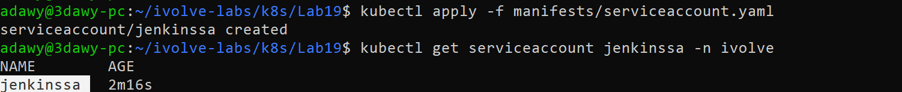
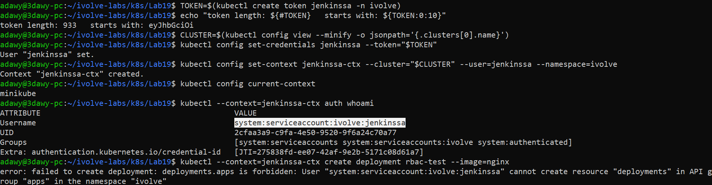
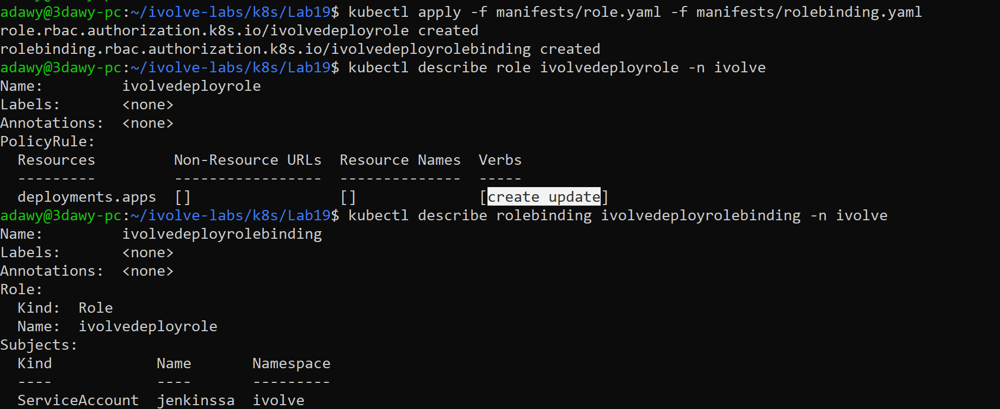
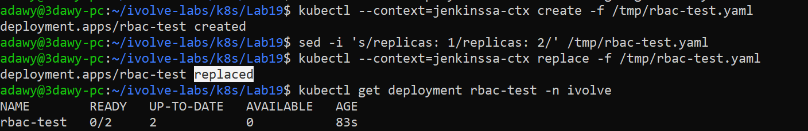
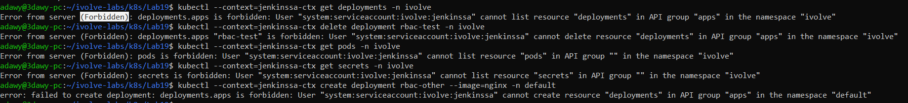
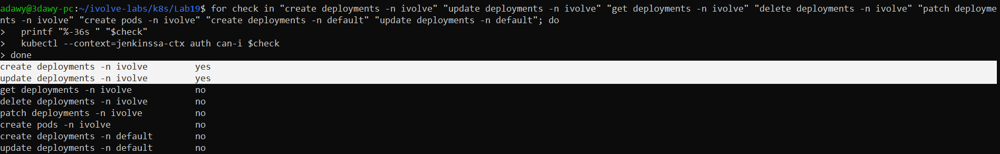

# Lab 19: Securing Kubernetes with RBAC and Service Accounts

## Objective
Secure access to the Kubernetes API using Role-Based Access Control (RBAC) and a dedicated ServiceAccount (`jenkinssa`) in the `ivolve` namespace. Issue an authentication token for the ServiceAccount, grant it least-privilege permissions (`create` and `update` on Deployments only) through a `Role` and `RoleBinding`, and validate that all other actions, resources, and namespaces are denied.

## Requirements

| Item | Requirement |
|---|---|
| Namespace | `ivolve` |
| ServiceAccount | `jenkinssa` in `ivolve` |
| Token | Generated for `jenkinssa` to authenticate against the Kubernetes API |
| Role | `ivolvedeployrole` granting `create` and `update` on `deployments` in `ivolve` |
| RoleBinding | `ivolvedeployrolebinding` binding `ivolvedeployrole` to `jenkinssa` |
| Validation | Confirm `jenkinssa` can only `create` and `update` Deployments in `ivolve` |

## Environment
- Windows + WSL2 (Ubuntu 24.04) + Docker Desktop
- Minikube (docker driver), single node `minikube` (4 CPUs, taint `workload=ivolveApp:NoSchedule` from Lab 10)
- Namespace: `ivolve`

## Folder Structure

```text
Lab19/
├── README.md
├── manifests/
│   ├── serviceaccount.yaml
│   ├── role.yaml
│   └── rolebinding.yaml
└── screenshots/
    ├── 01-serviceaccount-created.png
    ├── 02-token-whoami-and-denied-before-role.png
    ├── 03-role-and-rolebinding.png
    ├── 04-allowed-create-and-update-deployment.png
    ├── 05-denied-actions.png
    └── 06-can-i-permissions.png
```

## Components

| Component | Name | Role |
|---|---|---|
| ServiceAccount | `jenkinssa` | Non-human identity representing an external automation client (Jenkins) in `ivolve` |
| Token (JWT) | Bound to `jenkinssa` | Short-lived credential (`TokenRequest` API) proving the client is `jenkinssa` |
| Role | `ivolvedeployrole` | Defines allowed API verbs (`create`, `update`) on `deployments.apps` within `ivolve` |
| RoleBinding | `ivolvedeployrolebinding` | Grants the permissions defined in `ivolvedeployrole` to the `jenkinssa` ServiceAccount |

## Workflow

```text
  External Client (Jenkins / kubectl --context=jenkinssa-ctx)
        |
        | 1. Presents Bearer Token (JWT)
        v
  +-------------------------------------------------------------------+
  |                      Kubernetes API Server                        |
  |                                                                   |
  |  2. Authentication:                                               |
  |     Verifies JWT -> system:serviceaccount:ivolve:jenkinssa        |
  |                                                                   |
  |  3. Authorization (RBAC):                                         |
  |     Checks RoleBinding (ivolvedeployrolebinding)                  |
  |       └──> Role (ivolvedeployrole) in namespace: ivolve           |
  |              ├── create / update deployments.apps  --> ALLOWED    |
  |              └── get / delete / pods / other ns    --> FORBIDDEN  |
  +-------------------------------------------------------------------+
```

## RBAC Objects Compared

| Object | Scope | Purpose |
|---|---|---|
| `Role` | Single namespace (`ivolve`) | Defines a set of permissions within one namespace |
| `ClusterRole` | Cluster-wide | Defines permissions across all namespaces or for cluster-scoped resources (such as nodes) |
| `RoleBinding` | Single namespace (`ivolve`) | Binds a `Role` (or `ClusterRole`) to subjects within that specific namespace |
| `ClusterRoleBinding` | Cluster-wide | Binds a `ClusterRole` to subjects across the entire cluster |

## Design Decisions
- **Lowercase resource names:** Kubernetes conventions use lowercase names (`jenkinssa`, `ivolvedeployrole`, `ivolvedeployrolebinding`) in the YAML manifests.
- **Additive least-privilege model:** RBAC in Kubernetes has no deny rules; everything is denied by default unless explicitly allowed. Granting only `["create", "update"]` on `deployments` in `apps` ensures `jenkinssa` cannot read Secrets, delete workloads, list Pods, or touch other namespaces.
- **Short-lived bound tokens (`kubectl create token`):** Since Kubernetes 1.24, ServiceAccount tokens are no longer auto-created as permanent Secrets. Instead, the `TokenRequest` API issues time-bound JWTs (1 hour by default), reducing the risk of leaked credentials.
- **Dedicated `kubeconfig` context (`jenkinssa-ctx`):** Passing `--token` on the command line while using the default admin context can still send the admin client certificate from `kubeconfig`. Creating a separate context bound only to the token accurately simulates how Jenkins authenticates externally without altering the default `minikube` admin context.
- **Using `create` and `replace` for validation:** Because `kubectl apply` requires `get` and `patch` permissions, validation uses `kubectl create -f` (HTTP `POST` -> `create`) and `kubectl replace -f` (HTTP `PUT` -> `update`), matching the exact two verbs granted by the Role.

## Relation to Previous Labs

| Previous Lab | Relation |
|---|---|
| Lab 10 (taint/label) | The node taint (`workload=ivolveApp:NoSchedule`) keeps the test Deployment Pods `Pending` (`0/2`), while the API Server still allows `jenkinssa` to create and update the Deployment object itself. |
| Lab 11 (namespace) | The `ivolve` namespace acts as the security boundary for `ivolvedeployrole` and `ivolvedeployrolebinding`. |
| Lab 15 (Deployment) | `jenkinssa` is designed to deploy and update application Deployments such as `ivolveapp` in a CI/CD pipeline. |
| Lab 17 (NetworkPolicy) | Lab 17 restricted network traffic between Pods; Lab 19 restricts API access to the cluster control plane. |
| Lab 18 (Monitoring RBAC) | Lab 18 used a ServiceAccount mounted inside the Prometheus Pod (`get`/`list`/`watch` on `pods`). Lab 19 uses a ServiceAccount token from outside the cluster for CI/CD deployment (`create`/`update` on `deployments`). |

## Steps

### Step 1: Create the ServiceAccount
`manifests/serviceaccount.yaml`:

```yaml
apiVersion: v1
kind: ServiceAccount
metadata:
  name: jenkinssa
  namespace: ivolve
```

```bash
cd ~/ivolve-labs/k8s/Lab19
kubectl apply -f manifests/serviceaccount.yaml
kubectl get serviceaccount jenkinssa -n ivolve
```

The `jenkinssa` identity now exists in the `ivolve` namespace, with zero permissions attached by default.



### Step 2: Generate a Token and Configure the Context
Request a short-lived JWT token for `jenkinssa` and configure a separate `kubeconfig` context (`jenkinssa-ctx`) to act as this ServiceAccount:

```bash
TOKEN=\$(kubectl create token jenkinssa -n ivolve)
echo "token length: \${#TOKEN}   starts with: \${TOKEN:0:10}"

CLUSTER=\$(kubectl config view --minify -o jsonpath='{.clusters[0].name}')
kubectl config set-credentials jenkinssa --token="\$TOKEN"
kubectl config set-context jenkinssa-ctx --cluster="\$CLUSTER" --user=jenkinssa --namespace=ivolve
```

Verify authentication and test authorization before creating the Role:

```bash
kubectl config current-context
kubectl --context=jenkinssa-ctx auth whoami
kubectl --context=jenkinssa-ctx create deployment rbac-test --image=nginx
```

- Only the length (`933`) and prefix (`eyJhbGciOi`) of the JWT are printed so the secret token is never exposed in logs or screenshots.
- `auth whoami` returns `system:serviceaccount:ivolve:jenkinssa`, confirming **authentication** works.
- `create deployment` fails with `Forbidden`, confirming **authorization** denies all actions before the Role is bound.



### Step 3: Create the Role and RoleBinding
`manifests/role.yaml`:

```yaml
apiVersion: rbac.authorization.k8s.io/v1
kind: Role
metadata:
  name: ivolvedeployrole
  namespace: ivolve
rules:
  - apiGroups: ["apps"]
    resources: ["deployments"]
    verbs: ["create", "update"]
```

`manifests/rolebinding.yaml`:

```yaml
apiVersion: rbac.authorization.k8s.io/v1
kind: RoleBinding
metadata:
  name: ivolvedeployrolebinding
  namespace: ivolve
subjects:
  - kind: ServiceAccount
    name: jenkinssa
    namespace: ivolve
roleRef:
  apiGroup: rbac.authorization.k8s.io
  kind: Role
  name: ivolvedeployrole
```

Apply and inspect both resources:

```bash
kubectl apply -f manifests/role.yaml -f manifests/rolebinding.yaml
kubectl describe role ivolvedeployrole -n ivolve
kubectl describe rolebinding ivolvedeployrolebinding -n ivolve
```

- `apiGroups: ["apps"]` targets the API group where `Deployments` live (core resources such as Pods and Services use `""`).
- `ivolvedeployrolebinding` links the `ServiceAccount` `jenkinssa` in `ivolve` to `ivolvedeployrole`.



### Step 4: Validate Allowed Actions (Create and Update Deployment)
Generate a local Deployment manifest using `--dry-run=client`, then create and update it using `jenkinssa-ctx`:

```bash
kubectl create deployment rbac-test --image=nginx --dry-run=client -o yaml > /tmp/rbac-test.yaml
kubectl --context=jenkinssa-ctx create -f /tmp/rbac-test.yaml

sed -i 's/replicas: 1/replicas: 2/' /tmp/rbac-test.yaml
kubectl --context=jenkinssa-ctx replace -f /tmp/rbac-test.yaml

kubectl get deployment rbac-test -n ivolve
```

- `kubectl create -f` sends a `POST` request (`create` verb) and succeeds (`deployment.apps/rbac-test created`).
- `kubectl replace -f` sends a `PUT` request (`update` verb) and succeeds (`deployment.apps/rbac-test replaced`), scaling `UP-TO-DATE` to `2`.
- Using the admin context (`kubectl get deployment`), `rbac-test` shows `0/2` ready because the test manifest has no toleration for the node taint from Lab 10.



### Step 5: Validate Denied Actions (Other Verbs, Resources, and Namespaces)
Verify that `jenkinssa` cannot read or delete Deployments, access other resource types in `ivolve`, or create Deployments in `default`:

```bash
kubectl --context=jenkinssa-ctx get deployments -n ivolve
kubectl --context=jenkinssa-ctx delete deployment rbac-test -n ivolve
kubectl --context=jenkinssa-ctx get pods -n ivolve
kubectl --context=jenkinssa-ctx get secrets -n ivolve
kubectl --context=jenkinssa-ctx create deployment rbac-other --image=nginx -n default
```

Every command returns `Error from server (Forbidden)`:
- `get` (`list`) and `delete` on `deployments.apps` are not in the Role's verbs.
- `pods` and `secrets` are not in the Role's resources.
- `default` is outside the `ivolve` namespace scope of the `Role` and `RoleBinding`.



### Step 6: Verify the Permission Matrix with `auth can-i`
Query the API Server directly for a full permission check across verbs, resources, and namespaces:

```bash
for check in "create deployments -n ivolve" "update deployments -n ivolve" "get deployments -n ivolve" "delete deployments -n ivolve" "patch deployments -n ivolve" "create pods -n ivolve" "create deployments -n default" "update deployments -n default"; do
  printf "%-36s " "\$check"
  kubectl --context=jenkinssa-ctx auth can-i \$check
done
```

Only `create deployments -n ivolve` and `update deployments -n ivolve` return `yes`; all other checks return `no`.



### Step 7: Clean Up the Temporary Test Resources and Context
Remove the temporary test Deployment and the local `jenkinssa-ctx` credentials from `kubeconfig`, leaving the required lab resources (`jenkinssa`, `ivolvedeployrole`, `ivolvedeployrolebinding`) running in the cluster:

```bash
kubectl delete deployment rbac-test -n ivolve
kubectl config delete-context jenkinssa-ctx
kubectl config delete-user jenkinssa
rm /tmp/rbac-test.yaml
unset TOKEN
```

### Step 8: Check that the Manifests Match the Cluster
Before committing, compare the local files against the live objects in the cluster:

```bash
kubectl diff -f manifests/ && echo "OK: files match the cluster"
```

## Notes
- **Why `create` and `replace` instead of `apply`:** `kubectl apply` reads the existing object (`get`) and sends a partial update (`patch`). In a real Jenkins pipeline that runs `kubectl apply` or `kubectl rollout status`, `get`, `list`, `watch`, and `patch` would also be added to the Role. This lab strictly enforces only `create` and `update` as required.
- **Token expiration:** Tokens created via `kubectl create token` expire after 1 hour by default (`--duration` can customize this). For long-running external systems that cannot rotate tokens automatically, a Secret of type `kubernetes.io/service-account-token` annotated with `kubernetes.io/service-account.name: jenkinssa` can be used, though short-lived tokens are preferred for security.
- **Immutability of `roleRef`:** Once a `RoleBinding` is created, its `roleRef` field cannot be changed. Pointing it to a different Role requires deleting and recreating the `RoleBinding`.

## Cleanup (optional)

```bash
kubectl delete -f manifests/
```

## Push to GitHub

```bash
cd ~/ivolve-labs
find k8s/Lab19 -name "*Zone.Identifier" -type f -delete
git status
git add k8s/Lab19
git commit -m "Add Lab19: RBAC with ServiceAccount, Role and RoleBinding for jenkinssa"
git -c http.version=HTTP/1.1 push origin main
```