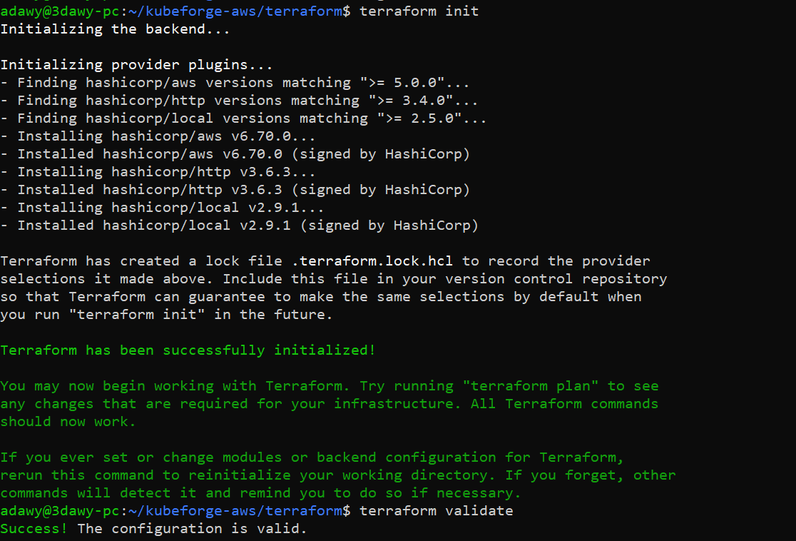
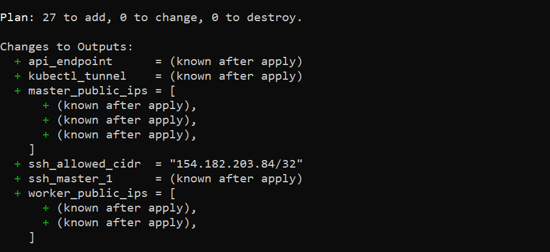
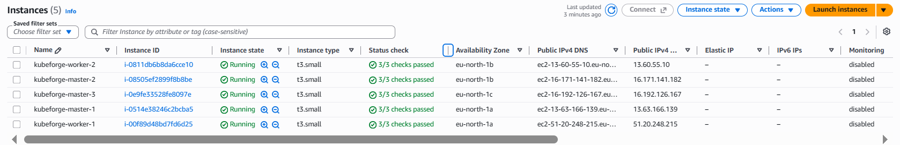
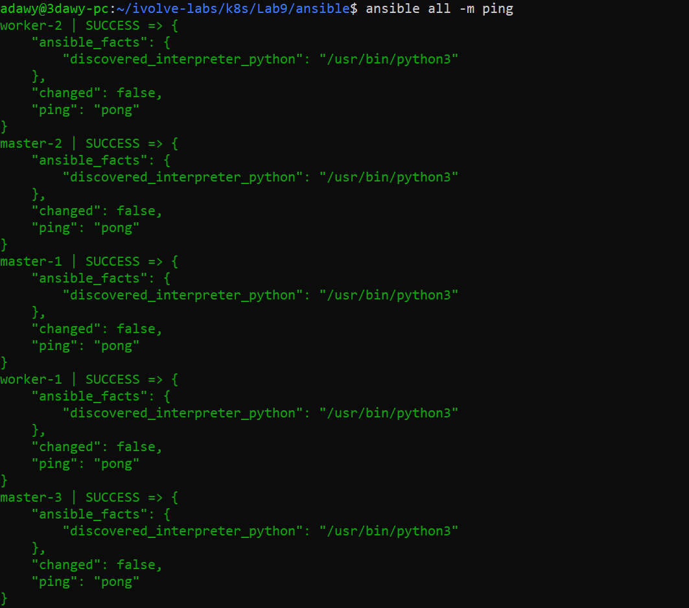
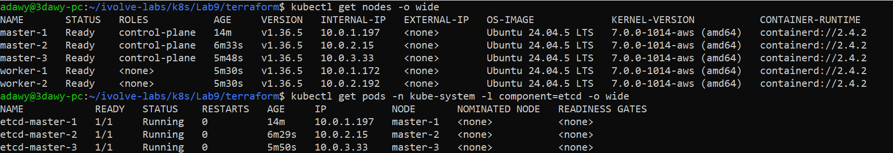
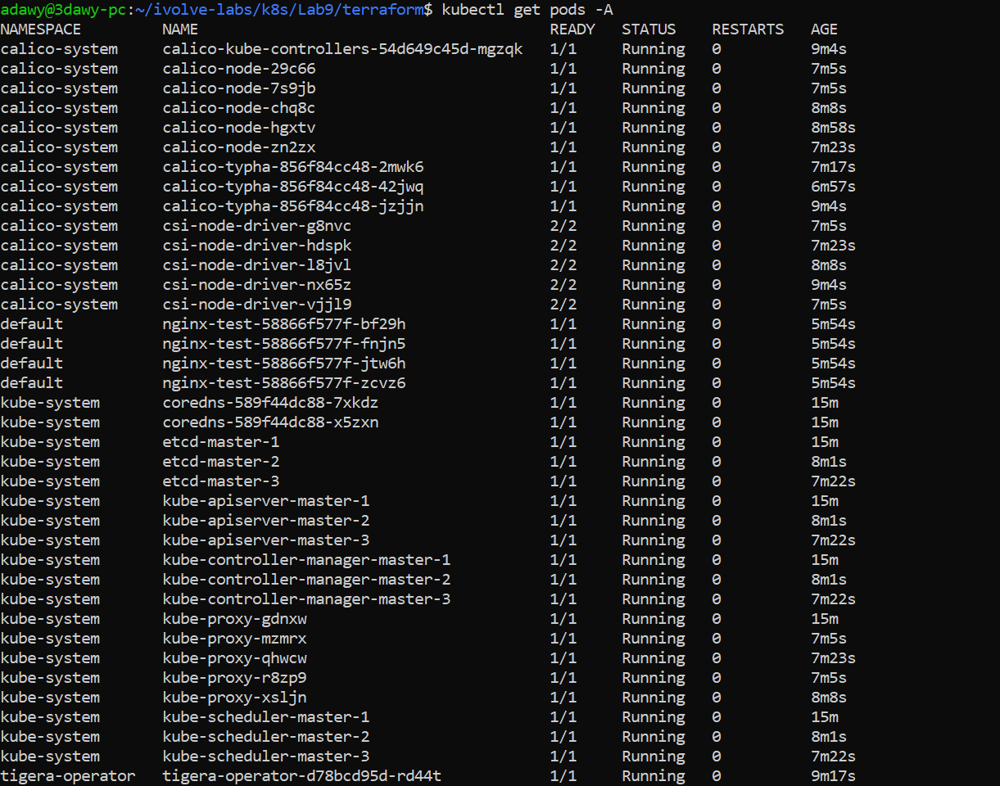
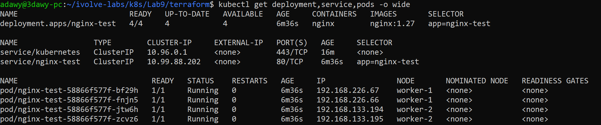
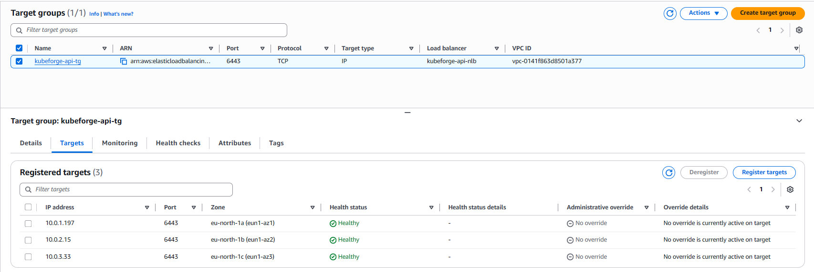
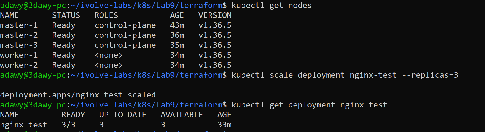

# Lab 9: Highly Available Kubernetes Cluster on AWS (kubeadm + Terraform + Ansible)

A Kubernetes cluster built **from scratch with kubeadm** (3 control-plane nodes + 2 workers), on AWS, fully automated:

- **Terraform** builds the infrastructure (VPC, subnets, security group, 5 EC2 instances, internal Network Load Balancer) and generates the Ansible inventory.
- **Ansible** prepares the nodes and runs every kubeadm step (init, CNI, join control planes, join workers).

No managed service (EKS) is used. Every control-plane component is installed and wired by hand, then automated.

## 1. The task and how this lab maps to it

The instructor's guide builds a kubeadm HA cluster on 8 servers (load balancer, NFS, 3 masters, 3 workers) on an older Kubernetes version. This lab keeps the same kubeadm flow with these changes:

| Instructor's guide | This lab | Why |
|---|---|---|
| HAProxy + Keepalived (VIP) | Internal AWS Network Load Balancer on port 6443 | Keepalived needs VRRP, which AWS does not support |
| NFS server | Skipped | Allowed by the instructor, not needed for the cluster |
| 3 workers | 2 workers | Minimum that still shows scheduling across nodes (cost) |
| Old Kubernetes version | Kubernetes 1.36, containerd 2.x, Calico 3.32 | Old versions are out of support |
| Manual commands | Terraform + Ansible | Repeatable, destroyable, CV-ready |

| Guide step | Ansible role |
|---|---|
| Prepare servers (swap, kernel modules, sysctl, containerd) | `common` |
| Install kubeadm, kubelet, kubectl | `common` |
| `kubeadm init` on master-1 | `control_plane_init` |
| Install CNI | `cni` |
| Join master-2 and master-3 (`--control-plane`) | `control_plane_join` |
| Join workers | `worker_join` |

## 2. Architecture

```
                         Internet
                            |
                      Internet Gateway
                            |
        +-------------------+-------------------+
        |        VPC 10.0.0.0/16  (eu-north-1)  |
        |                                       |
        |   Internal Network Load Balancer      |
        |        TCP 6443 (API server)          |
        |      /          |           \         |
        | master-1     master-2     master-3    |
        | AZ a         AZ b         AZ c        |
        | apiserver + etcd (stacked, 3 members) |
        |                                       |
        |   worker-1 (AZ a)    worker-2 (AZ b)  |
        |   containerd + kubelet + Calico       |
        +---------------------------------------+
```

| Component | Choice |
|---|---|
| Region | eu-north-1 (Stockholm) |
| Kubernetes | 1.36 (`k8s_minor` in `ansible/group_vars/all.yml`) |
| Runtime | containerd 2.x from the Docker apt repo (Kubernetes 1.36 needs containerd 2.0+, Ubuntu 24.04 ships 1.7), systemd cgroup driver |
| CNI | Calico via the Tigera operator, VXLAN |
| Control plane | 3 masters, stacked etcd, one per Availability Zone |
| API endpoint | NLB DNS name, set as `controlPlaneEndpoint` |
| Nodes | Ubuntu 24.04, t3.small (2 vCPU, 2 GB, the kubeadm minimum), 20 GB gp3 |
| Network | Public subnets, no NAT Gateway (saves about 32 USD per month) |
| Access | SSH only from my IP. The API server is never public: `kubectl` goes through an SSH tunnel |

Pod network `192.168.0.0/16`, service network `10.96.0.0/12`, VPC `10.0.0.0/16`. The three ranges must not overlap.

## 3. Project layout

```
k8s/Lab9/
  terraform/     providers, variables, network, security, compute, nlb, inventory, outputs
  ansible/       ansible.cfg, site.yml, group_vars/, roles/ (common, control_plane_init, cni, control_plane_join, worker_join)
  manifests/     nginx-test.yaml (test workload)
  screenshots/   proof images used in this README
```

## 4. Prepare the tools (WSL, Ubuntu)

AWS CLI:

```bash
sudo apt update && sudo apt install -y unzip curl wget gnupg lsb-release
curl "https://awscli.amazonaws.com/awscli-exe-linux-x86_64.zip" -o awscliv2.zip
unzip -q awscliv2.zip
sudo ./aws/install
aws --version
```

Terraform:

```bash
wget -O- https://apt.releases.hashicorp.com/gpg | sudo gpg --dearmor -o /usr/share/keyrings/hashicorp-archive-keyring.gpg
echo "deb [signed-by=/usr/share/keyrings/hashicorp-archive-keyring.gpg] https://apt.releases.hashicorp.com $(lsb_release -cs) main" | sudo tee /etc/apt/sources.list.d/hashicorp.list
sudo apt update && sudo apt install -y terraform
terraform -version
```

Ansible:

```bash
sudo apt install -y ansible
ansible --version
```

kubectl (use the repo of the same minor version as the cluster):

```bash
sudo mkdir -p /etc/apt/keyrings
curl -fsSL https://pkgs.k8s.io/core:/stable:/v1.36/deb/Release.key | sudo gpg --dearmor -o /etc/apt/keyrings/kubernetes-apt-keyring.gpg
echo 'deb [signed-by=/etc/apt/keyrings/kubernetes-apt-keyring.gpg] https://pkgs.k8s.io/core:/stable:/v1.36/deb/ /' | sudo tee /etc/apt/sources.list.d/kubernetes.list
sudo apt update && sudo apt install -y kubectl
kubectl version --client
```

Versions used: AWS CLI 2.37, Terraform 1.16, ansible-core 2.16, kubectl 1.37 client.

## 5. Prepare AWS

1. **Budget alert** (Billing, Budgets, monthly cost budget of 5 USD with an email alert). It only notifies, it does not stop resources. The real protection is `terraform destroy`.
2. **IAM user** `kubeforge-admin` (no console access) with the `AdministratorAccess` policy, and a CLI access key. Admin is acceptable for a lab; in production the permissions would be scoped.
3. Configure the CLI with region `eu-north-1` and output `json`:

```bash
aws configure
aws sts get-caller-identity
aws ec2 describe-availability-zones --query "AvailabilityZones[].ZoneName" --output text
```

The last command must list `eu-north-1a eu-north-1b eu-north-1c`.

4. **SSH key pair** (private key stays in `~/.ssh`, inside WSL, never in the repo):

```bash
ssh-keygen -t ed25519 -f ~/.ssh/kubeforge -N "" -C "kubeforge-aws"
ls -l ~/.ssh/kubeforge ~/.ssh/kubeforge.pub
```

## 6. Build the infrastructure with Terraform

```bash
cd ~/ivolve-labs/k8s/Lab9/terraform
terraform init
terraform validate
terraform plan
```

`init` downloads the aws, http and local providers. `validate` checks the syntax. `plan` showed **27 resources to add, 0 to destroy**.





```bash
terraform apply
```

After `apply`, the AWS console (EC2, Instances, Stockholm region) shows the 5 instances running, 3 masters and 2 workers:



What was created:

| File | Resources |
|---|---|
| `network.tf` | VPC, internet gateway, 3 public subnets (one per AZ), route table and associations |
| `security.tf` | Security group: all traffic between nodes, SSH from my IP only (auto-detected), 6443 from inside the VPC |
| `compute.tf` | Key pair, 3 master and 2 worker EC2 instances (IMDSv2 required) |
| `nlb.tf` | Internal NLB, target group (IP targets, TCP health check on 6443), listener, 3 attachments |
| `inventory.tf` | Writes `ansible/inventory.ini` from the real IPs |

Check the SSH access and the generated inventory:

```bash
terraform output
cat ../ansible/inventory.ini
eval "$(terraform output -raw ssh_master_1)"
exit
```

## 7. Build the cluster with Ansible

```bash
cd ~/ivolve-labs/k8s/Lab9/ansible
ansible all -m ping
```

All 5 nodes answer `pong`:



Then each stage runs on its own (tags), so every stage can be verified before the next one:

```bash
ansible-playbook site.yml --tags prepare
ansible-playbook site.yml --tags init
ansible-playbook site.yml --tags cni
ansible-playbook site.yml --tags join-masters
ansible-playbook site.yml --tags join-workers
ansible-playbook site.yml --tags verify
```

| Tag | Hosts | What it does |
|---|---|---|
| `prepare` | all | hostname and /etc/hosts, swap off, kernel modules `overlay` and `br_netfilter`, sysctl (`ip_forward`, bridge iptables), containerd 2.x with the systemd cgroup driver, kubelet, kubeadm, kubectl (held with apt) |
| `init` | master-1 | `kubeadm init` with `controlPlaneEndpoint` set to the NLB, certificate SAN list including 127.0.0.1, `--upload-certs`, downloads the kubeconfig |
| `cni` | master-1 | Tigera operator and the Calico `Installation` (pod CIDR, VXLAN, NAT outgoing) |
| `join-masters` | master-2, master-3 (one at a time) | `kubeadm join --control-plane --certificate-key`, which adds etcd members |
| `join-workers` | workers | `kubeadm join` |
| `verify` | master-1 | waits until every node is Ready |

Checks after `prepare`:

```bash
ansible all -a "containerd --version"
ansible all -a "kubeadm version -o short"
ansible all -a "systemctl is-active containerd"
ansible all -m shell -a "swapon --show | wc -l"
```

Check after `init` (one node, `NotReady` because there is no CNI yet, CoreDNS `Pending`):

```bash
ansible master-1 -a "kubectl --kubeconfig /etc/kubernetes/admin.conf get nodes"
ansible master-1 -a "kubectl --kubeconfig /etc/kubernetes/admin.conf get pods -A"
```

## 8. Use the cluster from WSL

The API server is only reachable inside the VPC, so `kubectl` goes through an SSH tunnel to master-1 and then to the NLB:

```bash
cd ~/ivolve-labs/k8s/Lab9/terraform
M1=$(terraform output -json master_public_ips | python3 -c "import sys,json;print(json.load(sys.stdin)[0])")
NLB=$(terraform output -raw api_endpoint)
ssh -f -N -i ~/.ssh/kubeforge -L 6443:$NLB:6443 ubuntu@$M1
export KUBECONFIG=~/ivolve-labs/k8s/Lab9/artifacts/kubeconfig
chmod 600 $KUBECONFIG
kubectl get nodes -o wide
kubectl get pods -n kube-system -l component=etcd -o wide
kubectl get pods -A
```

Result: 3 `control-plane` nodes and 2 workers, all `Ready`, version `v1.36.5`, containerd 2.4.2, and **3 etcd pods** (one per master):



Every pod is Running: 3 API servers, 3 controller managers, 3 schedulers, CoreDNS, kube-proxy on each node, and Calico (`calico-node` on each node, typha and kube-controllers in `calico-system`, the operator in `tigera-operator`):



## 9. Test workload

```bash
kubectl apply -f ~/ivolve-labs/k8s/Lab9/manifests/nginx-test.yaml
kubectl rollout status deployment/nginx-test
kubectl get pods -o wide
```

4 nginx replicas, 2 on worker-1 and 2 on worker-2 (`topologySpreadConstraints` on the hostname):



## 10. Verify the high availability

**Load balancer.** EC2, Target Groups, `kubeforge-api-tg`, Targets tab: all 3 masters are **healthy**. The NLB stops sending traffic to a master about 30 seconds after it stops answering on 6443.



**Failure test.** In the console I stopped `kubeforge-master-3` (Instance state, Stop instance) and waited about a minute. The API server still answers through the NLB, and a write (which needs an etcd quorum of 2 out of 3) still succeeds:

```bash
kubectl get nodes
kubectl scale deployment nginx-test --replicas=3
kubectl get deployment nginx-test
```

`master-3` is `NotReady`, the other 4 nodes stay `Ready`, and the scale request is accepted:



The tunnel was opened through master-1, so master-1 must stay up for this test.

## 11. Clean up

```bash
pkill -f "L 6443:"
cd ~/ivolve-labs/k8s/Lab9/terraform
terraform destroy
```

The first command closes the SSH tunnel.

The whole stack costs about 0.16 USD per hour while running (5 x t3.small, 5 public IPv4 addresses, 1 NLB, EBS). It is rebuilt from the repository in about 20 minutes.

## 12. Problems found and how they were solved

| Problem | Fix |
|---|---|
| Keepalived (VRRP) does not work on AWS | Internal NLB in front of the 3 API servers |
| Ubuntu 24.04 ships containerd 1.7, and Kubernetes 1.36 needs containerd 2.0+ | Install `containerd.io` (2.x) from the Docker apt repository |
| Calico `VXLANCrossSubnet` sends same-subnet pod traffic unencapsulated, and the AWS source/dest check drops it | Use `VXLAN` (always encapsulate) |
| Join commands were lost between separate Ansible runs | Each join role asks master-1 for a fresh token and certificate key (`delegate_to`) |
| `apt` lock held by the first-boot updates | `lock_timeout: 300` on every apt task |
| `kubectl` through the tunnel needs a valid certificate for `127.0.0.1` | `127.0.0.1` and `localhost` added to `apiServer.certSANs` |
| Pods Pending, nodes NotReady right after `kubeadm init` | Expected until the CNI is installed |

## 13. Security notes

- SSH is open to a single /32 (my current IP). If the IP changes, re-run `terraform apply`.
- Nodes are in public subnets to avoid the NAT Gateway cost. In production they would be private, with a NAT Gateway or SSM.
- The security group allows all traffic between nodes to keep the lab simple. In production only the required ports would be opened.
- `terraform.tfstate`, `artifacts/kubeconfig` (admin credentials), `inventory.ini` and the SSH private key are never committed (`.gitignore`).

## 14. Next steps

- EBS CSI driver for dynamic persistent volumes
- Cluster upgrade with kubeadm (1.36 to 1.37)
- Prometheus and Grafana
- Remote Terraform state in S3
